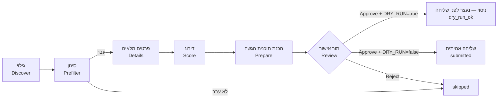

# JobHunter — מדריך שימוש

המדריך הזה מיועד לשימוש יום־יומי במערכת. פקודות, שמות קבצים וקוד מופיעים באנגלית בתוך בלוקי קוד.

**התקנה בפעם הראשונה, בלי רקע בפיתוח?** יש להתחיל ב-[FRIEND-SETUP.md](FRIEND-SETUP.md).

**תוכן העניינים:**
[מה המערכת עושה](#מה-המערכת-עושה-ומה-לא) ·
[איך זה עובד](#איך-זה-עובד) ·
[התקנה ראשונה](#התקנה-ראשונה-מאפס-windows-11) ·
[בחירת מודל שפה](#בחירת-מודל-שפה) ·
[הפעלה יומית](#הפעלה-יומית) ·
[מסכי ה-dashboard](#מסכי-ה-dashboard) ·
[עדכון קורות חיים](#עדכון-קורות-חיים) ·
[התראות LinkedIn (אופציונלי)](#תוסף-אופציונלי-התראות-משרות-מ-linkedin) ·
[שכר](#שכר) ·
[מאגר התשובות](#מאגר-התשובות-והחוק-הקשיח) ·
[בחירת קורות חיים](#בחירת-קורות-חיים-לפי-שפה) ·
[DRY_RUN](#dry_run--מצב-ניסוי) ·
[הגדרות](#כל-ההגדרות) ·
[סטטוסים](#סטטוסים) ·
[נתונים וגיבוי](#איפה-נשמרים-הנתונים) ·
[פתרון תקלות](#פתרון-תקלות) ·
[מבנה הפרויקט](#מבנה-הפרויקט)

---

## מה המערכת עושה ומה לא

**עושה:**
- מחפשת משרות באתר **דרושים** לפי **סוגי התפקידים** שהגדרת (Full Stack, Backend, Junior, אוטומציה…), כל אחד עם עדיפות (tier).
- מסננת אותן בכללים קבועים: מילים בכותרת, בכירות, מיקום, חברות, ו**שנות ניסיון נדרשות** — משרה שדורשת יותר מ-`maxRequiredYears` מדולגת.
- מדרגת כל משרה מ-0 עד 100 עבור סוג התפקיד שלה, עם הסבר קצר בעברית. הדירוג נעשה במודל שפה לבחירתך: מקומי (Ollama, חינם, שום דבר לא יוצא מהמחשב) או ספק API בתשלום (Anthropic, OpenAI, Gemini). ראו [בחירת מודל שפה](#בחירת-מודל-שפה).
- ממיינת לפי **rank**, שמעדיף משרות ג׳וניור ותפקידי ליבה: `rank = score + בונוס ניסיון + בונוס tier`.
- **מכינה** הגשה לכל משרה שנבחרה:
  - פותחת את חלון ההגשה באתר;
  - בוחרת את קורות החיים המתאימים;
  - ממלאת את השאלות רק מתוך הפרופיל שלך ומאגר התשובות;
  - מצלמת מסך ועוצרת.
- **שולחת רק אחרי שאישרת** בתור האישור, ורק כש-`DRY_RUN=false`.

**לא עושה:**
- לא ממציאה עובדות. כל ערך נשלח מגיע מהפרופיל, ממאגר התשובות או ממך, והמקור נשמר לכל שדה.
- לא עוקפת CAPTCHA, הגנות בוטים או הגבלות קצב. במקרה כזה הריצה נעצרת ומסומנת `blocked`.
- לא מתחברת לאתרים בשבילך. ההתחברות ידנית, פעם אחת, בחלון Chrome רגיל. ראו [התחברות לדרושים](#התחברות-לדרושים).
- לא שולחת לבד. בשלב הנוכחי אין שליחה אוטומטית בכלל.
- לא נכנסת ל-LinkedIn ולא עושה בו שום פעולה. משרות מ-LinkedIn אפשר לקבל דרך התראות המייל, ולהגיש להן ידנית: ראו [התראות LinkedIn](#תוסף-אופציונלי-התראות-משרות-מ-linkedin) (תוסף אופציונלי, כבוי כברירת מחדל).

**אתרים:** דרושים — גילוי והגשה. AllJobs ו-JobMaster — בשלב הבא. משרות שההגשה אליהן היא בקישור חיצוני (אתר החברה) או במייל מגיעות לתור האישור עם הקישור, ומטופלות ידנית בינתיים.

---

## איך זה עובד



1. **גילוי:** המערכת פותחת את דף החיפוש בדרושים, קוראת את הנתונים שהאתר עצמו טוען, ולוחצת "הצג עוד משרות" עד המגבלה שהגדרת. היא עובדת לאט ובטאב אחד, כמו אדם. כל משרה נשמרת פעם אחת בלבד, וגם משרה זהה מאתר אחר (אותה חברה ואותה כותרת, תוך 14 יום) מזוהה ככפילות.
2. **סינון:** כללים קבועים, בלי מודל. סוג תפקיד **כבוי** הופך את מילות הכותרת שלו למילים פוסלות: למשל כש-`support` כבוי, "איש/אשת תמיכה טכנית" או "Tier 1/2 Support" מדולגות עם הסיבה `role type disabled: support`, גם אם חיפוש של סוג תפקיד אחר מצא אותן. מילה שגם סוג תפקיד פעיל משתמש בה, ומילים של סוג תפקיד לחיפוש בלבד (Junior), לא נפסלות. כל שמירה במסך Preferences מריצה את הסינון מחדש על המשרות הקיימות (שנמצאו, דורגו או נפסלו בסינון), בלי חיפוש חדש. ההתאמה היא למילים שלמות ובלי תלות באותיות גדולות, כך ש-"Java" לא פוסל "JavaScript": מילים שחייבות להופיע בכותרת, מילים שפוסלות (למשל "בכיר", "ראש צוות", "Senior"), מיקום וחברות חסומות. משרה שלא עוברת מקבלת `skipped` עם הסיבה.
3. **פרטים:** למשרות שעברו, המערכת פותחת את דף המשרה ושומרת את התיאור והדרישות המלאים.
4. **דרישת ניסיון:** לפני המודל, ביטוי רגולרי מחלץ את שנות הניסיון הנדרשות מהדרישות ומהתיאור, בעברית ובאנגלית.
   - שורות שמסומנות "יתרון" / advantage / nice to have / a plus לא נספרות.
   - טווח נספר לפי המינימום שלו.
   - כמה דרישות → המקסימום מבין המינימומים.
   - אם הדרישה גבוהה מ-`maxRequiredYears`, המשרה מקבלת `skipped_experience` עם הטקסט שנמצא, **בלי** לשלוח אותה למודל.
   - אם הביטוי לא מצא כלום, המודל מחזיר את הדרישה בזמן הדירוג. הביטוי גובר כשיש את שניהם.
5. **דירוג:** המודל משווה את המשרה לפרופיל שלך **עבור סוג התפקיד שלה** ומחזיר ציון, כישורים מתאימים, דרישות חסרות, בכירות ושני משפטי הסבר. הדירוג נשמר ולא יחושב שוב כל עוד המשרה לא השתנתה.
   - סוג התפקיד של משרה נקבע לפי **הכותרת שלה**: ה-tier הטוב ביותר מבין סוגי התפקידים שמילות הכותרת שלהם מופיעות בה. סוג תפקיד עם `searchOnly: true` (למשל Junior) משמש רק לחיפוש ולא קובע tier. אם אף סוג לא מתאים לכותרת — tier 3.
   - המודל מחזיר גם `devContentScore` (0–100): כמה מהעבודה היא פיתוח בפועל (קוד, SQL, APIs, דיבאג). במשרות tier 3 (למשל תמיכה) ה-rank מחושב לפי `min(score, devContentScore)`, כך שמשרת תמיכה בלי פיתוח לא תעלה גבוה. ב-dashboard מסומן אז `*` ליד הציון.
   - אם המודל מזהה שזה **קורס או מסלול הכשרה** ולא משרה, היא מקבלת `skipped_not_a_job` עם הסיבה. מילים כמו "הכשרה", "קורס", "bootcamp" בכותרת מסננות עוד לפני כן.
6. **rank:** `score + experienceBoost + tierBoost`.
   - בונוס ניסיון (ברירת מחדל): ג׳וניור / 0–1 שנים +15, שנתיים +5, 3 שנים −10, לא ידוע 0.
   - בונוס tier: tier 1 +5, tier 2 0, tier 3 −25.
   - רשימת המשרות, תור האישור וסדר ההכנה ממוינים לפי rank, כך שהמכסה היומית מנוצלת קודם על המשרות הטובות ביותר.
7. **הכנת תוכנית הגשה:**
   - המערכת פותחת את חלון ההגשה ורואה אילו קורות חיים קיימים בחשבון ואילו שאלות יש.
   - לכל שאלה היא מוצאת תשובה ומתעדת את המקור שלה.
   - היא מסמנת רק מה שמאושר, מצלמת מסך ו**עוצרת**. המשרה עוברת לתור האישור.
8. **תור אישור:** עוברים על התוכנית, משלימים תשובות חסרות, מתקנים, ומאשרים או דוחים.
9. **שליחה:**
   - במצב ניסוי (`DRY_RUN=true`) האישור ממלא הכל, מצלם ועוצר.
   - במצב אמיתי הוא שולח ושומר הוכחה: צילום לפני ואחרי, טקסט האישור ותשובת השרת.

---

## התקנה ראשונה מאפס (Windows 11)

כל התקנה משרתת משתמש אחד. כל ההגדרות נעשות במסכים של ה-dashboard, בלי לערוך קבצים ביד.

1. **Node.js:** התקינו את גרסת ה-LTS מ-https://nodejs.org (נדרש 22.13 ומעלה). לבדיקה:
   ```powershell
   node --version
   ```
2. **מודל שפה מקומי (אופציונלי):** כדי לעבוד חינם ובלי ששום מידע יוצא מהמחשב, התקינו את Ollama מ-https://ollama.com/download ופתחו את האפליקציה. צריך כרטיס מסך עם מספיק זיכרון (ל-`gemma4:12b` בערך 8GB). בלי כרטיס כזה, בחרו באשף ספק API — ראו [בחירת מודל שפה](#בחירת-מודל-שפה).
3. **הורדת הקוד:**
   ```powershell
   git clone https://github.com/Orel009/JobHunterAI.git
   cd JobHunterAI
   ```
4. **הפעלה:**
   ```powershell
   npm start
   ```
   או לחיצה כפולה על `start.cmd`. בהפעלה הראשונה המערכת מתקינה את החבילות, בודקת ש-Google Chrome מותקן, יוצרת את `.env` ואת `data\preferences.yaml` מקבצי הדוגמה, ופותחת את ה-dashboard עם **אשף ההגדרה**.

### אשף ההגדרה

האשף נפתח רק בהתקנה חדשה (אין עדיין פרופיל). אפשר לחזור אחורה בכל שלב, ו-"set up later" סוגר אותו; הכל נשאר זמין גם במסכים הרגילים.

| שלב | מה עושים |
|---|---|
| 1. About you | שם מלא, ו**לשון זכר או נקבה**. הבחירה קובעת את הצורות בכל טקסט עברי שנכתב בשמך (טיוטות, שאלות קבועות, הסברי דירוג) |
| 2. Language model | בחירת ספק ומודל, הזנת מפתח API אם צריך, ו-`Test connection` |
| 3. Your CV | העלאת קורות חיים ב-PDF: עברית, אנגלית או שניהם. הקריאה רצה ברקע עם פס התקדמות |
| 4. Review your profile | פרטי קשר, תפקידים והשכלה כפי שנקראו. מתקנים ולוחצים Save |
| 5. Skills | רמה לכל כישור (`strong` / `basic`), קישור כישורים לתפקידים (ממנו מחושבות שנות הניסיון), ומחיקת כישורים לא רלוונטיים |
| 6. Experience | הצהרה על סך הניסיון בפיתוח (`declaredExperience`), לשאלות כלליות של שנות ניסיון |
| 7. What to search | סוגי תפקידים, ערים, ומקסימום שנות ניסיון נדרשות |
| 8. Drushim | שמות קורות החיים **בדיוק כפי שהם בחשבון בדרושים**, וכפתור שפותח חלון התחברות. ההתחברות עצמה ידנית — המערכת לא מקלידה סיסמה |
| 9. Standard answers | תשובות לשאלות שחוזרות בכל טופס (עיר, משרה מלאה, זמינות…). ריק = לשאול כל פעם |

ב-"Finish setup" הפרופיל מאושר ונשמר ב-`data\profile\profile.json`, והתשובות נטענות למאגר.

**חשוב על קורות החיים בדרושים:** ההגשה שולחת את הקובץ ששמור **בחשבון שלך בדרושים**, לא את הקובץ שהעלית למערכת. לכן צריך להעלות אותו גם לדרושים.

### התחברות לדרושים
ההתחברות נעשית **ידנית**, ב-**Google Chrome הרגיל** שמותקן במחשב:
1. הכפתור **Open the Drushim login window** (באשף או בבאנר), או מהטרמינל:
   ```powershell
   npm run login -- drushim
   ```
2. נפתח **חלון Chrome רגיל**, נפרד מה-Chrome האישי, עם פרופיל משלו (`data\browser-profile`). זה Chrome אמיתי ולא דפדפן אוטומטי, ולכן **"התחברות עם Google" עובדת בו**. אפשר גם להתחבר בקוד ב-SMS / במייל או בסיסמה.
3. מתחברים, ואז **סוגרים את חלון ה-Chrome הזה**.
4. המערכת בודקת את החיבור עם אותו פרופיל ומדפיסה דוח: אילו עוגיות התחברות נשמרו, אילו **לא שרדו** סגירה ופתיחה מחדש של הדפדפן (שם ותוקף בלבד, אף פעם לא הערך), והאם האתר מזהה התחברות.

המערכת עצמה משתמשת באותו Chrome ובאותו פרופיל, כך שהיא רואה את אותה התחברות. שניהם לא יכולים לרוץ יחד: כל עוד חלון ההתחברות פתוח, ריצות ובדיקות מחכות להודעה "close the login window first".

אם Chrome לא מותקן, נפתח במקומו הדפדפן המובנה. בו "התחברות עם Google" לא עובדת, ויש להתחבר בקוד ב-SMS / במייל או בסיסמה. Chrome מותקן במיקום לא רגיל? יש להגדיר `CHROME_PATH` ב-`.env`.

### כללי הפרופיל
- שנות ניסיון בכישור נספרות **רק מתפקידים מסוג `work`** שמקושרים לכישור. פרויקטים, צבא והשכלה נספרים בדירוג ובהתאמה, אבל לא בשאלות שנות ניסיון.
- כפילויות של כישור מאחדים לרשומה אחת, ושאר הכתיבים נכנסים ל-`aliases` (למשל JavaScript עם `ES6`, `JS`). ה-aliases משמשים בכל מקום: בסינון, בדירוג, בשאלות שנות ניסיון ובהתאמה למאגר התשובות.
- כישור ברמה `basic` נספר בדירוג ובהתאמה, אבל **אף פעם** לא עונה אוטומטית על הצהרת כן/לא או על שאלת שנות ניסיון.
- `declaredExperience` עונה רק על שאלות **כלליות** ("N שנות ניסיון בפיתוח תוכנה"), אף פעם לא על טכנולוגיה מסוימת.

### דרך ידנית (למתקדמים)
אפשר לבנות טיוטת פרופיל גם מהטרמינל: שמים `cv-he.pdf` ו/או `cv-en.pdf` ב-`data\profile\` ומריצים:
```powershell
npm run profile:init
```
נוצרים `data\profile\profile.draft.json` ו-`data\profile\profile.conflicts.md` (סתירות בין שני הקבצים ופרטים שנפסלו כי לא מופיעים בקורות החיים). את הטיוטה בודקים במסך Profile ולוחצים "Approve draft". התחברות לדרושים מהטרמינל:
```powershell
npm run login -- drushim
npm run session:check -- drushim
```

---

## בחירת מודל שפה

המודל קורא מודעות, מדרג, מתאים שאלות למאגר וכותב טיוטות. בוחרים אותו באשף או במסך **Settings**, בנפרד לשתי משימות:
- **analyze** — דירוג, התאמה, סיווג וקריאת קורות חיים. הרבה קריאות, וחשוב שה-JSON יהיה אמין.
- **write** — טיוטות לשאלות פתוחות. מעט קריאות, והאיכות חשובה.

| ספק | עלות | פרטיות | מתי מתאים |
|---|---|---|---|
| **Ollama** (ברירת מחדל) | חינם | הכל נשאר במחשב | יש כרטיס מסך עם מספיק זיכרון |
| **Anthropic** (Claude) | לפי שימוש | המודעות, הפרופיל וקורות החיים נשלחים לספק | מחשב חלש, או איכות כתיבה גבוהה |
| **OpenAI** | לפי שימוש | כנ"ל | כנ"ל |
| **Google Gemini** | לפי שימוש | כנ"ל | כנ"ל |
| **Test mode** | חינם | — | בדיקות בלבד: אין מודל, התשובות ריקות |

- **מפתחות API** נשמרים **רק** בקובץ `.env` במחשב שלך. הם לא נשמרים במסד הנתונים, לא נכתבים ליומן, ומוצגים במסך רק מוסתרים (`sk-a…wxyz`).
- **הצעות מודלים:** שדה המודל מציע את רשימת המודלים שהספק מחזיר. `Test connection` שולח בקשה קטנה ובודק שמתקבל JSON תקין.
- **שימוש ועלות:** במסך Settings מוצגים הטוקנים של היום ושל 30 הימים האחרונים. העלות מחושבת לפי המחירים **שאתם** מזינים (דולר למיליון טוקנים, מדף התמחור של הספק); אין מחירים מובנים.
- **מגבלה יומית:** `Daily token limit` (או `DAILY_LLM_TOKEN_LIMIT` ב-`.env`). כשמגיעים אליה, שלבי המודל נעצרים עד מחר. Ollama אף פעם לא מוגבל.
- **התאמה לכרטיס המסך:** `npm start` ו-`npm run doctor` בודקים את המודל שנבחר. עם Ollama הם משווים את גודל המודל לזיכרון כרטיס המסך (`nvidia-smi`), ואם הוא לא נכנס מציעים מודל קטן יותר או ספק API.
- **השוואת מודלים:** `npm run model:bench` מריץ את אותן משרות ושאלות על כמה מודלים (`BENCH_MODELS`, בפורמט `provider:model`; שם בלי ספק = Ollama) ושומר דוח ב-`data\reports\`.

---

## הפעלה יומית

```powershell
npm start
```
או לחיצה כפולה על `start.cmd` בתיקיית הפרויקט.

הבדיקות שרצות לפי הסדר (בכל תקלה מוצגת הודעה בעברית ובאנגלית עם הוראות תיקון):
1. גרסת Node, והתקנת חבילות אם צריך.
2. קובץ `.env` (נוצר מהדוגמה בהפעלה הראשונה).
3. מודל השפה שנבחר לכל משימה:
   - **Ollama:** רץ (אם לא, המערכת מנסה להפעיל את האפליקציה), המודל מותקן (אם לא, מציעה להוריד), והמודל נכנס בזיכרון כרטיס המסך.
   - **ספק API:** יש מפתח, והספק עונה.
   - בהתקנה חדשה בעיות במודל הן רק אזהרה, כי האשף מגדיר אותו.
4. `data\preferences.yaml` (נוצר מהדוגמה בהפעלה הראשונה) ו-`profile.json` תקינים.
5. מסד הנתונים מעודכן.
6. Google Chrome מותקן, והגרסה שלו. אם לא, מותקן במקומו דפדפן מובנה (בלי "התחברות עם Google").
7. החיבור לדרושים. אם לא מחוברים, המערכת שואלת אם לפתוח חלון התחברות; אפשר לענות לא, והמערכת תעלה עם הגשה מושבתת.
8. ה-dashboard נבנה מחדש אם השתנה.

אם התראות LinkedIn מופעלות, נבדק גם החיבור לתיבת המייל. כשהן כבויות, אין שום בדיקה כזו.

בסוף מודפס סיכום: מצב DRY RUN באותיות גדולות, המודל, מצב החיבור, כמה הוגשו היום מתוך המכסה, וכמה תשובות ממתינות. אחר כך ה-dashboard נפתח בדפדפן בכתובת http://127.0.0.1:8787. לעצירה: `Ctrl+C`.

**ציד אחד מלא:**
```powershell
npm start -- --hunt
```
אחרי העלייה המערכת מריצה גילוי ודירוג (וקוראת התראות LinkedIn, אם התוסף פעיל), ואז מכינה תוכניות הגשה למשרות שקיבלו לפחות `autoSubmitMinScore`. מספר התוכניות מוגבל למכסה היומית שנשארה. **שום דבר לא נשלח.** ההגשות מחכות לאישור שלך בתור האישור. בסוף מודפס סיכום.

**בדיקה בלבד, בלי לשנות כלום:**
```powershell
npm run doctor
```

---

## מסכי ה-dashboard

### פס עליון (בכל המסכים)

| רכיב | מה הוא |
|---|---|
| `DRY RUN` / `LIVE` | מצב ניסוי (צהוב) או שליחה אמיתית (אדום) |
| `Today: x/y submitted` | הגשות אמיתיות היום מתוך המכסה |
| `Drushim: logged in / NOT logged in` | מצב החיבור לדרושים |
| `re-check login` | בודק שוב את החיבור לדרושים |
| `pending answers` | כמה שאלות ממתינות לתשובה שלך במאגר |
| `LLM` | הספק והמודל של כל משימה, ואם יש בעיה: Ollama כבוי, מודל לא מותקן, או שהמגבלה היומית הושגה. עם ספק API מוצגים גם הטוקנים של היום |
| ספירות סטטוסים | כמה משרות יש בכל סטטוס |
| **Discover Drushim** | ריצה מלאה: חיפוש, סינון, פרטים, דירוג |
| **Score only** | דירוג בלבד, למשרות שעברו סינון ועוד לא דורגו או שהשתנו |
| **Stop** | עוצר את הריצה הנוכחית (מופיע רק כשיש ריצה) |
| Discover AllJobs / JobMaster | מושבתים, יגיעו בשלב הבא |
| **Fetch LinkedIn alerts** | קורא התראות משרות חדשות מהמייל ומדרג אותן. מופיע רק כש[התראות LinkedIn](#תוסף-אופציונלי-התראות-משרות-מ-linkedin) פעילות |

שורות התראה שעשויות להופיע מעל הפס:
- **אין חיבור לדרושים:** ההגשה מושבתת עד ההתחברות. הכפתור **Open the login window** פותח חלון שבו מתחברים ידנית.
- **אין פרופיל מאושר** (באנר אדום, עם כפתור **Open Profile**): הגילוי ממשיך לעבוד, אבל הדירוג ממתין. מספר המשרות שממתינות מוצג. ברגע שהפרופיל מאושר (**Approve draft**, סיום האשף או שמירת `profile.json` תקין), הדירוג מתחיל לבד, או מיד אחרי הריצה הנוכחית.
- **Update this CV on Drushim too:** העלית קורות חיים חדשים למערכת. ראו [עדכון קורות חיים](#עדכון-קורות-חיים).
- **DRY_RUN is OFF:** אישור יגרום לשליחה אמיתית.

למטה יש **Live log**, היומן החי של המערכת. אפשר לקפל אותו בלחיצה.

### Jobs — משרות
- **סינון:** אתר, סטטוס, ציון מינימלי, וחיפוש בכותרת או בחברה. `Refresh` מרענן.
- **ברירת המחדל:** משרות בסטטוס `skipped_*` מוסתרות, והתיבה **show skipped** מציגה אותן (בחירת סטטוס מסוים מציגה אותו בכל מקרה). הרשימה ממוינת לפי rank מהגבוה לנמוך, ומשרות שעוד לא דורגו בסוף.
- **עמודות:** `Rank` — הדירוג הסופי, ומתחתיו הפירוק: ציון, `exp` (בונוס ניסיון) ו-`tier`. `Role` — סוג התפקיד שלפיו המשרה דורגה. מסנן **All role types** מציג סוג תפקיד אחד.
- **לחיצה על שורה** פותחת את הפרטים: דרישת הניסיון עם המקור (`regex` / `llm`) והטקסט שנמצא, סימן ג׳וניור אם יש, פירוק ה-rank ואילו סוגי תפקידים מצאו את המשרה. בנוסף: הסבר הציון, כישורים מתאימים (ירוק) וחסרים (אדום), סיבת דילוג, ותיאור ודרישות המשרה.
- **`open`** פותח את המשרה באתר.
- **`apply`** מכין תוכנית הגשה: פותח את חלון ההגשה, ממלא מה שידוע, מצלם ועוצר. **לא שולח.** הכפתור מושבת כשאין חיבור לדרושים, או כשהמשרה כבר בתור, בבדיקה או נשלחה. במשרות LinkedIn מופיע במקומו `by hand`: ההגשה שם ידנית, ממסך LinkedIn.
- **`skip` / `unskip`** מדלג על משרה, או מחזיר אותה.

### Review queue — תור אישור
כל כרטיס הוא הגשה אחת:
- **כותרת:** המשרה, החברה, הסטטוס, מצב המוכנות וקישור למודעה. מצבי המוכנות:
  - `ready` — הכל מוכן;
  - `needs your answers` — חסרות תשובות;
  - `has drafts` — יש טקסט שהמודל ניסח וצריך לעבור עליו;
  - `a required statement is false` — הצהרת חובה לא נכונה עבורך.
- **ציון והסבר** הדירוג.
- **ℹ הערות**, למשל אילו קורות חיים קיימים בחשבון.
- **CV:** הקובץ שנבחר, השפה, ואחוז האותיות העבריות במודעה. `switch to …` מחליף ידנית.
- **טבלת השדות:** שאלה, תשובה ומקור. ליד כל תשובה יש `edit`:
  - בשאלות כן/לא — כפתורי **כן** / **לא**;
  - בשאר — שדה טקסט ו-`save`;
  - `save to answers bank` מסומן כברירת מחדל, כך שהתשובה תישמר במאגר ותשמש גם למשרות הבאות. בלי הסימון, התשובה תשמש רק להגשה הזו.

  תגיות המקור:

  | תגית | מקור |
  |---|---|
  | `profile` | מהפרופיל (שם, טלפון, מייל, עיר, קישורים) |
  | `answers bank` | ממאגר התשובות (`ref` = מספר הרשומה, `conf` = רמת ההתאמה) |
  | `skill years (work roles)` | חושב מתאריכי תפקידי ה-work שמקושרים לכישור |
  | `declared experience` | מההצהרה הכללית שלך (`declaredExperience`). טקסט ה-basis מוצג מתחת |
  | `LLM draft` | טיוטה שהמודל ניסח מעובדות הפרופיל (`cites` = העובדות שעליהן נשען) |
  | `you (this job only)` | הקלדת ידנית בלי לשמור במאגר |

  ⚠ **unsupported claims** — טענות בטיוטה שבדיקת העובדות לא מצאה להן בסיס בפרופיל. יש לתקן אותן לפני אישור.
- **צילומי מסך:** "before final click" — המצב לפני הלחיצה האחרונה; "after submit" — אחרי שליחה אמיתית. לחיצה פותחת בגודל מלא.
- **Approve:**
  - `Approve → DRY RUN (no submit)` במצב ניסוי.
  - `Approve → SUBMIT for real` במצב אמיתי, אחרי חלון אישור נוסף.
  - הכפתור מושבת כל עוד יש שאלות ממתינות, כשאין חיבור, או כשריצה אחרת פעילה.
- **Reject / skip job** — לא להגיש. המשרה מסומנת `skipped`.
- למעלה: בחירת אילו הגשות להציג, ו-**Prepare queued**, שמכין תוכניות לכל המשרות שבסטטוס `queued`.

### Profile — פרופיל
- **CVs:** שתי משבצות העלאה (עברית ואנגלית, PDF). כל קובץ נשמר בהיסטוריה (`data\profile\cv-history\`), והקריאה רצה ברקע עם פס התקדמות. `Read the CVs again` קורא שוב את הקבצים האחרונים.
- **Changes from the new CV:** אחרי קריאה, ההבדלים מהפרופיל הקיים מוצגים לאישור. ראו [עדכון קורות חיים](#עדכון-קורות-חיים).
- **העורך:** כל שדות הפרופיל:
  - לשון זכר / נקבה, פרטי קשר, קישורים ותקציר;
  - תפקידים: סוג (`work`, `project`, `education`, `military`, `volunteer`, `other`), חברה, תפקיד, תאריכים (`YYYY`, `YYYY-MM` או `present`), והכישורים שבהם השתמשת. עריכת תאריכים נועלת אותם, כך שעדכון קורות חיים לא יציע לשנות אותם;
  - כישורים: שם, רמה, aliases, ושנות הניסיון המחושבות. מחיקת כישור מוסיפה אותו לרשימת החסומים, וקורות חיים חדשים לא יחזירו אותו;
  - השכלה, שפות, והצהרת הניסיון (`declaredExperience`).
- **Save** שומר. `profile.json` נשמר רק אם הוא תקין; טיוטה אפשר לשמור גם עם בעיות. לפני כל שמירה נשמר גיבוי ב-`data\profile\backups\`. כשיש טיוטה, **Approve draft** הופך אותה ל-`profile.json`.

### Preferences — העדפות
כל `data\preferences.yaml` בטופס: סוגי תפקידים (tier, שאילתות, מילות כותרת, `searchOnly`, הפעלה), ערים ומילות "תמיד מותר" (remote / היברידי), מקסימום שנות ניסיון, מילות כותרת ובכירות שפוסלות, בונוסי ה-rank, ספים ומגבלות, ושמות קורות החיים בדרושים. השמירה בודקת תקינות ושומרת גיבוי ב-`data\backups\`.

### Settings — מודל שפה
ספק ומודל לכל משימה (analyze / write) עם הצעות מודלים ו-`Test connection`, מפתחות API (שמירה בלבד; מוצגים מוסתרים), מגבלת טוקנים יומית, טבלת מחירים לחישוב העלות, ודוח שימוש. עם ספק ענן מוצגת הודעת פרטיות. השינויים נכנסים לתוקף מיד, בלי הפעלה מחדש. ראו [בחירת מודל שפה](#בחירת-מודל-שפה). בתחתית המסך: הפעלה והגדרה של [התראות LinkedIn](#תוסף-אופציונלי-התראות-משרות-מ-linkedin) (אופציונלי).

### Answers bank — מאגר תשובות
- למעלה מוצגים מספר השאלות הממתינות והכפתור **Seed from preferences.yaml**, שטוען את `standardAnswers`. ערכים ריקים נטענים כשאלות ממתינות. השאלות נכתבות בלשון שנבחרה בפרופיל (זכר / נקבה).
- **הוספה:** שאלה, תשובה (ריק = ממתינה), סוג (`text`, `yes_no`, `choice`, `number`) ו-`Add`.
- **הטבלה:** השאלות הממתינות מופיעות ראשונות, וממוינות לפי **Blocks** — כמה הגשות פתוחות כל שאלה עוצרת.
  - שאלות כן/לא נענות בכפתורים, ושאר השאלות בשדה ו-`save`.
  - `Used` — כמה פעמים התשובה שימשה.
  - `Source` — מאיפה הגיעה: `seed` (מ-preferences.yaml), `user` (נוספה או נערכה כאן), או `review` (נשמרה מתור האישור).
  - `delete` מוחק.
- כל תשובה ששומרים מעדכנת אוטומטית את כל ההגשות הפתוחות שחיכו לה.

---

## עדכון קורות חיים

1. במסך **Profile** מעלים את הקובץ החדש במשבצת המתאימה (עברית / אנגלית). הקובץ הקודם נשאר בהיסטוריה.
2. המודל קורא את הקובץ ברקע. **הפרופיל לא משתנה אוטומטית.** במקום זה מוצגת רשימת שינויים, כל אחד עם תיבת סימון:
   - `added` — תפקיד, השכלה, כישור, שפה או קישור חדש;
   - `changed` — ערך שונה (למשל תאריך סיום או תואר);
   - `removed` — משהו שלא מופיע בקובץ החדש.
3. **Accept all safe changes** מאשר רק תוספות ותיקוני תאריכים. **Apply selected** מאשר את מה שסימנת. **discard** מבטל הכל.
4. מה שלעולם לא משתנה מקורות חיים: לשון זכר / נקבה, קישורי כישורים לתפקידים, רמות, aliases, כישורים שמחקת, הצהרת הניסיון, ותאריכים שערכת. תאריך עם חודש גם לא מוחלף בתאריך עם שנה בלבד.
5. אחרי האישור הפרופיל נבדק שוב, ומוצע **Re-score active jobs**: דירוג מחדש של המשרות הפעילות לפי הפרופיל המעודכן.
6. **לעדכן גם בדרושים:** ההגשות שולחות את הקובץ ששמור בחשבון בדרושים. לכן מופיע באנר קבוע "Update this CV on Drushim too" עם שם הקובץ שמוגדר בהעדפות. מעלים את הקובץ החדש לדרושים (אזור אישי → קורות חיים), מוודאים שהשם בדרושים זהה לשם בהעדפות, ולוחצים **I updated it on Drushim**. המערכת לא מעלה קבצים לדרושים בעצמה.

---

## תוסף אופציונלי: התראות משרות מ-LinkedIn

**כבוי כברירת מחדל.** כל עוד הוא כבוי, אין חיבור לתיבת מייל, אין צורך בהגדרות IMAP, ואין לו זכר ב-dashboard.

### למה רק בעזרה, בלי אוטומציה
תנאי השימוש של LinkedIn אוסרים על כלים אוטומטיים, וחשבונות שמשתמשים בהם עלולים להיות מוגבלים או חסומים. לכן המערכת **לעולם לא** מתחברת ל-LinkedIn, לא פותחת אותו בדפדפן האוטומטי, לא לוחצת ולא שולחת שם כלום, ולא קוראת את דפי האתר. גם ברמת הדפדפן, כל בקשה ל-linkedin.com מהדפדפן האוטומטי נחסמת.

במקום זה:
- **המשרות מגיעות מהמייל:** LinkedIn שולח התראות משרות במייל, והמערכת קוראת אותן מתיבת הדואר (קריאה בלבד: שום הודעה לא מסומנת כנקראה, לא מועברת ולא נמחקת).
- **ההגשה ידנית:** פותחים את המשרה בדפדפן הרגיל ומגישים לבד, עם חלון עזר שמכין את כל הנתונים להעתקה.

### הגדרה
1. **התראות משרות ב-LinkedIn:** מחפשים ב-LinkedIn משרה (למשל `Full Stack Developer` ומיקום), ומפעילים בתוצאות את המתג **Set alert** (התראת משרה). בהגדרות ההתראות (Jobs → Job alerts) בוחרים תדירות יומית וקבלה במייל. אפשר ליצור כמה התראות.
2. **סיסמת אפליקציה ב-Gmail** (Gmail לא מאפשר להתחבר עם הסיסמה הרגילה):
   1. להפעיל אימות דו-שלבי: https://myaccount.google.com/security → 2-Step Verification.
   2. ליצור סיסמת אפליקציה: https://myaccount.google.com/apppasswords. שם: `JobHunter` → **Create**.
   3. מוצגת סיסמה בת 16 אותיות, פעם אחת בלבד. מעתיקים אותה (הרווחים לא משנים).
   4. אם Gmail מבקש, יש להפעיל IMAP בהגדרות Gmail: See all settings → Forwarding and POP/IMAP.
3. **ב-dashboard:** במסך **Settings**, באזור **LinkedIn job alerts (optional)**:
   - מסמנים **Enable LinkedIn job alerts (email)**;
   - ממלאים כתובת מייל וסיסמת אפליקציה (`imap.gmail.com`, פורט `993` כבר ממולאים), ולוחצים **Save**. הסיסמה נשמרת רק ב-`.env` ומוצגת מוסתרת;
   - **Mailbox / label:** `INBOX`, או שם התווית ב-Gmail אם ההתראות מסוננות לתווית;
   - **Read alerts from the last N days:** כמה ימים אחורה לקרוא (ברירת מחדל 14);
   - **Test connection** מתחבר וסופר כמה מיילי התראה יש בטווח.

### שימוש
- **Fetch LinkedIn alerts** בפס העליון (או **Fetch alerts now** במסך LinkedIn) קורא מיילים חדשים בלבד מ-`jobalerts-noreply@linkedin.com`, מוסיף את המשרות עם `site=linkedin`, ומסנן ומדרג אותן כרגיל. גם `npm start -- --hunt` קורא את ההתראות כשהתוסף פעיל. כל מייל נקרא פעם אחת (לפי ה-Message-ID שלו), וכל משרה נשמרת פעם אחת.
- **מידע חלקי:** במייל יש רק כותרת, חברה ומיקום, ולכן הדירוג הראשוני זהיר ומסומן **incomplete info**. כדי לדרג כמו שצריך, מדביקים את תיאור המשרה מ-LinkedIn בתיבה שבמסך LinkedIn ולוחצים **Save and re-score**.
- **מיקומים:** מיקומים באנגלית מ-LinkedIn (למשל `Haifa, Haifa District, Israel`) מותאמים לשמות העבריים ב-`locations` (חיפה, השרון, מרכז…).

### מסך LinkedIn (הגשה בעזרה)
מופיע רק כשהתוסף פעיל. בחירת משרה מהרשימה (`To do` / `Applied` / `All`) מציגה:
- **Open in my browser** — פותח את המשרה בדפדפן ברירת המחדל של Windows, לא בדפדפן של המערכת.
- **CV to attach** — עברית או אנגלית לפי אותו כלל שפה כמו בדרושים, והכפתור **show file** פותח את התיקייה עם הקובץ מסומן, כדי לגרור אותו לטופס.
- **Your details**, **Declared experience**, **Years per skill**, **Answers bank** — הנתונים מהפרופיל ומהמאגר, כל אחד עם כפתור **copy** ועם המקור שלו.
- **I applied** — אחרי הגשה ידנית: הסטטוס `submitted_manual` ושעת ההגשה נשמרים. **Skip** — מדלג.
- **“Apply on company website”?** — אם המשרה ב-LinkedIn מפנה לאתר החברה, מדביקים את הקישור:
  - קישור למשרה **בדרושים** הופך למשרת דרושים רגילה (קריאת הדף, דירוג, ואז `apply` ואישור בתור). משרת ה-LinkedIn מסומנת ככפילות שלה;
  - כל קישור אחר שולח את המשרה לתור האישור עם הקישור, להגשה ידנית.

**אין לסמן או להצהיר בטופס של LinkedIn על שום דבר שאינו נכון**, בדיוק כמו בשאלות הסינון בדרושים.

### כיבוי
מבטלים את הסימון ב-Settings. הקריאה מהמייל נעצרת, מסך LinkedIn והמסנן נעלמים, אבל המשרות וההיסטוריה שכבר יובאו נשמרים.

## שכר

הכל דטרמיניסטי: מודל השפה אף פעם לא ממציא או מחשב מספר שכר.

**השכר שפורסם במשרה** (חודשי ברוטו ב-₪) נקרא לפי הסדר:
1. שדה השכר של דרושים בדף המשרה (למשל `שכר: 10000-13000`);
2. אזכור שכר בכותרת, בתיאור או בדרישות: "שכר", "משכורת", "salary", ₪ / ש"ח, `k` (‏`11K-13K`), טווחים ("בין 8-10", "12,000 עד 15,000"), "החל מ-" / "עד". מספרים שאינם שכר מסוננים: מענקים, בונוסים, תן ביס, שעות, ימים;
3. מדרגת השכר שבכרטיס החיפוש של דרושים (מסומנת `~`, משוערת).

שכר לשעה נשמר בנפרד, ולא משמש לסף, לתשובות או לסטטיסטיקה. ליד כל שכר נשמר המקור: הטקסט שממנו נקרא.

**הגדרות** (מסך Preferences ← Salary, וב-`preferences.yaml` תחת `salary`). לכל ערך: ההגדרה של סוג התפקיד, אחרת של ה-tier שלו, אחרת ה-default. הסף וה-`numericFallback` מתחילים **ריקים**. רק `textAnswerNoRange` ממולא מראש, ברמת ה-default.

| ערך | משמעות |
|---|---|
| `floor` | השכר החודשי המינימלי. **ריק = בלי סינון לפי שכר** (ברירת המחדל). אם מוגדר, הוא גם מעלה את X בתשובה |
| `textAnswerNoRange` | תשובה לשאלת שכר טקסטואלית כשהמשרה לא מפרסמת טווח. ממולא מראש ב-default: "גמיש, בהתאם להיקף התפקיד ולתנאים. אשמח לדבר על כך בשיחה" |
| `numericFallback` | מספר אחד לשדות שמקבלים רק מספר, כשאין טווח. ריק = השאלה ממתינה לך |
| `ranking.salaryBoost` | תוספת ל-rank כשהשכר שפורסם מגיע לסף (ברירת מחדל 0) |

**הכללים:**
- **המשרה מפרסמת טווח → החצי העליון שלו:** X = אמצע הטווח, מעוגל **כלפי מעלה** ל-500; Y = המקסימום שפורסם. טקסט: "X–Y ₪ ברוטו"; שדה מספרי: X. למשל 10,000–13,000 → "11,500–13,000 ₪ ברוטו". אם מוגדר סף, X = הגבוה מבין האמצע והסף. פורסם רק מינימום או רק מקסימום → הערך הזה.
- סינון לפי שכר קורה רק אם הגדרת סף: המקסימום שפורסם נמוך מהסף → `skipped_salary`, עם הטווח והסף כסיבה, בסינון ולפני הדירוג במודל.
- **אין טווח** → שאלת טקסט מקבלת את `textAnswerNoRange`. שדה מספרי מקבל את `numericFallback`, וכל עוד הוא ריק השאלה ממתינה לך. תשובה ששמרת במאגר לשאלה הזו תשמש אז.
- בתור האישור התגית היא `salary rule`, עם הבסיס: `posted range` או `fallback`. אותם כללים בדיוק בחלון העזר של LinkedIn.

**מסך Market:** סטטיסטיקה של השכר שפורסם במשרות שנמצאו (בתחום שלך: בלי משרות שנפסלו לפי כותרת או בכירות), לפי סוג תפקיד × שנות ניסיון נדרשות (0–1, 2, 3), ב-30 / 60 / 90 הימים האחרונים: כמות, p25, חציון, p75, מינימום ומקסימום, ו"% מתחת לסף שלי". כל משרה נספרת פעם אחת, לפי אמצע הטווח שלה. מתחת ל-10 משרות מופיעה אזהרת מדגם קטן. **suggest floor** מציע סף (p25 מעוגל ל-500) ושומר רק אחרי **Set this floor**. שום ערך לא משתנה לבד.

---

## מאגר התשובות והחוק הקשיח

### סדר מציאת תשובה לכל שדה
1. **פרופיל** — לשדות טקסט כמו שם, מייל, טלפון, עיר, LinkedIn ו-GitHub.
2. **מאגר תשובות** — קודם התאמה מדויקת לשאלה. המערכת מנרמלת את הניסוח, כך ש-"את/ה מוכן/ה" ו-"אתה מוכן" נחשבות לאותה שאלה, וגם כתיבים חלופיים של כישור: תשובה ל-"ניסיון ב-JavaScript?" תשמש גם ל-"ניסיון ב-ES6?". אם אין התאמה מדויקת, המודל רק **בוחר** רשומה קיימת עם אותה משמעות ומחזיר את מספרה ורמת ביטחון. הוא לא כותב תשובה. התאמה מתחת לסף (`matchConfidence`) נדחית.
3. **שנות ניסיון** — המודל רק **מסווג** את השאלה, ולא עונה עליה:
   - **כללית** ("N שנות ניסיון בפיתוח תוכנה", בלי טכנולוגיה): התשובה מגיעה מ-`declaredExperience.totalDevYears`. אם N קטן או שווה לערך — כן. אם גדול — לא, והמשרה מקבלת `skipped_screening`. בתור האישור מוצגת תגית "declared experience" עם טקסט ה-basis.
   - **טכנולוגית** ("N שנות ניסיון ב-React"): התשובה מחושבת רק מתפקידי `work` שמקושרים לכישור, אף פעם לא מההצהרה הכללית.
   - **לא ברור** → ממתינה לך.

   פרטים על המקרה הטכנולוגי, לשאלות כמו "האם יש לך לפחות 3 שנות ניסיון ב-React?":
   - התשובה מחושבת מהפרופיל, רק אם הכישור קיים בו ומחובר לתפקידים עם תאריכים.
   - החישוב שמרני: "2021–2024" נספר מדצמבר 2021 עד ינואר 2024, כדי שלא יוצגו יותר שנים מכפי שיש באמת. תאריכים עם חודש בפרופיל (למשל `2021-03`) נותנים חישוב מדויק יותר.
   - כישור ברמה `basic` לעולם לא עונה כאן. השאלה תמיד ממתינה לך.
   - כתיבים חלופיים (`aliases`) נחשבים: "ES6" נספר כ-JavaScript.
   - אם הכישור לא בפרופיל, או שאין תאריכים, השאלה ממתינה.
4. **טיוטה** — רק לשאלות פתוחות, כמו "למה את/ה מתעניין/ת בתפקיד?":
   - המודל מקבל רק עובדות מהפרופיל, כל אחת עם מזהה, וחייב לציין על אילו עובדות נשען.
   - טיוטה שלא מצטטת עובדות, או מצטטת עובדה שלא קיימת, נפסלת.
   - בדיקה נוספת מסמנת טענות לא נתמכות.
   - טיוטה תמיד מוצגת לך לפני שליחה.
5. אם אף שלב לא הצליח, השאלה **ממתינה** (`pending`) ונשמרת במאגר, כדי שיהיה צריך לענות עליה רק פעם אחת.

### החוק הקשיח — מה המודל לעולם לא עונה
- כל שאלת **כן/לא**, **בחירה מרשימה**, **מספר**, או **אישור תנאים / הסכמה**.
- שאלות טקסט שעוסקות ב:
  - **זמינות** ומועד תחילה;
  - **משמרות**, **סופי שבוע**, לילות;
  - **רילוקיישן**, ניידות או רכב;
  - **שכר** (נענה לפי [כללי השכר](#שכר), אף פעם לא במודל);
  - **הודעה מוקדמת**;
  - **צבא**, מילואים או **סיווג ביטחוני**;
  - נושאים **משפטיים**: אישור עבודה, אזרחות, הסכמה, פרטיות;
  - **רישיון**;
  - **שנות ניסיון**.

אלה מגיעים רק מהמאגר או מהפרופיל, או נשארים ממתינים לך.

### למה משרה נתקעת או מדולגת
- **ממתינה לתשובות:** יש שאלה בלי תשובה במאגר. אפשר לענות עליה במסך Answers bank או ישירות בתור האישור.
- **מדולגת בגלל שאלת סינון (screening):** בדרושים, שאלות הסינון הן הצהרות שצריך לסמן ב-✓, למשל "האם יש לך ידע בפריוריטי?". אם התשובה האמיתית שלך היא **לא**, אי אפשר לסמן ולהגיש ביושר. המשרה מקבלת `skipped_screening` עם הסיבה `screening statement answered no: …`.
- **כבר הוגש:** אם האתר מדווח שכבר הגשת למשרה, היא מסומנת `skipped` עם התאריך.

---

## בחירת קורות חיים לפי שפה

- המערכת סופרת אותיות עבריות ולועזיות בכותרת, בתיאור ובדרישות של המשרה. אין כאן מודל, רק ספירה.
- **קורות חיים באנגלית** נבחרים רק אם האותיות העבריות הן פחות מ-`ENGLISH_CV_MAX_HEBREW_RATIO` (ברירת מחדל 20%) מכלל האותיות. בכל מקרה אחר נבחרים **קורות החיים בעברית**. מודעה רגילה בעברית עם מונחים טכניים באנגלית תקבל עברית.
- השמות נלקחים מ-`cv.he` / `cv.en` ב-`preferences.yaml`, וחייבים להיות **בדיוק** כמו בחשבון בדרושים.
- אם הקובץ שנבחר לא נמצא בחשבון, ההגשה מסומנת `failed` עם הסיבה. המערכת **אף פעם** לא בוחרת קובץ אחר במקומו.
- **עקיפה ידנית:** בתור האישור, בשורת `CV`, לוחצים על `switch to English` או `switch to Hebrew`.

---

## DRY_RUN — מצב ניסוי

- **`DRY_RUN=true`** (ברירת המחדל): גם אחרי Approve המערכת ממלאת הכל, מצלמת ועוצרת לפני הלחיצה האחרונה. הסטטוס הוא `dry_run_ok`. יש גם הגנה כפולה: בקשת השליחה לאתר נחסמת ברמת הרשת.
- **מעבר לשליחה אמיתית:** ב-`.env` משנים את השורה ל:
  ```
  DRY_RUN=false
  ```
  ואז עוצרים (`Ctrl+C`) ומפעילים מחדש (`npm start`). בפס העליון יופיע `LIVE` באדום, וכפתור האישור יהיה `Approve → SUBMIT for real` עם חלון אישור נוסף.
- **חזרה למצב ניסוי:** `DRY_RUN=true` והפעלה מחדש.
- גם במצב אמיתי אין שליחה בלי Approve שלך, והמכסה היומית (`dailyApplyLimit`) נאכפת.

---

## כל ההגדרות

### `.env`

| שם | ברירת מחדל | הסבר |
|---|---|---|
| `DRY_RUN` | `true` | `true` = לעולם לא שולח. `false` = שולח אחרי Approve |
| `HEADLESS` | `false` | `true` = הדפדפן עובד ברקע בלי חלון |
| `DATA_DIR` | `data` | תיקיית כל הנתונים האישיים |
| `PREFERENCES_FILE` | (ריק) | קובץ העדפות חלופי, יחסית לתיקיית הפרויקט. ריק = `data/preferences.yaml` (או `preferences.yaml` ישן בתיקיית הפרויקט, אם קיים) |
| `PROFILE_FILE` | (ריק) | קובץ פרופיל חלופי, למשל `data/profile/profile.draft.json` לבדיקה לפני אישור. ריק = `data/profile/profile.json` |
| `PORT` | `8787` | הפורט של ה-dashboard |
| `LOG_LEVEL` | `info` | פירוט היומן: `trace` / `debug` / `info` / `warn` / `error` |
| `LLM_ANALYZE_PROVIDER` / `LLM_WRITE_PROVIDER` | `ollama` | הספק לכל משימה: `ollama`, `anthropic`, `openai`, `gemini`, או `fake` (מצב ניסוי). נערך במסך Settings |
| `LLM_ANALYZE_MODEL` / `LLM_WRITE_MODEL` | (ריק) | המודל לכל משימה. ריק עם Ollama = `OLLAMA_MODEL_ANALYZE` / `OLLAMA_MODEL_WRITE`; חובה עם ספק API |
| `ANTHROPIC_API_KEY` / `OPENAI_API_KEY` / `GEMINI_API_KEY` | (ריק) | מפתחות API. נשמרים רק כאן, ומוזנים במסך Settings |
| `DAILY_LLM_TOKEN_LIMIT` | (ריק) | מגבלת טוקנים יומית לספקי API. כשמגיעים אליה, שלבי המודל נעצרים עד מחר. ריק או 0 = בלי מגבלה |
| `OLLAMA_URL` | `http://127.0.0.1:11434` | כתובת Ollama |
| `OLLAMA_MODEL_ANALYZE` | `gemma4:12b` | מודל Ollama לדירוג, להתאמת שאלות ולחילוץ נתונים |
| `OLLAMA_MODEL_WRITE` | `gemma4:12b` | מודל Ollama לניסוח טיוטות |
| `OLLAMA_TIMEOUT_MS` | `180000` | זמן מקסימלי לקריאה ל-Ollama, במילישניות |
| `BENCH_MODELS` | `gemma4:12b` | המודלים שמושווים ב-`npm run model:bench`, בפורמט `provider:model` מופרדים בפסיק (שם בלי ספק = Ollama) |
| `MAX_PAGES_PER_RUN` | `3` | כמה פעמים ללחוץ "הצג עוד משרות" לכל חיפוש |
| `DAILY_APPLY_LIMIT` | `15` | מכסת הגשות אמיתיות ליום |
| `AUTO_SUBMIT_MIN_SCORE` | `80` | ציון מינימלי להכנת תוכנית ב-`--hunt` (בשלב הבא — גם לשליחה אוטומטית) |
| `MATCH_CONFIDENCE` | `0.85` | ביטחון מינימלי להתאמת שאלה לרשומה במאגר |
| `COMPANY_COOLDOWN_DAYS` | `30` | ימי המתנה בין הגשות לאותה חברה (נאכף בשלב הבא) |
| `DEDUPE_WINDOW_DAYS` | `14` | חלון הזמן לזיהוי אותה משרה באתרים שונים |
| `ENGLISH_CV_MAX_HEBREW_RATIO` | `0.2` | מתחת לאחוז הזה של אותיות עבריות נבחרים קורות חיים באנגלית |
| `PACE_MIN_MS` / `PACE_MAX_MS` | `2500` / `7000` | השהיה אקראית בין פעולות בדפדפן |
| `CHROME_PATH` | (ריק) | הנתיב ל-`chrome.exe`, רק אם Chrome מותקן במקום לא רגיל. ריק = חיפוש אוטומטי (רישום Windows, Program Files, LocalAppData) |
| `IMAP_HOST` / `IMAP_PORT` | `imap.gmail.com` / `993` | שרת המייל להתראות LinkedIn. רק כשהתוסף פעיל |
| `IMAP_USER` / `IMAP_APP_PASSWORD` | (ריק) | כתובת המייל וסיסמת האפליקציה. נשמרים רק כאן, ומוזנים במסך Settings. לא נדרשים כשהתוסף כבוי |

### `preferences.yaml`

| מפתח | ברירת מחדל | הסבר |
|---|---|---|
| `roleTypes[]` | — | סוגי תפקידים: `id`, `label`, `tier` (1 ליבה / 2 טוב / 3 גיבוי), `enabled`, `searchOnly` (רק לחיפוש, לא קובע tier), `queries` (חיפושים), `titleKeywords` (מילים שחייבות להופיע בכותרת), `notes` (הנחיה למודל) |
| `maxRequiredYears` | `3` | משרה שדורשת יותר שנות ניסיון → `skipped_experience` |
| `ranking.experienceBoost.junior / years2 / years3 / above3 / unknown` | `15 / 5 / −10 / −20 / 0` | בונוס ה-rank לפי הניסיון הנדרש |
| `ranking.tierBoost.tier1 / tier2 / tier3` | `5 / 0 / −25` | בונוס ה-rank לפי עדיפות סוג התפקיד |
| `queries.titles` | — | (ישן) רשימת חיפוש אחת, בשימוש רק כשאין `roleTypes` |
| `locations` | — | ערים או אזורים מותרים. ההתאמה היא לעיר של המשרה **או** לשדה האזור של האתר (למשל "שרון"), בשני הכיוונים. ריק = כל מקום. משרה בלי מיקום עוברת |
| `filters.includeTitleKeywords` | — | מילות כותרת נוספות, בנוסף ל-`titleKeywords` של כל סוגי התפקידים |
| `filters.excludeTitleKeywords` | — | מילים שפוסלות משרה |
| `filters.excludeSeniorityKeywords` | Senior, Sr, Lead, Team Lead, Tech Lead, Principal, Staff, Architect, Head of, Manager, Director, בכיר, בכירה, ראש צוות, ארכיטקט, מנהל פיתוח | מילות בכירות שפוסלות. ההתאמה היא למילים שלמות, אז צריך לרשום כל צורה (בכיר וגם בכירה) |
| `filters.excludeCompanies` | — | חברות שלא רוצים |
| `filters.remoteKeywords` | — | מיקום שתמיד עובר ("מהבית", "היברידי", "כל הארץ") |
| `candidateSummary` | — | תיאור קצר שלך, משמש לדירוג **רק** כשעדיין אין `profile.json` |
| `cv.he` / `cv.en` | — | שמות קורות החיים בדיוק כמו בחשבון בדרושים |
| `thresholds.autoSubmitMinScore` | מ-`.env` | גובר על `AUTO_SUBMIT_MIN_SCORE` |
| `thresholds.matchConfidence` | מ-`.env` | גובר על `MATCH_CONFIDENCE` |
| `limits.maxPagesPerRun` | מ-`.env` | גובר על `MAX_PAGES_PER_RUN` |
| `limits.dailyApplyLimit` | מ-`.env` | גובר על `DAILY_APPLY_LIMIT` |
| `limits.companyCooldownDays` | מ-`.env` | גובר על `COMPANY_COOLDOWN_DAYS` |
| `standardAnswers` | — | תשובות קבועות שנטענות למאגר (ריק = שאלה ממתינה) |

מפתחות מוכרים ב-`standardAnswers`:
`city`, `salaryExpectation`, `noticePeriod`, `availability`, `fullTime`, `drivingLicense`, `shifts`, `weekends`, `relocation`, `militaryService`, `securityClearance`, `hybridOk`, `applyConsent`.

כל מפתח אחר נשמר במאגר עם המפתח עצמו כשאלה.

---

## סטטוסים

### משרה

| סטטוס | משמעות |
|---|---|
| `discovered` | נמצאה, עוד לא דורגה |
| `scored` | דורגה |
| `queued` | ממתינה להכנת תוכנית הגשה |
| `needs_review` | יש תוכנית, והיא מחכה בתור האישור |
| `dry_run_ok` | ניסוי הצליח: הכל מולא והמערכת עצרה לפני השליחה |
| `submitted` | נשלחה באמת |
| `submitted_manual` | הוגשה ידנית (LinkedIn: "I applied"), עם שעת ההגשה |
| `failed` | נכשלה. הסיבה מוצגת (אין חיבור, קורות חיים לא נמצאו, האתר השתנה…) |
| `skipped` | דילוג, עם סיבה: סינון ראשוני (כותרת / בכירות / מיקום), כפילות, כבר הוגש, או דילוג ידני |
| `skipped_experience` | המשרה דורשת יותר מ-`maxRequiredYears` שנות ניסיון. הטקסט שנמצא מוצג כסיבה |
| `skipped_screening` | שאלת סינון שהתשובה האמיתית שלך עליה היא לא |
| `skipped_not_a_job` | קורס או מסלול הכשרה, לא משרה (זוהה בדירוג) |
| `skipped_salary` | המקסימום שפורסם נמוך מסף השכר של סוג התפקיד. הטווח והסף מוצגים כסיבה |
| `ready` | שמור לשלב הבא, ולא בשימוש כרגע |
| `blocked` | שמור. בפועל, ריצה (run) שנתקלה ב-CAPTCHA או בחסימה מסומנת `blocked` ונעצרת |

### הגשה (בתור האישור)

| סטטוס | משמעות |
|---|---|
| `needs_review` | מחכה לך |
| `approved` | אושרה ורצה עכשיו |
| `dry_run_ok` | ניסוי הסתיים בהצלחה |
| `submitted` | נשלחה, ויש הוכחה: צילומים, טקסט אישור ותשובת השרת |
| `skipped` | לא הוגשה (שאלת סינון שתשובתה לא, או כבר הוגש) |
| `rejected` | דחית אותה |
| `failed` | נכשלה. הסיבה מוצגת בכרטיס |

---

## איפה נשמרים הנתונים

כל הנתונים האישיים נמצאים בתיקייה `data\`. היא **לא** עולה ל-git.

| נתיב | מה יש בו |
|---|---|
| `data\jobhunter.sqlite` | מסד הנתונים: משרות, ציונים, מאגר תשובות, הגשות, ריצות |
| `data\preferences.yaml` | ההעדפות (נערך במסך Preferences). גיבויים ב-`data\backups\` |
| `data\settings.json` | מחירי המודלים לחישוב העלות, ומצב התראות LinkedIn (פעיל / כבוי, טווח ימים, תיבה) |
| `data\onboarding.json` | מצב אשף ההגדרה |
| `data\profile\` | `profile.json`, טיוטות, `profile.conflicts.md`, הטקסט שחולץ מקורות החיים, `cv-history\` (כל הקבצים שהועלו), `cv-state.json`, `pending-update.json` (שינויים שממתינים לאישור), `backups\` |
| `data\browser-profile\` | פרופיל ה-Chrome של המערכת: ההתחברות לדרושים. גם חלון ההתחברות וגם הריצות משתמשים בו |
| `data\screenshots\` | **הוכחות:** `appN-prepare-…png`, `appN-dryrun-…png`, `appN-before-submit-…png`, `appN-after-…png`, `appN-response.json` (תשובת השרת), `appN-plan-…json` (תוכנית השדות) |
| `data\logs\jobhunter.log` | היומן |
| `data\reports\` | דוחות `model:bench` |
| `data\investigations\` | תיעוד בדיקות רשת של אתרים |

**גיבוי:** עוצרים את המערכת ומעתיקים את כל התיקייה `data\` למקום בטוח. את `browser-profile` אפשר לא לגבות; במקרה הגרוע מתחברים מחדש. השחזור הוא העתקה בחזרה.

---

## פתרון תקלות

הצעד הראשון תמיד:
```powershell
npm run doctor
```
הפקודה בודקת הכל (Node, חבילות, `.env`, Ollama, המודל, הקבצים, מסד הנתונים, ההתחברות) ומדפיסה מה לתקן, בלי לשנות כלום.

| תקלה | מה עושים |
|---|---|
| **אין חיבור / הסשן פג** (באנר אדום, `not_logged_in`, `login expired`) | **Open the login window** בבאנר (או `npm run login -- drushim`), התחברות ידנית, סגירת החלון. החיבור נבדק שוב אוטומטית |
| **Ollama לא רץ** | לפתוח את אפליקציית Ollama (`npm start` מנסה להפעיל אותה לבד) |
| **המודל חסר** | `ollama pull gemma4:12b` (או השם שבחרת) |
| **המודל לא נכנס בכרטיס המסך** | לבחור במסך Settings מודל מקומי קטן יותר, או ספק API |
| **`No API key` / `Cannot reach …`** | במסך Settings: להזין מפתח, ואז `Test connection` |
| **`daily LLM token limit reached`** | המגבלה היומית הושגה ושלבי המודל נעצרו. אפשר להמשיך מחר, או להגדיל את `Daily token limit` במסך Settings |
| **`LLM provider not reachable`** | הספק לא ענה. יש לבדוק את החיבור לאינטרנט, או את Ollama |
| **המכסה היומית מלאה** | המערכת מסרבת לאשר מעבר ל-`dailyApplyLimit`. לדרושים יש גם מכסה משלהם (`Drushim's daily submission limit reached`). ממשיכים מחר |
| **CV לא נמצא** (`CV "…" not found in the panel`) | השם ב-`cv.he` / `cv.en` חייב להיות זהה לשם בחשבון. השמות הזמינים מופיעים בהערה ℹ בכרטיס ההגשה |
| **האתר שינה מבנה** (`apply panel did not open`, `apply button not found`, או `the form changed since review`) | אם הטופס השתנה מאז שבדקת, ההגשה חוזרת לתור לבדיקה מחדש. אם החלון לא נפתח כלל, צריך לעדכן את `backend/src/sites/drushim/selectors.json`. אפשר להיעזר ב-`npm run investigate:apply -- apply <jobUrl>`, שבודק בלי לשלוח: כל בקשת שליחה נחסמת |
| **ריצה `blocked`** | האתר הציג CAPTCHA או חסימה. המערכת לא עוקפת. אפשר לפתוח את האתר ידנית, לחכות, ולנסות מאוחר יותר |
| **`profile.json` לא נטען** (`unresolved conflicts`) | נשארו ערכי `CONFLICT` בקובץ. יש לתקן אותם לפי `profile.conflicts.md` |
| **הפורט תפוס** | JobHunter כבר רץ בחלון אחר. יש לסגור אותו, או לשנות `PORT` ב-`.env` |
| **`close the login window (Chrome) first`** | חלון ההתחברות (Chrome עם הפרופיל של המערכת) עדיין פתוח. יש לסגור אותו ולנסות שוב |
| **"לא ניתן להיכנס לחשבון — ייתכן שהדפדפן או האפליקציה לא מאובטחים"** בהתחברות עם Google | Google חוסם התחברות מדפדפן אוטומטי. כך היה בגרסאות קודמות. עכשיו ההתחברות נפתחת ב-Chrome הרגיל, שבו זה עובד. אם ההודעה עדיין מופיעה: `npm run doctor` צריך להראות `Google Chrome <גרסה>`. אם Chrome לא נמצא, יש להתקין אותו (או להגדיר `CHROME_PATH`), או להתחבר בקוד ב-SMS / במייל או בסיסמה |

---

## מבנה הפרויקט

```
JobHunterAI/
  start.cmd, scripts/start.mjs     npm start / doctor (no dependencies)
  backend/src/
    cli/                           start, login, profile-init, discover, bench, session-check, investigate*
    config.ts, log.ts              .env + logging
    db/                            SQLite + migrations/*.sql
    browser/                       persistent browser, pacing, block detection, session state
    sites/                         SiteAdapter types, registry, drushim/ (adapter, normalize, apply, selectors.json)
    core/                          normalization, dedupe, prefilter, preferences
    llm/                           provider interface, providers/ (ollama, anthropic, openai, gemini, fake),
                                   settings (.env), usage + daily limit, scoring
    profile/                       PDF → profile, verification, skill years
    apply/                         answers bank, field resolution, drafts, CV choice, plans, apply service
    pipeline/runner.ts             one run at a time (discover / score / prepare / approve)
    server/                        REST API + live log
  backend/test/                    tests (Playwright only against local fixtures)
  frontend/src/                    the dashboard (React)
  docs/GUIDE.md                    this guide
```

### הוספת אתר חדש (adapter)

לקראת AllJobs ו-JobMaster:

1. **לבדוק לפני שכותבים.** מקליטים את תעבורת הרשת באתר ומחפשים את ה-JSON שהאתר עצמו טוען:
   ```powershell
   npm run investigate -- alljobs "https://www.alljobs.co.il/..." --wait 30
   ```
   התוצאות נשמרות ב-`data\investigations\`.
2. **יוצרים תיקייה** `backend/src/sites/<site>/` עם:
   - `normalize.ts` — פונקציות טהורות שממירות את נתוני האתר ל-`RawJob`;
   - `adapter.ts` — מימוש `SiteAdapter`: הפונקציה `search` מחזירה משרות, ו-`getDetails` מחזירה פרטים מלאים;
   - `selectors.json` — כתובות ובוררים, כדי שאפשר יהיה לעדכן בלי לגעת בקוד.
3. **רושמים את האתר** ב-`backend/src/sites/registry.ts`: מוסיפים ל-`adapters` ומשנים את `enabled: true` ב-`SITES`. הכפתור יופיע ב-dashboard.
4. **בדיקות:** שומרים fixtures מנוקים מפרטים אישיים ב-`backend/test/fixtures/`, וכותבים בדיקות ל-normalize. מריצים:
   ```powershell
   npm test
   ```
5. **הגשה:** תהליך ההגשה של דרושים נמצא ב-`backend/src/sites/drushim/apply.ts` (`openPanel`, `fillPanel`, `submitPanel`). כרגע `backend/src/apply/service.ts` קורא ישירות לדרושים, והכללה לאתרים נוספים תיעשה בשלב הבא.
6. ההתחברות לאתר החדש: `npm run login -- <site>`, אחרי שהאתר נוסף ל-`SITES`.

### פקודות למפתחים

| פקודה | מה עושה |
|---|---|
| `npm run dev` | API עם טעינה מחדש, ו-dashboard בפורט 5173 (פיתוח) |
| `npm run build` | בונה את ה-dashboard |
| `npm test` | בדיקות. בדיקות הדפדפן (`*.pw.test.ts`) רצות על Chromium המובנה: `npx playwright install chromium` פעם אחת |
| `npm run typecheck` | בדיקת טיפוסים |
| `npm run discover -- drushim [discover\|score\|full\|enrich]` | ריצה מהטרמינל. `enrich` = פרטים מלאים ודירוג למשרות שכבר נמצאו, בלי חיפוש חדש |
| `npm run model:bench` | השוואת מודלים ובדיקת המצאות בטיוטות, לפני ואחרי |
| `npm run bench:drafts` | רק בדיקת המצאות בטיוטות |
| `npm run db:migrate` | החלת מיגרציות |
| `npm run package` | יוצר `dist/JobHunter-<version>.zip` עם הקבצים שב-git בלבד, ובודק שאין בו `data/`, `.env`, PDF או מסד נתונים. לשיתוף בלי גישה ל-GitHub |
| `npm run session:check -- drushim` | האם הפרופיל מחובר, ואילו עוגיות התחברות שרדו הפעלה מחדש של הדפדפן |
| `npm run investigate -- <site> <url> [--click "טקסט"] [--wait 30]` | הקלטת רשת באתר |
| `npm run investigate:apply -- find <מילות חיפוש...>` / `apply <jobUrl...>` | בדיקת תהליך הגשה, עם חסימת כל שליחה |
