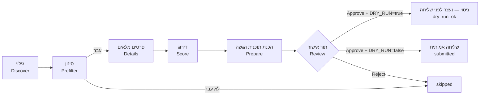

# JobHunter — מדריך שימוש

המדריך הזה מיועד לשימוש יום־יומי במערכת. פקודות, שמות קבצים וקוד מופיעים באנגלית בתוך בלוקי קוד.

**התקנה בפעם הראשונה, בלי רקע בפיתוח?** יש להתחיל ב-[FRIEND-SETUP.md](FRIEND-SETUP.md).

**תוכן העניינים:**
[מה המערכת עושה](#מה-המערכת-עושה-ומה-לא) ·
[איך זה עובד](#איך-זה-עובד) ·
[התקנה ראשונה](#התקנה-ראשונה-מאפס-windows-11) ·
[בחירת מודל שפה](#בחירת-מודל-שפה) ·
[הפעלה יומית: סשן אחד](#הפעלה-יומית-סשן-אחד) ·
[מסכי ה-dashboard](#מסכי-ה-dashboard) ·
[עדכון קורות חיים](#עדכון-קורות-חיים) ·
[התראות משרות במייל: LinkedIn, Indeed (אופציונלי)](#תוסף-אופציונלי-התראות-משרות-במייל-linkedin-indeed) ·
[שכר](#שכר) ·
[מאגר התשובות](#מאגר-התשובות-והחוק-הקשיח) ·
[בחירת קורות חיים](#בחירת-קורות-חיים-לפי-שפה) ·
[JobMaster](#jobmaster) ·
[Jobnet](#jobnet) ·
[JobKarov](#jobkarov) ·
[חברות יעד](#חברות-יעד-greenhouse-comeet) ·
[תוסף JobHunter Fill](#תוסף-jobhunter-fill-ל-chrome-אופציונלי) ·
[השהיית אתר](#השהיית-אתר-אחרי-חסימה) ·
[DRY_RUN](#dry_run--מצב-ניסוי) ·
[שליחה אוטומטית](#שליחה-אוטומטית-כבויה-כברירת-מחדל) ·
[ציד מתוזמן](#ציד-מתוזמן-אופציונלי) ·
[הגדרות](#כל-ההגדרות) ·
[סטטוסים](#סטטוסים) ·
[נתונים וגיבוי](#איפה-נשמרים-הנתונים) ·
[פתרון תקלות](#פתרון-תקלות) ·
[מבנה הפרויקט](#מבנה-הפרויקט)

---

## מה המערכת עושה ומה לא

**עושה:**
- מחפשת משרות באתר **דרושים** לפי **סוגי התפקידים** שהגדרת (Full Stack, Backend, Junior, אוטומציה…), כל אחד עם עדיפות (tier).
- מסננת אותן בכללים קבועים: מילים בכותרת, בכירות, מיקום, חברות, ו**שנות ניסיון נדרשות** — משרה שדורשת יותר מ-`maxRequiredYears` מדולגת.
- מדרגת כל משרה מ-0 עד 100 עבור סוג התפקיד שלה, עם הסבר קצר בעברית. הדירוג נעשה במודל שפה לבחירתך: מקומי (Ollama, חינם, שום דבר לא יוצא מהמחשב) או ספק API בתשלום (Anthropic, OpenAI, Gemini). ראו [בחירת מודל שפה](#בחירת-מודל-שפה).
- ממיינת לפי **rank**, שמעדיף משרות ג׳וניור ותפקידי ליבה: `rank = score + בונוס ניסיון + בונוס tier`.
- **מכינה** הגשה לכל משרה שנבחרה:
  - פותחת את חלון ההגשה באתר;
  - בוחרת את קורות החיים המתאימים;
  - ממלאת את השאלות רק מתוך הפרופיל שלך ומאגר התשובות;
  - מצלמת מסך ועוצרת.
- **שולחת רק אחרי שאישרת** בתור האישור, ורק כש-`DRY_RUN=false`.

**לא עושה:**
- לא ממציאה עובדות. כל ערך נשלח מגיע מהפרופיל, ממאגר התשובות או ממך, והמקור נשמר לכל שדה.
- לא עוקפת CAPTCHA, הגנות בוטים או הגבלות קצב. במקרה כזה הריצה נעצרת ומסומנת `blocked`.
- לא מתחברת לאתרים בשבילך. ההתחברות ידנית, פעם אחת, בחלון Chrome רגיל. ראו [התחברות לדרושים](#התחברות-לדרושים).
- לא שולחת לבד, אלא אם הפעלת [שליחה אוטומטית](#שליחה-אוטומטית-כבויה-כברירת-מחדל) לאתר (כבויה כברירת מחדל). גם אז הגשה נשלחת רק כשכל תנאי השער מתקיימים.
- לא נכנסת ל-LinkedIn ולא עושה בו שום פעולה. משרות מ-LinkedIn אפשר לקבל דרך התראות המייל, ולהגיש להן ידנית: ראו [התראות LinkedIn](#תוסף-אופציונלי-התראות-משרות-במייל-linkedin-indeed) (תוסף אופציונלי, כבוי כברירת מחדל).

**אתרים:** דרושים, [JobMaster](#jobmaster), [Jobnet](#jobnet) ו-[JobKarov](#jobkarov) — גילוי והגשה. AllJobs — לא נבנה (הגנת בוטים חזקה; ראו את דוח הבדיקה). משרות שההגשה אליהן היא בקישור חיצוני (אתר החברה) או במייל מגיעות לתור האישור עם הקישור, ומטופלות ידנית בינתיים.

---

## איך זה עובד



1. **גילוי:** המערכת פותחת את דף החיפוש בדרושים, קוראת את הנתונים שהאתר עצמו טוען, ולוחצת "הצג עוד משרות" עד המגבלה שהגדרת. היא עובדת לאט ובטאב אחד, כמו אדם. כל משרה נשמרת פעם אחת בלבד, וגם משרה זהה מאתר אחר (אותה חברה ואותה כותרת, תוך 14 יום) מזוהה ככפילות.
2. **סינון:** כללים קבועים, בלי מודל. סוג תפקיד **כבוי** הופך את מילות הכותרת שלו למילים פוסלות: למשל כש-`support` כבוי, "איש/אשת תמיכה טכנית" או "Tier 1/2 Support" מדולגות עם הסיבה `role type disabled: support`, גם אם חיפוש של סוג תפקיד אחר מצא אותן. מילה שגם סוג תפקיד פעיל משתמש בה, ומילים של סוג תפקיד לחיפוש בלבד (Junior), לא נפסלות. כל שמירה במסך Preferences מריצה את הסינון מחדש על המשרות הקיימות (שנמצאו, דורגו או נפסלו בסינון), בלי חיפוש חדש. ההתאמה היא למילים שלמות ובלי תלות באותיות גדולות, כך ש-"Java" לא פוסל "JavaScript": מילים שחייבות להופיע בכותרת, מילים שפוסלות (למשל "בכיר", "ראש צוות", "Senior"), "מוביל/ת" **כתפקיד** ("מוביל/ת צוות תוכנה", "מוביל/ה טכנולוגי/ת", "מהנדס/ת מוביל/ה בתחום…"), אבל אף פעם לא "מוביל" כתואר ("לארגון מוביל", "חברה מובילה"), מיקום וחברות חסומות. משרה שלא עוברת מקבלת `skipped` עם הסיבה.
3. **פרטים:** למשרות שעברו, המערכת פותחת את דף המשרה ושומרת את התיאור והדרישות המלאים.
4. **דרישת ניסיון:** לפני המודל, ביטוי רגולרי מחלץ את שנות הניסיון הנדרשות מהדרישות ומהתיאור, בעברית ובאנגלית.
   - שורות שמסומנות "יתרון" / advantage / nice to have / a plus לא נספרות.
   - טווח נספר לפי המינימום שלו.
   - כמה דרישות → המקסימום מבין המינימומים.
   - אם הדרישה גבוהה מ-`maxRequiredYears`, המשרה מקבלת `skipped_experience` עם הטקסט שנמצא, **בלי** לשלוח אותה למודל.
   - אם הביטוי לא מצא כלום, המודל מחזיר את הדרישה בזמן הדירוג. הביטוי גובר כשיש את שניהם.
5. **דירוג:** המודל משווה את המשרה לפרופיל שלך **עבור סוג התפקיד שלה** ומחזיר ציון, כישורים מתאימים, דרישות חסרות, בכירות ושני משפטי הסבר. הדירוג נשמר ולא יחושב שוב כל עוד המשרה לא השתנתה.
   - סוג התפקיד של משרה נקבע לפי **הכותרת שלה**: ה-tier הטוב ביותר מבין סוגי התפקידים שמילות הכותרת שלהם מופיעות בה. סוג תפקיד עם `searchOnly: true` (למשל Junior) משמש רק לחיפוש ולא קובע tier. אם אף סוג לא מתאים לכותרת — tier 3.
   - המודל מחזיר גם `devContentScore` (0–100): כמה מהעבודה היא פיתוח בפועל (קוד, SQL, APIs, דיבאג). במשרות tier 3 (למשל תמיכה) ה-rank מחושב לפי `min(score, devContentScore)`, כך שמשרת תמיכה בלי פיתוח לא תעלה גבוה. ההגדרה `devContentCap` של סוג התפקיד משנה את זה: `false` לסוגי תפקידים שנמדדים לפי ההתאמה לתפקיד עצמו (למשל `solutions-integration`), ו-`true` כדי להפעיל את המגבלה גם ב-tier אחר. ב-dashboard מסומן אז `*` ליד הציון.
   - אם המודל מזהה שזה **קורס או מסלול הכשרה** ולא משרה, היא מקבלת `skipped_not_a_job` עם הסיבה. מילים כמו "הכשרה", "קורס", "bootcamp" בכותרת מסננות עוד לפני כן.
6. **rank:** `score + experienceBoost + tierBoost`.
   - בונוס ניסיון (ברירת מחדל): ג׳וניור / 0–1 שנים +15, שנתיים +5, 3 שנים −10, לא ידוע 0.
   - בונוס tier: tier 1 +5, tier 2 0, tier 3 −25.
   - רשימת המשרות, תור האישור וסדר ההכנה ממוינים לפי rank, כך שהמכסה היומית מנוצלת קודם על המשרות הטובות ביותר.
7. **הכנת תוכנית הגשה:**
   - המערכת פותחת את חלון ההגשה ורואה אילו קורות חיים קיימים בחשבון ואילו שאלות יש.
   - לכל שאלה היא מוצאת תשובה ומתעדת את המקור שלה.
   - היא מסמנת רק מה שמאושר, מצלמת מסך ו**עוצרת**. המשרה עוברת לתור האישור.
8. **תור אישור:** עוברים על התוכנית, משלימים תשובות חסרות, מתקנים, ומאשרים או דוחים.
9. **שליחה:**
   - במצב ניסוי (`DRY_RUN=true`) האישור ממלא הכל, מצלם ועוצר.
   - במצב אמיתי הוא שולח ושומר הוכחה: צילום לפני ואחרי, טקסט האישור ותשובת השרת.

---

## התקנה ראשונה מאפס (Windows 11)

כל התקנה משרתת משתמש אחד. כל ההגדרות נעשות במסכים של ה-dashboard, בלי לערוך קבצים ביד.

1. **Node.js:** התקינו את גרסת ה-LTS מ-https://nodejs.org (נדרש 22.13 ומעלה). לבדיקה:
   ```powershell
   node --version
   ```
2. **מודל שפה מקומי (אופציונלי):** כדי לעבוד חינם ובלי ששום מידע יוצא מהמחשב, התקינו את Ollama מ-https://ollama.com/download ופתחו את האפליקציה. צריך כרטיס מסך עם מספיק זיכרון (ל-`gemma4:12b` בערך 8GB). בלי כרטיס כזה, בחרו באשף ספק API — ראו [בחירת מודל שפה](#בחירת-מודל-שפה).
3. **הורדת הקוד:**
   ```powershell
   git clone https://github.com/Orel009/JobHunterAI.git
   cd JobHunterAI
   ```
4. **הפעלה:**
   ```powershell
   npm start
   ```
   או לחיצה כפולה על `start.cmd`. בהפעלה הראשונה המערכת מתקינה את החבילות, בודקת ש-Google Chrome מותקן, יוצרת את `.env` ואת `data\preferences.yaml` מקבצי הדוגמה, ופותחת את ה-dashboard עם **אשף ההגדרה**.

### אשף ההגדרה

האשף נפתח רק בהתקנה חדשה (אין עדיין פרופיל). אפשר לחזור אחורה בכל שלב, ו-"set up later" סוגר אותו; הכל נשאר זמין גם במסכים הרגילים.

| שלב | מה עושים |
|---|---|
| 1. About you | שם מלא, ו**לשון זכר או נקבה**. הבחירה קובעת את הצורות בכל טקסט עברי שנכתב בשמך (טיוטות, שאלות קבועות, הסברי דירוג) |
| 2. Language model | בחירת ספק ומודל, הזנת מפתח API אם צריך, ו-`Test connection` |
| 3. Your CV | העלאת קורות חיים ב-PDF: עברית, אנגלית או שניהם. הקריאה רצה ברקע עם פס התקדמות |
| 4. Review your profile | פרטי קשר, תפקידים והשכלה כפי שנקראו. מתקנים ולוחצים Save |
| 5. Skills | רמה לכל כישור (`strong` / `basic`), קישור כישורים לתפקידים (ממנו מחושבות שנות הניסיון), ומחיקת כישורים לא רלוונטיים |
| 6. Experience | הצהרה על סך הניסיון בפיתוח (`declaredExperience`), לשאלות כלליות של שנות ניסיון |
| 7. What to search | סוגי תפקידים, ערים, ומקסימום שנות ניסיון נדרשות |
| 8. Drushim | שמות קורות החיים **בדיוק כפי שהם בחשבון בדרושים**, וכפתור שפותח חלון התחברות. ההתחברות עצמה ידנית — המערכת לא מקלידה סיסמה |
| 9. Standard answers | תשובות לשאלות שחוזרות בכל טופס (עיר, משרה מלאה, זמינות…). ריק = לשאול כל פעם |

ב-"Finish setup" הפרופיל מאושר ונשמר ב-`data\profile\profile.json`, והתשובות נטענות למאגר.

**חשוב על קורות החיים בדרושים:** ההגשה שולחת את הקובץ ששמור **בחשבון שלך בדרושים**, לא את הקובץ שהעלית למערכת. לכן צריך להעלות אותו גם לדרושים.

### התחברות לדרושים
ההתחברות נעשית **ידנית**, ב-**Google Chrome הרגיל** שמותקן במחשב:
1. הכפתור **Open the Drushim login window** (באשף או בבאנר), או מהטרמינל:
   ```powershell
   npm run login -- drushim
   ```
2. נפתח **חלון Chrome רגיל**, נפרד מה-Chrome האישי, עם פרופיל משלו (`data\browser-profile`). זה Chrome אמיתי ולא דפדפן אוטומטי, ולכן **"התחברות עם Google" עובדת בו**. אפשר גם להתחבר בקוד ב-SMS / במייל או בסיסמה.
3. מתחברים, ואז **סוגרים את חלון ה-Chrome הזה**.
4. המערכת בודקת את החיבור עם אותו פרופיל ומדפיסה דוח: אילו עוגיות התחברות נשמרו, אילו **לא שרדו** סגירה ופתיחה מחדש של הדפדפן (שם ותוקף בלבד, אף פעם לא הערך), והאם האתר מזהה התחברות.

המערכת עצמה משתמשת באותו Chrome ובאותו פרופיל, כך שהיא רואה את אותה התחברות. שניהם לא יכולים לרוץ יחד: כל עוד חלון ההתחברות פתוח, ריצות ובדיקות מחכות להודעה "close the login window first".

אם Chrome לא מותקן, נפתח במקומו הדפדפן המובנה. בו "התחברות עם Google" לא עובדת, ויש להתחבר בקוד ב-SMS / במייל או בסיסמה. Chrome מותקן במיקום לא רגיל? יש להגדיר `CHROME_PATH` ב-`.env`.

### כללי הפרופיל
- שנות ניסיון בכישור נספרות **רק מתפקידים מסוג `work`** שמקושרים לכישור. פרויקטים, צבא והשכלה נספרים בדירוג ובהתאמה, אבל לא בשאלות שנות ניסיון.
- כפילויות של כישור מאחדים לרשומה אחת, ושאר הכתיבים נכנסים ל-`aliases` (למשל JavaScript עם `ES6`, `JS`). ה-aliases משמשים בכל מקום: בסינון, בדירוג, בשאלות שנות ניסיון ובהתאמה למאגר התשובות.
- כישור ברמה `basic` נספר בדירוג ובהתאמה, אבל **אף פעם** לא עונה אוטומטית על הצהרת כן/לא או על שאלת שנות ניסיון.
- `declaredExperience` עונה רק על שאלות **כלליות** ("N שנות ניסיון בפיתוח תוכנה"), אף פעם לא על טכנולוגיה מסוימת.

### דרך ידנית (למתקדמים)
אפשר לבנות טיוטת פרופיל גם מהטרמינל: שמים `cv-he.pdf` ו/או `cv-en.pdf` ב-`data\profile\` ומריצים:
```powershell
npm run profile:init
```
נוצרים `data\profile\profile.draft.json` ו-`data\profile\profile.conflicts.md` (סתירות בין שני הקבצים ופרטים שנפסלו כי לא מופיעים בקורות החיים). את הטיוטה בודקים במסך Profile ולוחצים "Approve draft". התחברות לדרושים מהטרמינל:
```powershell
npm run login -- drushim
npm run session:check -- drushim
```

---

## בחירת מודל שפה

המודל קורא מודעות, מדרג, מתאים שאלות למאגר וכותב טיוטות. בוחרים אותו באשף או במסך **Settings**, בנפרד לשתי משימות:
- **analyze** — דירוג, התאמה, סיווג וקריאת קורות חיים. הרבה קריאות, וחשוב שה-JSON יהיה אמין.
- **write** — טיוטות לשאלות פתוחות. מעט קריאות, והאיכות חשובה.

| ספק | עלות | פרטיות | מתי מתאים |
|---|---|---|---|
| **Ollama** (ברירת מחדל) | חינם | הכל נשאר במחשב | יש כרטיס מסך עם מספיק זיכרון |
| **Anthropic** (Claude) | לפי שימוש | המודעות, הפרופיל וקורות החיים נשלחים לספק | מחשב חלש, או איכות כתיבה גבוהה |
| **OpenAI** | לפי שימוש | כנ"ל | כנ"ל |
| **Google Gemini** | לפי שימוש | כנ"ל | כנ"ל |
| **Test mode** | חינם | — | בדיקות בלבד: אין מודל, התשובות ריקות |

- **מפתחות API** נשמרים **רק** בקובץ `.env` במחשב שלך. הם לא נשמרים במסד הנתונים, לא נכתבים ליומן, ומוצגים במסך רק מוסתרים (`sk-a…wxyz`).
- **הצעות מודלים:** שדה המודל מציע את רשימת המודלים שהספק מחזיר. `Test connection` שולח בקשה קטנה ובודק שמתקבל JSON תקין.
- **שימוש ועלות:** במסך Settings מוצגים הטוקנים של היום ושל 30 הימים האחרונים. העלות מחושבת לפי המחירים **שאתם** מזינים (דולר למיליון טוקנים, מדף התמחור של הספק); אין מחירים מובנים.
- **מגבלה יומית:** `Daily token limit` (או `DAILY_LLM_TOKEN_LIMIT` ב-`.env`). כשמגיעים אליה, שלבי המודל נעצרים עד מחר. Ollama אף פעם לא מוגבל.
- **התאמה לכרטיס המסך:** `npm start` ו-`npm run doctor` בודקים את המודל שנבחר. עם Ollama הם משווים את גודל המודל לזיכרון כרטיס המסך (`nvidia-smi`), ואם הוא לא נכנס מציעים מודל קטן יותר או ספק API.
- **השוואת מודלים:** `npm run model:bench` מריץ את אותן משרות ושאלות על כמה מודלים (`BENCH_MODELS`, בפורמט `provider:model`; שם בלי ספק = Ollama) ושומר דוח ב-`data\reports\`.

---

## הפעלה יומית: סשן אחד

זו הדרך העיקרית לעבוד עם JobHunter: מדליקים את המחשב בזמן פנוי, מריצים פעם אחת, נותנים למערכת לשלוח, וכשכתוב שאפשר — סוגרים ומכבים. אין צורך בתזמון ([ציד מתוזמן](#ציד-מתוזמן-אופציונלי) הוא תוספת אופציונלית).

1. **הפעלה:** `npm start`, או לחיצה כפולה על `start.cmd` בתיקיית הפרויקט. ה-dashboard נפתח.
2. **▶ Run & send** — הכפתור הראשי בראש המסך. ריצה אחת עושה את הכל:
   - גילוי בכל האתרים הפעילים (היום: דרושים), וקריאת התראות משרות מהמייל (LinkedIn, Indeed) אם [התוסף](#תוסף-אופציונלי-התראות-משרות-במייל-linkedin-indeed) פעיל;
   - דירוג;
   - הכנת תוכניות הגשה למשרות הטובות ביותר, עד המכסה היומית;
   - שליחה של המשרות שעוברות את [שער השליחה האוטומטית](#שליחה-אוטומטית-כבויה-כברירת-מחדל), **רק** כש-`DRY_RUN=false` והשליחה האוטומטית פעילה לאתר. אחרת הריצה נעצרת אחרי ההכנה, והסיבה כתובה בהתקדמות ובסיכום.

   בזמן הריצה מוצגים מתחת לכותרת: השלב הנוכחי, רשימת השלבים, הספירות (נמצאו, דורגו, להכנה) והמשרה שבטיפול. **Pause auto-submit** האדום עוצר את השליחה מיד, גם באמצע הריצה.
3. **מה שמחכה לבדיקה:** ב-**Review queue** אפשר לאשר כמה הגשות יחד ב[אישור קבוצתי](#אישור-קבוצתי), ולעבור אחת-אחת על אלה שצריכות בדיקה אישית (טיוטות, שאלות ממתינות, טענות מסומנות).
4. **סיום:** כשמופיע **Done. Safe to close / shut down** (רקע ירוק), סוגרים: `Ctrl+C` בחלון הפקודה או סגירת החלון, ואז מכבים את המחשב. הסיכום כולל:
   - כמה משרות חדשות נמצאו;
   - כמה דולגו, ולמה (למשל `prefilter: seniority`, `already_applied`);
   - כמה נשלחו (ואם לא נשלח כלום — למה: `DRY_RUN`, שליחה אוטומטית כבויה או מושהית);
   - כמה הגשות מחכות לבדיקה שלך בתור האישור;
   - כמה נכשלו.

   אם משהו עוד רץ (ריצה, אישור קבוצתי, או חלון ההתחברות שעדיין פתוח), מופיע **Still running** (רקע צהוב) עם מה שרץ. יש לחכות עד שהוא מסתיים.

**אותו סשן מהשורה, בלי dashboard:**
```powershell
npm start -- --hunt --send
```
אותה ריצה בדיוק. בסוף מודפס אותו סיכום ("Done. Safe to close / shut down" או "Still running"), והתהליך נסגר לבד. אם JobHunter כבר פתוח, הפקודה מבקשת ממנו להריץ, מציגה את ההתקדמות ומחכה לסיום.

`npm start -- --hunt` (בלי `--send`) מריץ אותה ריצה ומשאיר את ה-dashboard פתוח.

### מה נבדק בהפעלה

הבדיקות שרצות לפי הסדר (בכל תקלה מוצגת הודעה בעברית ובאנגלית עם הוראות תיקון):
1. גרסת Node, והתקנת חבילות אם צריך.
2. קובץ `.env` (נוצר מהדוגמה בהפעלה הראשונה).
3. מודל השפה שנבחר לכל משימה:
   - **Ollama:** רץ (אם לא, המערכת מנסה להפעיל את האפליקציה), המודל מותקן (אם לא, מציעה להוריד), והמודל נכנס בזיכרון כרטיס המסך.
   - **ספק API:** יש מפתח, והספק עונה.
   - בהתקנה חדשה בעיות במודל הן רק אזהרה, כי האשף מגדיר אותו.
4. `data\preferences.yaml` (נוצר מהדוגמה בהפעלה הראשונה) ו-`profile.json` תקינים.
5. מסד הנתונים מעודכן.
6. Google Chrome מותקן, והגרסה שלו. אם לא, מותקן במקומו דפדפן מובנה (בלי "התחברות עם Google").
7. החיבור לדרושים. אם לא מחוברים, המערכת שואלת אם לפתוח חלון התחברות; אפשר לענות לא, והמערכת תעלה עם הגשה מושבתת.
8. ה-dashboard נבנה מחדש אם השתנה.

אם התראות המשרות במייל מופעלות, נבדק גם החיבור לתיבת המייל. כשהן כבויות, אין שום בדיקה כזו.

בסוף מודפס סיכום: מצב DRY RUN באותיות גדולות, המודל, מצב החיבור, כמה הוגשו היום מתוך המכסה, וכמה תשובות ממתינות. אחר כך ה-dashboard נפתח בדפדפן בכתובת http://127.0.0.1:8787. לעצירה: `Ctrl+C`.

הריצה (`Run & send` או `--hunt`) מכינה תוכניות רק למשרות שקיבלו לפחות `autoSubmitMinScore`, ומספרן מוגבל למכסה היומית שנשארה. אם ההתחברות לדרושים פגה, הריצה ממשיכה רק בגילוי ובדירוג, והסיכום מבקש להתחבר שוב.

**בדיקה בלבד, בלי לשנות כלום:**
```powershell
npm run doctor
```

---

## מסכי ה-dashboard

### פס עליון (בכל המסכים)

| רכיב | מה הוא |
|---|---|
| **▶ Run & send** | הכפתור הראשי, בכותרת: [סשן אחד](#הפעלה-יומית-סשן-אחד) — גילוי, דירוג, הכנה, ושליחה של מה שעובר את השער. מתחת לכותרת מוצגים ההתקדמות ואחר כך הסיכום |
| `DRY RUN` / `LIVE` | מצב ניסוי (צהוב) או שליחה אמיתית (אדום) |
| `Today: Drushim x/y · JobMaster x/y · …` | הגשות אמיתיות היום **לכל אתר** מתוך המכסה היומית, שהיא לכל אתר בנפרד. ב-tooltip: הסך הכול |
| `Drushim: logged in / NOT logged in` | מצב החיבור לדרושים |
| `re-check login` | בודק שוב את החיבור לדרושים |
| `JobMaster: logged in` / `Jobnet: …` | מצב ההתחברות של כל אתר. **בכל הפעלה** של המערכת נבדקת ההתחברות של כל אתר פעיל, אחד אחרי השני ברקע (חוץ מאתר מושהה). עד שהבדיקה מסתיימת מוצג `login unknown`. `re-check` ליד התג בודק שוב |
| `pending answers` | כמה שאלות ממתינות לתשובה שלך במאגר |
| `LLM` | הספק והמודל של כל משימה, ואם יש בעיה: Ollama כבוי, מודל לא מותקן, או שהמגבלה היומית הושגה. עם ספק API מוצגים גם הטוקנים של היום |
| ספירות סטטוסים | כמה משרות יש בכל סטטוס |
| **Discover Drushim** | ריצה מלאה: חיפוש, סינון, פרטים, דירוג |
| **Score only** | דירוג בלבד, למשרות שעברו סינון ועוד לא דורגו או שהשתנו |
| **Stop** | עוצר את הריצה הנוכחית (מופיע רק כשיש ריצה) |
| **Discover JobMaster** / **Score only** | כמו בדרושים, ל-JobMaster. ליד התג `JobMaster` — מצב ההתחברות, בדיקה חוזרת או פתיחת חלון התחברות |
| Discover AllJobs | מושבת |
| **Pause auto-submit** | בכותרת, רק כשהשליחה האוטומטית פעילה: עוצר אותה מיד לכל האתרים, גם באמצע Run & send |
| **Fetch job-alert emails** | קורא התראות משרות חדשות מהמייל (LinkedIn, Indeed) ומדרג אותן. מופיע רק כש[התראות המשרות במייל](#תוסף-אופציונלי-התראות-משרות-במייל-linkedin-indeed) פעילות |

שורות התראה שעשויות להופיע מעל הפס:
- **אין חיבור לדרושים:** ההגשה מושבתת עד ההתחברות. הכפתור **Open the login window** פותח חלון שבו מתחברים ידנית.
- **אין פרופיל מאושר** (באנר אדום, עם כפתור **Open Profile**): הגילוי ממשיך לעבוד, אבל הדירוג ממתין. מספר המשרות שממתינות מוצג. ברגע שהפרופיל מאושר (**Approve draft**, סיום האשף או שמירת `profile.json` תקין), הדירוג מתחיל לבד, או מיד אחרי הריצה הנוכחית.
- **Update this CV on Drushim too:** העלית קורות חיים חדשים למערכת. ראו [עדכון קורות חיים](#עדכון-קורות-חיים).
- **DRY_RUN is OFF:** אישור יגרום לשליחה אמיתית.

למטה יש **Live log**, היומן החי של המערכת. אפשר לקפל אותו בלחיצה.

### Jobs — משרות
- **סינון:** אתר, סטטוס, ציון מינימלי, וחיפוש בכותרת או בחברה. `Refresh` מרענן.
- **ברירת המחדל:** משרות בסטטוס `skipped_*` מוסתרות, והתיבה **show skipped** מציגה אותן (בחירת סטטוס מסוים מציגה אותו בכל מקרה). הרשימה ממוינת לפי rank מהגבוה לנמוך, ומשרות שעוד לא דורגו בסוף.
- **עמודות:** `Rank` — הדירוג הסופי, ומתחתיו הפירוק: ציון, `exp` (בונוס ניסיון) ו-`tier`. `Role` — סוג התפקיד שלפיו המשרה דורגה. מסנן **All role types** מציג סוג תפקיד אחד.
- **לחיצה על שורה** פותחת את הפרטים: דרישת הניסיון עם המקור (`regex` / `llm`) והטקסט שנמצא, סימן ג׳וניור אם יש, פירוק ה-rank ואילו סוגי תפקידים מצאו את המשרה. בנוסף: הסבר הציון, כישורים מתאימים (ירוק) וחסרים (אדום), סיבת דילוג, ותיאור ודרישות המשרה.
- **`open`** פותח את המשרה באתר.
- **`apply`** מכין תוכנית הגשה: פותח את חלון ההגשה, ממלא מה שידוע, מצלם ועוצר. **לא שולח.** הכפתור מושבת כשאין חיבור לדרושים, או כשהמשרה כבר בתור, בבדיקה או נשלחה. במשרות LinkedIn ו-Indeed מופיע במקומו `by hand`: ההגשה שם ידנית, ממסך **Email alerts**.
- **`skip` / `unskip`** מדלג על משרה, או מחזיר אותה.

### Review queue — תור אישור
כל כרטיס הוא הגשה אחת:
- **כותרת:** המשרה, החברה, הסטטוס, מצב המוכנות וקישור למודעה. מצבי המוכנות:
  - `ready` — הכל מוכן;
  - `needs your answers` — חסרות תשובות;
  - `has drafts` — יש טקסט שהמודל ניסח וצריך לעבור עליו;
  - `a required statement is false` — הצהרת חובה לא נכונה עבורך.
- **ציון והסבר** הדירוג.
- **ℹ הערות**, למשל אילו קורות חיים קיימים בחשבון.
- **CV:** הקובץ שנבחר, השפה, ואחוז האותיות העבריות במודעה. `switch to …` מחליף ידנית.
- **טבלת השדות:** שאלה, תשובה ומקור. ליד כל תשובה יש `edit`:
  - בשאלות כן/לא — כפתורי **כן** / **לא**;
  - בשאר — שדה טקסט ו-`save`;
  - `save to answers bank` מסומן כברירת מחדל, כך שהתשובה תישמר במאגר ותשמש גם למשרות הבאות. בלי הסימון, התשובה תשמש רק להגשה הזו.

  תגיות המקור:

  | תגית | מקור |
  |---|---|
  | `profile` | מהפרופיל (שם, טלפון, מייל, עיר, קישורים) |
  | `answers bank` | ממאגר התשובות (`ref` = מספר הרשומה, `conf` = רמת ההתאמה) |
  | `skill years (work roles)` | חושב מתאריכי תפקידי ה-work שמקושרים לכישור |
  | `declared experience` | מההצהרה הכללית שלך (`declaredExperience`). טקסט ה-basis מוצג מתחת |
  | `LLM draft` | טיוטה שהמודל ניסח מעובדות הפרופיל (`cites` = העובדות שעליהן נשען) |
  | `you (this job only)` | הקלדת ידנית בלי לשמור במאגר |

  ⚠ **unsupported claims** — טענות בטיוטה שבדיקת העובדות לא מצאה להן בסיס בפרופיל. יש לתקן אותן לפני אישור.
- **צילומי מסך:** "before final click" — המצב לפני הלחיצה האחרונה; "after submit" — אחרי שליחה אמיתית. לחיצה פותחת בגודל מלא.
- **Approve:**
  - `Approve → DRY RUN (no submit)` במצב ניסוי.
  - `Approve → SUBMIT for real` במצב אמיתי, אחרי חלון אישור נוסף.
  - הכפתור מושבת כל עוד יש שאלות ממתינות, כשאין חיבור, או כשריצה אחרת פעילה.
- **Reject / skip job** — לא להגיש. המשרה מסומנת `skipped`.
- למעלה: בחירת אילו הגשות להציג, ו-**Prepare queued**, שמכין תוכניות לכל המשרות שבסטטוס `queued`.

#### אישור קבוצתי
בשורה **Batch approval** מעל הכרטיסים:
- **select all with rank ≥ X** — מסמן את כל ההגשות שאפשר לאשר בקבוצה עם rank של X ומעלה. אפשר גם לסמן ולבטל ידנית בתיבה שליד כותרת כל כרטיס.
- **Approve selected (n) → SUBMIT** (או **→ DRY RUN** במצב ניסוי), אחרי חלון אישור: ההגשות נשלחות **אחת אחרי השנייה**, מה-rank הגבוה לנמוך, עם ההפסקות הרגילות בין הגשות. התוצאה של כל אחת מופיעה מיד בחלונית מעל הכרטיסים.
- **עצירה:** האישור הקבוצתי נעצר מיד אם האתר מציג CAPTCHA או הגנת בוטים (אין שום עקיפה), אם הגעת למכסה היומית, או אם ההתחברות לאתר נפלה. ההגשות שלא נשלחו נשארות בתור, והסיבה מוצגת.
- **מה אי אפשר לסמן:** הגשה עם טיוטה שהמודל כתב, שאלה ממתינה, טענות מסומנות (⚠), בלי קורות חיים, או שאינה `ready`. התיבה שלה מושבתת, והסיבה מופיעה ליד כפתורי הכרטיס. הגשות כאלה צריכות בדיקה אישית ואישור רגיל.
- לפני כל הגשה המערכת בודקת שוב: שלא נשלחה כבר באתר, שהחברה לא נוספה לרשימת ההחרגה, ושהטופס לא השתנה מאז הבדיקה.

### Profile — פרופיל
- **CVs:** שתי משבצות העלאה (עברית ואנגלית, PDF). כל קובץ נשמר בהיסטוריה (`data\profile\cv-history\`), והקריאה רצה ברקע עם פס התקדמות. `Read the CVs again` קורא שוב את הקבצים האחרונים.
- **Changes from the new CV:** אחרי קריאה, ההבדלים מהפרופיל הקיים מוצגים לאישור. ראו [עדכון קורות חיים](#עדכון-קורות-חיים).
- **העורך:** כל שדות הפרופיל:
  - לשון זכר / נקבה, פרטי קשר, קישורים ותקציר;
  - תפקידים: סוג (`work`, `project`, `education`, `military`, `volunteer`, `other`), חברה, תפקיד, תאריכים (`YYYY`, `YYYY-MM` או `present`), והכישורים שבהם השתמשת. עריכת תאריכים נועלת אותם, כך שעדכון קורות חיים לא יציע לשנות אותם;
  - כישורים: שם, רמה, aliases, ושנות הניסיון המחושבות. מחיקת כישור מוסיפה אותו לרשימת החסומים, וקורות חיים חדשים לא יחזירו אותו;
  - השכלה, שפות, והצהרת הניסיון (`declaredExperience`).
- **Save** שומר. `profile.json` נשמר רק אם הוא תקין; טיוטה אפשר לשמור גם עם בעיות. לפני כל שמירה נשמר גיבוי ב-`data\profile\backups\`. כשיש טיוטה, **Approve draft** הופך אותה ל-`profile.json`.

### Preferences — העדפות
כל `data\preferences.yaml` בטופס: סוגי תפקידים (tier, שאילתות, מילות כותרת, `searchOnly`, הפעלה), ערים ומילות "תמיד מותר" (remote / היברידי), מקסימום שנות ניסיון, מילות כותרת ובכירות שפוסלות, בונוסי ה-rank, ספים ומגבלות, ושמות קורות החיים בדרושים. השמירה בודקת תקינות ושומרת גיבוי ב-`data\backups\`.

### Settings — מודל שפה
ספק ומודל לכל משימה (analyze / write) עם הצעות מודלים ו-`Test connection`, מפתחות API (שמירה בלבד; מוצגים מוסתרים), מגבלת טוקנים יומית, טבלת מחירים לחישוב העלות, ודוח שימוש. עם ספק ענן מוצגת הודעת פרטיות. השינויים נכנסים לתוקף מיד, בלי הפעלה מחדש. ראו [בחירת מודל שפה](#בחירת-מודל-שפה). בתחתית המסך: הפעלה והגדרה של [התראות LinkedIn](#תוסף-אופציונלי-התראות-משרות-במייל-linkedin-indeed) (אופציונלי).

### History — היסטוריה
כל הגשה שנשלחה באמת: הגשות שהמערכת שלחה, והגשות ידניות שסומנו `I applied` (LinkedIn, Indeed).
- **לכל הגשה:** תאריך, חברה, משרה (קישור), אתר, קורות החיים שנשלחו, rank וציון, ואיך נשלחה: `approved` (אישרת), `auto` (שליחה אוטומטית) או `by hand`.
- **ראיות** (בלחיצה על שורה): צילום הטופס המלא לפני השליחה, צילום אחרי השליחה, תוכנית השדות עם המקור של כל תשובה, תשובת האתר, וטקסט האישור. בהגשה אוטומטית מוצגים גם כל תנאי השער שנבדקו.
- **מעקב תוצאות:** סטטוס עם תאריך לכל שינוי: `no response`, `screening call`, `interview`, `home assignment`, `offer`, `rejected`, `withdrawn`. אפשר להוסיף הערה לכל שינוי, וגם הערות חופשיות להגשה. כל השינויים נשמרים כציר זמן, ו-× מוחק רשומה שגויה.
- **סינון** לפי אתר, תוצאה וטווח תאריכים. **Export CSV** מוריד את מה שמוצג, בקובץ שנפתח נכון באקסל.
- **סטטיסטיקה:** הגשות בכל שבוע (ראשון–שבת), ושיעור תגובה לפי סוג תפקיד ולפי אתר. "תגובה" היא כל תשובה מהמעסיק: שיחת סינון, ראיון, מטלה, הצעה או דחייה.

### Answers bank — מאגר תשובות
- למעלה מוצגים מספר השאלות הממתינות והכפתור **Seed from preferences.yaml**, שטוען את `standardAnswers`. ערכים ריקים נטענים כשאלות ממתינות. השאלות נכתבות בלשון שנבחרה בפרופיל (זכר / נקבה).
- **הוספה:** שאלה, תשובה (ריק = ממתינה), סוג (`text`, `yes_no`, `choice`, `number`) ו-`Add`.
- **הטבלה:** השאלות הממתינות מופיעות ראשונות, וממוינות לפי **Blocks** — כמה הגשות פתוחות כל שאלה עוצרת.
  - שאלות כן/לא נענות בכפתורים, ושאר השאלות בשדה ו-`save`.
  - `Used` — כמה פעמים התשובה שימשה.
  - `Source` — מאיפה הגיעה: `seed` (מ-preferences.yaml), `user` (נוספה או נערכה כאן), או `review` (נשמרה מתור האישור).
  - `delete` מוחק.
- כל תשובה ששומרים מעדכנת אוטומטית את כל ההגשות הפתוחות שחיכו לה.

---

## עדכון קורות חיים

1. במסך **Profile** מעלים את הקובץ החדש במשבצת המתאימה (עברית / אנגלית). הקובץ הקודם נשאר בהיסטוריה.
2. המודל קורא את הקובץ ברקע. **הפרופיל לא משתנה אוטומטית.** במקום זה מוצגת רשימת שינויים, כל אחד עם תיבת סימון:
   - `added` — תפקיד, השכלה, כישור, שפה או קישור חדש;
   - `changed` — ערך שונה (למשל תאריך סיום או תואר);
   - `removed` — משהו שלא מופיע בקובץ החדש.
3. **Accept all safe changes** מאשר רק תוספות ותיקוני תאריכים. **Apply selected** מאשר את מה שסימנת. **discard** מבטל הכל.
4. מה שלעולם לא משתנה מקורות חיים: לשון זכר / נקבה, קישורי כישורים לתפקידים, רמות, aliases, כישורים שמחקת, הצהרת הניסיון, ותאריכים שערכת. תאריך עם חודש גם לא מוחלף בתאריך עם שנה בלבד.
5. אחרי האישור הפרופיל נבדק שוב, ומוצע **Re-score active jobs**: דירוג מחדש של המשרות הפעילות לפי הפרופיל המעודכן.
6. **לעדכן גם בדרושים:** ההגשות שולחות את הקובץ ששמור בחשבון בדרושים. לכן מופיע באנר קבוע "Update this CV on Drushim too" עם שם הקובץ שמוגדר בהעדפות. מעלים את הקובץ החדש לדרושים (אזור אישי → קורות חיים), מוודאים שהשם בדרושים זהה לשם בהעדפות, ולוחצים **I updated it on Drushim**. המערכת לא מעלה קבצים לדרושים בעצמה.

---

## תוסף אופציונלי: התראות משרות במייל (LinkedIn, Indeed)

**כבוי כברירת מחדל.** כל עוד הוא כבוי, אין חיבור לתיבת מייל, אין צורך בהגדרות IMAP, ואין לו זכר ב-dashboard. כשהוא פעיל, אפשר להפעיל כל מקור בנפרד: LinkedIn, Indeed, או שניהם.

### למה רק בעזרה, בלי אוטומציה
תנאי השימוש של LinkedIn ושל Indeed אוסרים על כלים אוטומטיים, וחשבונות שמשתמשים בהם עלולים להיות מוגבלים או חסומים. לכן המערכת **לעולם לא** מתחברת אליהם, לא פותחת אותם בדפדפן האוטומטי, לא לוחצת ולא שולחת שם כלום, ולא קוראת את דפי האתרים. גם ברמת הדפדפן, כל בקשה ל-linkedin.com או ל-indeed.com (וכל תת-דומיין שלהם) מהדפדפן האוטומטי נחסמת.

במקום זה:
- **המשרות מגיעות מהמייל:** LinkedIn ו-Indeed שולחים התראות משרות במייל, והמערכת קוראת אותן מתיבת הדואר (קריאה בלבד: שום הודעה לא מסומנת כנקראה, לא מועברת ולא נמחקת).
- **ההגשה ידנית:** פותחים את המשרה בדפדפן הרגיל ומגישים לבד, עם חלון עזר שמכין את כל הנתונים להעתקה.

### הגדרה
1. **התראות משרות ב-LinkedIn:** מחפשים ב-LinkedIn משרה (למשל `Full Stack Developer` ומיקום), ומפעילים בתוצאות את המתג **Set alert** (התראת משרה). בהגדרות ההתראות (Jobs → Job alerts) בוחרים תדירות יומית וקבלה במייל. אפשר ליצור כמה התראות.
2. **התראות משרות ב-Indeed:**
   1. נכנסים ל-https://il.indeed.com ומתחברים עם **אותה כתובת Gmail** שהמערכת קוראת (ההתראות נשלחות לכתובת של החשבון).
   2. מחפשים משרה ומיקום, למשל `Full Stack Developer` ב-`תל אביב`, או `מפתח/ת תוכנה` ב-`נתניה`.
   3. בתוצאות לוחצים על **Get new jobs for this search by email** / **קבלת משרות חדשות במייל** (או על סמל הפעמון ליד החיפוש) ומאשרים.
   4. חוזרים על זה לכל חיפוש שרוצים: חיפוש אחד לכל סוג תפקיד ואזור עובד טוב. ניהול וביטול: בתפריט החשבון ← **Job alerts** / **התראות משרות**.
   5. ההתראות מגיעות מכתובת כמו `alert@indeed.com`. רק מיילים מכתובות ההתראות של Indeed נקראים.
3. **סיסמת אפליקציה ב-Gmail** (Gmail לא מאפשר להתחבר עם הסיסמה הרגילה):
   1. להפעיל אימות דו-שלבי: https://myaccount.google.com/security → 2-Step Verification.
   2. ליצור סיסמת אפליקציה: https://myaccount.google.com/apppasswords. שם: `JobHunter` → **Create**.
   3. מוצגת סיסמה בת 16 אותיות, פעם אחת בלבד. מעתיקים אותה (הרווחים לא משנים).
   4. אם Gmail מבקש, יש להפעיל IMAP בהגדרות Gmail: See all settings → Forwarding and POP/IMAP.
4. **ב-dashboard:** במסך **Settings**, באזור **Email job alerts (optional)**:
   - מסמנים **Enable email job alerts**, ותחת **Sources** מסמנים **LinkedIn** ו/או **Indeed**;
   - ממלאים כתובת מייל וסיסמת אפליקציה (`imap.gmail.com`, פורט `993` כבר ממולאים), ולוחצים **Save**. הסיסמה נשמרת רק ב-`.env` ומוצגת מוסתרת;
   - **Mailbox / label:** `INBOX`, או שם התווית ב-Gmail אם ההתראות מסוננות לתווית;
   - **Read alerts from the last N days:** כמה ימים אחורה לקרוא (ברירת מחדל 14);
   - **Test connection** מתחבר וסופר כמה מיילי התראה יש בטווח, לכל מקור.

### שימוש
- **Fetch job-alert emails** בפס העליון (או **Fetch alerts now** במסך **Email alerts**) קורא מיילים חדשים בלבד מכל מקור פעיל, מוסיף את המשרות (`site=linkedin` / `site=indeed`), ומסנן ומדרג אותן כרגיל. גם **Run & send** קורא את ההתראות, ראשון בריצה, כשהתוסף פעיל. כל מייל נקרא פעם אחת (לפי ה-Message-ID שלו), וכל משרה נשמרת פעם אחת.
- **מידע חלקי:** במייל יש רק כותרת, חברה ומיקום, ולכן הדירוג הראשוני זהיר ומסומן **incomplete info**. כדי לדרג כמו שצריך, מדביקים את תיאור המשרה בתיבה שבמסך **Email alerts** ולוחצים **Save and re-score**.
- **מיקומים:** מיקומים באנגלית (למשל `Haifa, Haifa District, Israel` או `Tel Aviv-Yafo`) מותאמים לשמות העבריים ב-`locations` (חיפה, השרון, מרכז…).

### משרות מ-Indeed: לאן כל משרה הולכת
לכל משרה במייל של Indeed יש קישור. המערכת בודקת **בלי לגשת ל-Indeed** לאן הוא מוביל: היא פותחת רק את מה שכתוב בתוך הקישור עצמו (קישורי מעקב של מייל, וקישורי המעקב המקודדים של Indeed). אם היעד ידוע רק ל-Indeed, נשמר הקישור של Indeed.
- **קישור למשרה בדרושים** — נוצרת משרת דרושים רגילה (אם עוד לא קיימת), והיא עוברת את המסלול הרגיל: קריאת הדף, דירוג, הכנה ואישור. משרת ה-Indeed מסומנת ככפילות שלה, והקישור שלה נשמר.
- **קישור לאתר החברה או למערכת גיוס** (Greenhouse, Lever, Comeet וכו') — המשרה נשמרת עם הקישור. אחרי הדירוג, משרה עם ציון של לפחות `autoSubmitMinScore` נכנסת לתור האישור עם הקישור, להגשה ידנית.
- **Indeed Apply ("Easily apply") או יעד לא ידוע** — הגשה בעזרה, בדיוק כמו ב-LinkedIn: **Open in my browser**, נתונים להעתקה, ו-**I applied**.

### משרה שמופיעה בכמה מקורות
אותה חברה ואותה כותרת (אחרי נרמול) בתוך 14 יום נחשבות **משרה אחת**, מכל מקור: דרושים, LinkedIn או Indeed. כל הקישורים נשמרים עליה, ובמסך **Email alerts** מופיעה השורה **Also on:** עם הקישורים האחרים. אם המשרה הגיעה קודם מהתראה ועוד לא נעשה בה כלום, ואחר כך נמצאה גם בדרושים, משרת הדרושים הופכת למשרה הראשית, כי אפשר להגיש אליה במסלול הרגיל. משרה שכבר הוגשה ידנית נשארת הראשית.

### מסך Email alerts (הגשה בעזרה)
מופיע כשהתוסף פעיל, כשיש [חברות יעד](#חברות-יעד-greenhouse-comeet), וגם כשיש משרות שהמערכת השאירה להגשה ידנית (`needs_manual`, למשל CAPTCHA ב-JobKarov). כשהתוסף כבוי, שם המסך הוא **Assisted apply**, והוא מציג רק את המשרות האלה. בכל שורה מופיע המקור (`LinkedIn` / `Indeed`). בחירת משרה מהרשימה (`To do` / `Applied` / `All`) מציגה:
- **Open in my browser** — פותח את המשרה בדפדפן ברירת המחדל של Windows, לא בדפדפן של המערכת.
- **CV to attach** — עברית או אנגלית לפי אותו כלל שפה כמו בדרושים, והכפתור **show file** פותח את התיקייה עם הקובץ מסומן, כדי לגרור אותו לטופס.
- **Your details**, **Declared experience**, **Years per skill**, **Answers bank** — הנתונים מהפרופיל ומהמאגר, כל אחד עם כפתור **copy** ועם המקור שלו.
- **I applied** — אחרי הגשה ידנית: הסטטוס `submitted_manual` ושעת ההגשה נשמרים. **Skip** — מדלג.
- **“Apply on company website”?** — אם המשרה מפנה לאתר החברה, מדביקים את הקישור:
  - קישור למשרה **בדרושים** הופך למשרת דרושים רגילה (קריאת הדף, דירוג, ואז `apply` ואישור בתור). המשרה מההתראה מסומנת ככפילות שלה;
  - כל קישור אחר שולח את המשרה לתור האישור עם הקישור, להגשה ידנית.

**אין לסמן או להצהיר בטופס של LinkedIn או של Indeed על שום דבר שאינו נכון**, בדיוק כמו בשאלות הסינון בדרושים.

### כיבוי
מבטלים את הסימון ב-Settings (את כל התוסף, או מקור אחד). הקריאה מהמייל נעצרת, ומסך **Email alerts** והמסנן נעלמים כשהתוסף כבוי, אבל המשרות וההיסטוריה שכבר יובאו נשמרים.

## שכר

הכל דטרמיניסטי: מודל השפה אף פעם לא ממציא או מחשב מספר שכר.

**השכר שפורסם במשרה** (חודשי ברוטו ב-₪) נקרא לפי הסדר:
1. שדה השכר של דרושים בדף המשרה (למשל `שכר: 10000-13000`);
2. אזכור שכר בכותרת, בתיאור או בדרישות: "שכר", "משכורת", "salary", ₪ / ש"ח, `k` (‏`11K-13K`), טווחים ("בין 8-10", "12,000 עד 15,000"), "החל מ-" / "עד". מספרים שאינם שכר מסוננים: מענקים, בונוסים, תן ביס, שעות, ימים;
3. מדרגת השכר שבכרטיס החיפוש של דרושים (מסומנת `~`, משוערת).

שכר לשעה נשמר בנפרד, ולא משמש לסף, לתשובות או לסטטיסטיקה. ליד כל שכר נשמר המקור: הטקסט שממנו נקרא.

**הגדרות** (מסך Preferences ← Salary, וב-`preferences.yaml` תחת `salary`). לכל ערך: ההגדרה של סוג התפקיד, אחרת של ה-tier שלו, אחרת ה-default. הסף וה-`numericFallback` מתחילים **ריקים**. רק `textAnswerNoRange` ממולא מראש, ברמת ה-default.

| ערך | משמעות |
|---|---|
| `floor` | השכר החודשי המינימלי. **ריק = בלי סינון לפי שכר** (ברירת המחדל). אם מוגדר, הוא גם מעלה את X בתשובה |
| `textAnswerNoRange` | תשובה לשאלת שכר טקסטואלית כשהמשרה לא מפרסמת טווח. ממולא מראש ב-default: "גמיש, בהתאם להיקף התפקיד ולתנאים. אשמח לדבר על כך בשיחה" |
| `numericFallback` | מספר אחד לשדות שמקבלים רק מספר, כשאין טווח. ריק = השאלה ממתינה לך |
| `ranking.salaryBoost` | תוספת ל-rank כשהשכר שפורסם מגיע לסף (ברירת מחדל 0) |

**הכללים:**
- **המשרה מפרסמת טווח → החצי העליון שלו:** X = אמצע הטווח, מעוגל **כלפי מעלה** ל-500; Y = המקסימום שפורסם. טקסט: "X–Y ₪ ברוטו"; שדה מספרי: X. למשל 10,000–13,000 → "11,500–13,000 ₪ ברוטו". אם מוגדר סף, X = הגבוה מבין האמצע והסף. פורסם רק מינימום או רק מקסימום → הערך הזה.
- סינון לפי שכר קורה רק אם הגדרת סף: המקסימום שפורסם נמוך מהסף → `skipped_salary`, עם הטווח והסף כסיבה, בסינון ולפני הדירוג במודל.
- טווח שפורסם גובר גם על תשובה ששמרת במאגר לשאלת שכר כללית.
- **אין טווח** → קודם תשובה ששמרת במאגר לשאלה; אם אין, שאלת טקסט מקבלת את `textAnswerNoRange`. שדה מספרי מקבל את `numericFallback`, וכל עוד הוא ריק (ואין תשובה במאגר) השאלה ממתינה לך.
- בתור האישור התגית היא `salary rule`, עם הבסיס: `posted range` או `fallback`. אותם כללים בדיוק בחלון העזר של LinkedIn.

**מסך Market:** סטטיסטיקה של השכר שפורסם במשרות שנמצאו (בתחום שלך: בלי משרות שנפסלו לפי כותרת או בכירות), לפי סוג תפקיד × שנות ניסיון נדרשות (0–1, 2, 3), ב-30 / 60 / 90 הימים האחרונים: כמות, p25, חציון, p75, מינימום ומקסימום, ו"% מתחת לסף שלי". כל משרה נספרת פעם אחת, לפי אמצע הטווח שלה. מתחת ל-10 משרות מופיעה אזהרת מדגם קטן. **suggest floor** מציע סף (p25 מעוגל ל-500) ושומר רק אחרי **Set this floor**. שום ערך לא משתנה לבד.

---

## מאגר התשובות והחוק הקשיח

### סדר מציאת תשובה לכל שדה
1. **פרופיל** — לשדות טקסט כמו שם, מייל, טלפון, עיר, LinkedIn ו-GitHub.
2. **מאגר תשובות** — קודם התאמה מדויקת לשאלה. המערכת מנרמלת את הניסוח, כך ש-"את/ה מוכן/ה" ו-"אתה מוכן" נחשבות לאותה שאלה, וגם כתיבים חלופיים של כישור: תשובה ל-"ניסיון ב-JavaScript?" תשמש גם ל-"ניסיון ב-ES6?". אם אין התאמה מדויקת, המודל רק **בוחר** רשומה קיימת עם אותה משמעות ומחזיר את מספרה ורמת ביטחון. הוא לא כותב תשובה. התאמה מתחת לסף (`matchConfidence`) נדחית.
3. **שנות ניסיון** — המודל רק **מסווג** את השאלה, ולא עונה עליה:
   - **כללית** ("N שנות ניסיון בפיתוח תוכנה", בלי טכנולוגיה): התשובה מגיעה מ-`declaredExperience.totalDevYears`. אם N קטן או שווה לערך — כן. אם גדול — לא, והמשרה מקבלת `skipped_screening`. בתור האישור מוצגת תגית "declared experience" עם טקסט ה-basis.
   - **טכנולוגית** ("N שנות ניסיון ב-React"): התשובה מחושבת רק מתפקידי `work` שמקושרים לכישור, אף פעם לא מההצהרה הכללית.
   - **לא ברור** → ממתינה לך.

   פרטים על המקרה הטכנולוגי, לשאלות כמו "האם יש לך לפחות 3 שנות ניסיון ב-React?":
   - התשובה מחושבת מהפרופיל, רק אם הכישור קיים בו ומחובר לתפקידים עם תאריכים.
   - החישוב שמרני: "2021–2024" נספר מדצמבר 2021 עד ינואר 2024, כדי שלא יוצגו יותר שנים מכפי שיש באמת. תאריכים עם חודש בפרופיל (למשל `2021-03`) נותנים חישוב מדויק יותר.
   - כישור ברמה `basic` לעולם לא עונה כאן. השאלה תמיד ממתינה לך.
   - כתיבים חלופיים (`aliases`) נחשבים: "ES6" נספר כ-JavaScript.
   - אם הכישור לא בפרופיל, או שאין תאריכים, השאלה ממתינה.
4. **טיוטה** — רק לשאלות פתוחות, כמו "למה את/ה מתעניין/ת בתפקיד?":
   - המודל מקבל רק עובדות מהפרופיל, כל אחת עם מזהה, וחייב לציין על אילו עובדות נשען.
   - טיוטה שלא מצטטת עובדות, או מצטטת עובדה שלא קיימת, נפסלת.
   - בדיקה נוספת מסמנת טענות לא נתמכות.
   - טיוטה תמיד מוצגת לך לפני שליחה.
5. אם אף שלב לא הצליח, השאלה **ממתינה** (`pending`) ונשמרת במאגר, כדי שיהיה צריך לענות עליה רק פעם אחת.

### החוק הקשיח — מה המודל לעולם לא עונה
- כל שאלת **כן/לא**, **בחירה מרשימה**, **מספר**, או **אישור תנאים / הסכמה**.
- שאלות טקסט שעוסקות ב:
  - **זמינות** ומועד תחילה;
  - **משמרות**, **סופי שבוע**, לילות;
  - **רילוקיישן**, ניידות או רכב;
  - **שכר** (נענה לפי [כללי השכר](#שכר), אף פעם לא במודל);
  - **הודעה מוקדמת**;
  - **צבא**, מילואים או **סיווג ביטחוני**;
  - נושאים **משפטיים**: אישור עבודה, אזרחות, הסכמה, פרטיות;
  - **רישיון**;
  - **שנות ניסיון**.

אלה מגיעים רק מהמאגר או מהפרופיל, או נשארים ממתינים לך.

### למה משרה נתקעת או מדולגת
- **ממתינה לתשובות:** יש שאלה בלי תשובה במאגר. אפשר לענות עליה במסך Answers bank או ישירות בתור האישור.
- **מדולגת בגלל שאלת סינון (screening):** בדרושים, שאלות הסינון הן הצהרות שצריך לסמן ב-✓, למשל "האם יש לך ידע בפריוריטי?". אם התשובה האמיתית שלך היא **לא**, אי אפשר לסמן ולהגיש ביושר. המשרה מקבלת `skipped_screening` עם הסיבה `screening statement answered no: …`.
- **נכשלה כי לא היית מחובר/ת:** משרה שנכשלה רק בגלל "not logged in" חוזרת לבד ל-`queued` ברגע שההתחברות תקינה שוב: בבדיקת ההתחברות (בהפעלה, בכפתור `re-check login`, או ב-`npm run session:check`), בתחילת ציד, או כשנפתח דף משרה. הציד הבא מכין אותה מחדש.
- **כבר הוגש:** בכל ריצה המערכת קוראת מדרושים את רשימת המשרות שכבר הגשת אליהן, כולל הגשות שנעשו מחוץ למערכת. משרה כזו מקבלת `skipped` עם הסיבה `already_applied` ותאריך ההגשה, עוד בגילוי, ולא מגיעה לתור האישור. גם אם דף המשרה מציג "הגשת" (בלי כפתור הגשה), או שהאתר עונה בזמן השליחה שכבר נשלח, התוצאה היא `skipped` ולא `failed`.

---

## בחירת קורות חיים לפי שפה

- המערכת סופרת אותיות עבריות ולועזיות בכותרת, בתיאור ובדרישות של המשרה. אין כאן מודל, רק ספירה.
- **קורות חיים באנגלית** נבחרים רק אם האותיות העבריות הן פחות מ-`ENGLISH_CV_MAX_HEBREW_RATIO` (ברירת מחדל 20%) מכלל האותיות. בכל מקרה אחר נבחרים **קורות החיים בעברית**. מודעה רגילה בעברית עם מונחים טכניים באנגלית תקבל עברית.
- השמות נלקחים מ-`cv.he` / `cv.en` ב-`preferences.yaml`, וחייבים להיות **בדיוק** כמו בחשבון בדרושים.
- אם הקובץ שנבחר לא נמצא בחשבון, ההגשה מסומנת `failed` עם הסיבה. המערכת **אף פעם** לא בוחרת קובץ אחר במקומו.
- **עקיפה ידנית:** בתור האישור, בשורת `CV`, לוחצים על `switch to English` או `switch to Hebrew`.

---

## JobMaster

JobMaster עובד כמו דרושים: גילוי, דירוג, הכנה, אישור (או שליחה אוטומטית, אם הופעלה לאתר הזה). אין בו תשלום על הגשה: פרופיל חינמי מגיש לכל המשרות באתר.

- **התחברות:** `npm run login -- jobmaster`, או הקישור **open the JobMaster login window** ליד התג `JobMaster` בפס העליון. מתחברים ידנית בחלון (גם עם Google), וסוגרים אותו. המערכת אף פעם לא מקלידה סיסמה. **Run & send** בודק בכל ריצה גם את ההתחברות ל-JobMaster; אם היא פגה, JobMaster נשאר בגילוי בלבד, ודרושים ממשיך כרגיל.
- **גילוי:** אותם חיפושים של סוגי התפקידים, עם אותו קצב ואותה מכסה לריצה כמו בדרושים. כל דף הגנת בוטים עוצר את הריצה, בלי עקיפה.
- **משרות שכבר הגשת אליהן:** בכל ריצה המערכת קוראת את הרשימה **משרות שפניתי** מהחשבון. משרה שכבר הוגשה מדולגת (`already_applied`), ולא נשלחת שוב.
- **קורות חיים:** במסך **Preferences**, באזור **JobMaster**, רושמים את שמות הקבצים **בדיוק** כפי שהם מופיעים בחשבון JobMaster (עברית ואנגלית). הבחירה ביניהם לפי אותו כלל שפה כמו בדרושים. **אין גיבוי:** אם השם חסר או לא קיים בחשבון, ההגשה נכשלת עם הסבר, ולא נשלח קובץ אחר.
- **"לחשוף את פרטי ההתקשרות שלך למגייסים?"** — JobMaster שואל את זה פעם אחת. התשובה נלקחת מההגדרה **Share contact details with recruiters** ב-Preferences (ברירת מחדל: **לא**), ו-JobMaster זוכר אותה בחשבון.
- **שאלות התאמה למשרה** (כן/לא, שנות ניסיון, רמה): נענות **רק** ממאגר התשובות או מהפרופיל (שנות ניסיון בכישור מחושבות מתפקידי העבודה). מודל השפה אף פעם לא עונה עליהן. שאלה בלי תשובה ידועה נשארת **pending** בתור האישור, ואחרי שעונים עליה פעם אחת, התשובה נשמרת במאגר. "לא" היא תשובה תקינה: היא לא חוסמת את ההגשה.
- **"שליחת קו"ח למשרות דומות"** — JobMaster מסמן את זה כברירת מחדל. המערכת **מבטלת את הסימון לפני כל הגשה**, בודקת שהוא מבוטל לפני צילום הראיה ושוב רגע לפני הלחיצה, ובודקת גם את בקשת השליחה עצמה. אם הבקשה עדיין כוללת שליחה למשרות דומות, היא **נעצרת ולא יוצאת**, וההגשה נכשלת עם הסבר.
- **ראיה:** צילום החלון המלא לפני השליחה (קובץ קורות החיים שנבחר, התשובות, בלי "משרות דומות"), ואחרי השליחה — אישור האתר. הכל נשמר ב-**History**.
- **שליחה אוטומטית:** מתג נפרד לכל אתר ב-Settings, כבוי כברירת מחדל.

## Jobnet

Jobnet עובד כמו דרושים ו-JobMaster: גילוי, דירוג, הכנה, אישור (או שליחה אוטומטית, אם הופעלה לאתר הזה). אין בו תשלום על הגשה.

- **התחברות:** `npm run login -- jobnet`, או הקישור ליד התג `Jobnet` בפס העליון. מתחברים ידנית (בטופס ההתחברות של Jobnet יש CAPTCHA — פותרים אותו בעצמך), **מסמנים "זכור אותי"**, וסוגרים את החלון. בלי "זכור אותי" ההתחברות של Jobnet פגה אחרי זמן קצר. אם היא פגה, Jobnet נשאר בגילוי בלבד.
- **גילוי:** החיפוש החופשי של Jobnet עם אותם חיפושים של סוגי התפקידים, אותו קצב ואותה מכסה לריצה. כל דף הגנת בוטים עוצר את הריצה, בלי עקיפה.
- **מיקום משוער:** Jobnet נותן רק אזורים (מרכז, שרון, השפלה…) ורשימת תת-אזורים, לא את העיר של המשרה. לכן כל משרה מ-Jobnet מסומנת **location approximate**. במסך **Preferences**, באזור **Jobnet**, רושמים את האזורים שנחשבים לאזור שלך (למשל `שרון, מרכז`): משרה באחד מהם עוברת את סינון המיקום. בלי רשימה כזו, תת-האזורים של המשרה נבדקים מול `locations` כרגיל.
- **משרות שכבר הגשת אליהן:** Jobnet מסמן על כרטיס המשרה "שלחת קורות חיים למשרה זו בתאריך…". משרה כזו מדולגת ולא נשלחת שוב.
- **קורות חיים:** הקבצים השמורים בחשבון Jobnet. השמות נרשמים ב-Preferences ← Jobnet, בדיוק כפי שהם בחשבון, והבחירה לפי כלל השפה. **אין גיבוי:** שם חסר — ההגשה נכשלת. המערכת בוחרת את הקובץ דרך "שינוי", ובודקת שזה הקובץ שמוצג וגם הקובץ שנשלח בפועל.
- **"אני מאשר/ת את שליחת קורות החיים שלי למשרות דומות"**, תחומי ההפצה ואזורי ההפצה שלה, **ההרשמה לסוכן המשרות** (התראות במייל) ו**ייעוץ הלימודים** — Jobnet מסמן חלק מהם מראש. המערכת **מבטלת את כולם לפני כל הגשה**: בלחיצה, כמו אדם, ובודקת שוב לפני צילום הראיה ורגע לפני הלחיצה — גם את מצב התיבה וגם את סימן ה-✓ שמצויר על המסך. גם בקשת השליחה עצמה נבדקת: אם יש בה אחד מהם, או קובץ קורות חיים אחר מהמתוכנן, היא **נעצרת ולא יוצאת**.
- **תנאי השימוש:** התיבה מסומנת רק כשהיא מופיעה בטופס (למבקר שלא מחובר), כי בלעדיה אי אפשר לשלוח.
- **שאלות** (אם למשרה יש): נענות מהפרופיל וממאגר התשובות בלבד; שאלה פתוחה עשויה לקבל טיוטה, שתמיד דורשת בדיקה שלך. בלי תשובה — **pending**.
- **ראיה:** צילום הטופס המלא לפני השליחה, ואחרי השליחה — דף האישור. נשמר ב-**History**.
- **שליחה אוטומטית:** מתג נפרד ב-Settings, כבוי כברירת מחדל.

## JobKarov

JobKarov עובד כמו דרושים, JobMaster ו-Jobnet: גילוי, דירוג, הכנה, אישור (או שליחה אוטומטית, אם הופעלה לאתר הזה). אין בו תשלום על הגשה.

- **התחברות:** `npm run login -- jobkarov`, או הקישור ליד התג `JobKarov` בפס העליון. מתחברים ידנית וסוגרים את החלון. ההתחברות נשמרת כ-90 יום. **Run & send** בודק אותה בכל ריצה; אם היא פגה, JobKarov נשאר בגילוי בלבד.
- **"Sorry! This page cannot be found" (מזהה מספר …):** זה לא דף חסר. זה דף הסירוב של JobKarov (HTTP 402): האתר לא משרת את הרשת שלך כרגע. המערכת לא מנסה לעקוף אותו. פקודת ההתחברות בודקת את הכתובת לפני שהיא פותחת חלון, ואם האתר מסרב, היא מסבירה ולא פותחת אותו (`--anyway` פותח בכל זאת). בדיקת ההתחברות מציגה את הסיבה המדויקת בתג `JobKarov`: האתר מסרב (עם מספר המזהה), הפניה לכתובת אחרת, עוגיית ההתחברות חסרה, או שהחשבון לא נמצא. האתר מושהה ([השהיית אתר](#השהיית-אתר-אחרי-חסימה)), וחוזר רק אחרי בדיקה אחת שמראה דף אמיתי: אוטומטית ב-Run & send אחרי 48 שעות, או ב-**Settings ← Paused sites ← Resume JobKarov**.
- **מכסת טעינות לסשן:** JobKarov טוען לכל היותר 10 דפים בסשן (Run & send אחד, או פעולה אחת בנפרד). ההגדרה היא `jobkarov.maxPageLoads` ב-`preferences.yaml`. הגילוי משאיר 4 טעינות להגשות (2 לכל משרה: דף המשרה וחלון ההגשה). לכן בכל סשן רצים רק חלק מהחיפושים, לפי התור: קודם חיפושים שעוד לא רצו, ואחריהם אלה שרצו הכי מזמן. כשהמכסה נגמרת, השאר מחכה לסשן הבא, ומשרות שלא הוכנו חוזרות לתור. בסיכום של Run & send מופיע כמה טעינות נוצלו.
- **גילוי:** החיפוש של JobKarov **מסונן לערים שלך**: הרשימה `locations` ב-Preferences מתורגמת לערים של JobKarov לפי אותו כלל של סינון המיקום. לדוגמה, "השרון" מביא גם את הוד השרון ורמת השרון, ו"תל אביב" מביא גם את תל אביב - יפו. התוצאות ממוינות מהחדשה לישנה, ונקרא **דף תוצאות אחד לכל חיפוש** (כ-40–60 משרות). JobKarov טוען תוצאות נוספות רק בגלילה אינסופית, ואין דרך לבקש דף 2 בכתובת. לכן הסינון לערים והמיון לפי תאריך הם מה ששומר על הרלוונטיות. כל דף הגנת בוטים עוצר את הריצה, בלי עקיפה.
- **אין צורך בדף המשרה:** דף החיפוש כולל את המשרה המלאה: תיאור, דרישות ושורת הניסיון של האתר (למשל "ניסיון: 1-2 שנים"), שנקראת לחישוב שנות הניסיון הנדרשות.
- **משרות שכבר הגשת אליהן:** JobKarov מסמן אותן ("שלחת ב-…", "כבר שלחת"). משרה כזו מדולגת (`already_applied`), ולא נשלחת שוב. גם כפילות בין אתרים נבדקת, כמו בשאר האתרים.
- **משרות שמגישים באתר החברה:** עוברות לתור האישור עם הקישור, להגשה ידנית. בלי אוטומציה.
- **קורות חיים:** במסך **Preferences**, באזור **JobKarov**, רושמים את שמות הקבצים **כפי ש-JobKarov שמר אותם**: זה השם שמופיע בטופס השליחה שלו, והוא יכול להיות שונה משם הקובץ שהועלה. לדוגמה, JobKarov השמיט את "קורות חיים" ואת `.pdf` משם הקובץ העברי. הבחירה לפי כלל השפה. **אין גיבוי:** שם חסר — ההגשה נכשלת.
- **"קצת על עצמי":** תמיד ריק. JobKarov ממלא אותו מהחשבון, והמערכת מרוקנת אותו, כמו במדיניות של מכתבים מקדימים. גם בבקשת השליחה נבדק שהוא ריק.
- **"האם לשלוח קורות חיים למשרות דומות?"** — תמיד **לא**. זה נבדק בשלושה מקומות: בצילום הראיה, בטופס רגע לפני הלחיצה, ובבקשת השליחה עצמה (`multi=2`). אם התשובה בבקשה אינה "לא", או שקובץ קורות החיים אינו המתוכנן, הבקשה **נעצרת ולא יוצאת**. הבקשה נשמרת ליד הצילומים (`app<N>-request.txt`), עם שורת בדיקה, כדי שאפשר יהיה לאמת את ההגשות הראשונות.
- **שאלות המעסיק** (תשובות קבועות):
  - **שנות ניסיון** (ללא / עד שנתיים / 3-5 / מעל 5): שאלה כללית נענית מ-`declaredExperience` (2 שנים → "עד שנתיים"). שאלה על טכנולוגיה מסוימת נענית משנות הניסיון בכישור, לפי תפקידי העבודה. אם לא ברור איזו מהשתיים — **pending**.
  - **רמה** (ללא עד מצוין): **רק** ממאגר התשובות, אף פעם לא ממודל השפה. בלי תשובה במאגר — **pending**.
  - **כן/לא:** מהמאגר או מהפרופיל, כמו בשאר האתרים. "לא" היא תשובה תקינה.
  - **אם המעסיק מקבל רק תשובות אחרות** מהתשובה האמיתית שלך, המשרה מדולגת (`skipped_screening`). אף פעם לא נשלחת תשובה אחרת.
- **ציפיות שכר** (כשהמשרה דורשת): לפי כללי השכר הקיימים — החצי העליון של הטווח שפורסם, ואם אין טווח, התשובה שלך במאגר או ה-`numericFallback`. הסכום נשלח כטווח הקרוב ביותר ברשימה של JobKarov. אם אף כלל לא מתאים — **pending**.
- **CAPTCHA:** אם השרת עונה "send captcha", המערכת **לא מנסה כלום**. ההגשה לא יוצאת, והמשרה מקבלת סטטוס `needs_manual` עם הסיבה `captcha`. היא מופיעה במסך ההגשה בעזרה (**Assisted apply**, או **Email alerts** כשהתוסף פעיל): **Open in my browser**, כפתורי העתקה, ו-**I applied**. בסיכום של **Run & send** מופיע כמה פעמים זה קרה בסשן (למשל "CAPTCHA on 1 of 4 send attempts"). באישור קבוצתי, אחרי CAPTCHA יש הפסקה ארוכה לפני ההגשה הבאה. **CAPTCHA שני באותו סשן ובאותו אתר משהה את האתר ל-48 שעות** ([השהיית אתר](#השהיית-אתר-אחרי-חסימה)), ושאר המשרות שלו נשארות בתור האישור.
- **"לא אקטואלית יותר":** משרה שהמעסיק סימן ככזו, או שכבר לא מופיעה, מדולגת (`skipped`, הסיבה `expired`).
- **ראיה:** צילום טופס השליחה לפני הלחיצה, הבקשה שנשלחה, ותשובת השרת. נשמר ב-**History**.
- **שליחה אוטומטית:** מתג נפרד ב-Settings, כבוי כברירת מחדל.

## חברות יעד (Greenhouse, Comeet)

רשימה של חברות שמעניינות אותך. המערכת קוראת את רשימת המשרות **הציבורית** שלהן ישירות ממערכת הגיוס (ATS) שלהן, בכל Run & send, ומדרגת אותן כמו כל משרה אחרת. **ההגשה למשרות האלה ידנית**, במסך ההגשה בעזרה: הטפסים של מערכות הגיוס כוללים CAPTCHA, והגשה דרך ה-API שלהן דורשת מפתח של המעסיק.

- **הוספה:** מסך **Companies** ← מדביקים כתובת של דף הקריירה או קישור למשרה ← **Detect and add**. המערכת מזהה את מערכת הגיוס ואת מזהה החברה, קוראת את רשימת המשרות פעם אחת, ומציגה כמה משרות יש, כמה מהן בישראל, וכמה באזורים שלך. אחר כך מפעילים או מכבים כל חברה בתיבה בטבלה.
- **נתמך כרגע:** Greenhouse ו-Comeet. **Lever ו-Ashby מזוהים בלבד**, ומסומנים "not supported yet". אפשר לרשום אותם, אבל לא להפעיל.
- **דף קריירה שנבנה ב-script:** בחלק מהאתרים (למשל דף שמציג רשימת Comeet בלי מזהה החברה) הזיהוי לא מצליח. מדביקים במקום זה **קישור למשרה אחת** של החברה (כתובת `job-boards.greenhouse.io/…` או `comeet.com/jobs/…`).
- **בכל Run & send:** קריאה אחת של הרשימה לכל חברה מופעלת, עם הפסקה בין חברה לחברה, לפני הגילוי באתרים. נשמרות רק משרות **בישראל ובאזורים שלך**. שמות ערים באנגלית מתאימים גם לשמות בעברית ("Tel Aviv" ↔ "תל אביב"), ומשרת remote או hybrid בחו"ל לא נכנסת. אחר כך: סינון ראשוני, מקסימום שנות ניסיון, דירוג, וזיהוי כפילויות בין אתרים. אם אותה משרה מופיעה גם בדרושים (או באתר אחר עם הגשה אוטומטית), **העותק של האתר הוא זה שנשאר**, והעותק של החברה מסומן ככפילות שלו.
- **Comeet:** קריאה בלבד. ה-token נלקח רק מדף הקריירה הציבורי של החברה ב-Comeet, נשמר ב-`data\companies.yaml` (אף פעם לא במשרות ולא במסך), ומשמש **רק** לבקשת רשימת המשרות, **לכל היותר פעם אחת לכל חברה בכל ריצה**. אם ה-token נדחה, הוא לא נשלח שוב באותה ריצה, ונקרא מחדש מהדף בריצה הבאה.
- **ההגשה (מסך ההגשה בעזרה):** **Open in my browser** פותח את טופס ההגשה בדפדפן הרגיל שלך. מוצגים קובץ קורות החיים הנכון, כפתורי העתקה, ו-**I applied**. ב-**Greenhouse**, השאלות של הטופס נקראות פעם אחת כשפותחים את המשרה, ונענות מראש **מהפרופיל וממאגר התשובות בלבד** (גם שנות ניסיון והגדרות השכר). מודל השפה לא כותב שם תשובות. שאלה בלי תשובה מסומנת pending ונוספת למאגר, כדי שתענו עליה פעם אחת.
- **אף פעם לא בדפדפן האוטומטי:** דפי קריירה וטפסי הגשה של Greenhouse, Comeet, Lever ו-Ashby חסומים בו, כמו LinkedIn ו-Indeed. הקריאה היא בבקשות פשוטות ל-API הציבורי.
- **חסימה:** סירוב (HTTP 403 / 429) משהה את מערכת הגיוס הזו ל-48 שעות, כמו כל אתר ([השהיית אתר](#השהיית-אתר-אחרי-חסימה)).
- **הקובץ:** `data\companies.yaml` מתחיל ריק, ולא עולה ל-git.

## תוסף JobHunter Fill ל-Chrome (אופציונלי)

תוסף שממלא טופס הגשה **בדפדפן Chrome הרגיל שלך** (לא בפרופיל של המערכת), כדי לקצר הגשות ידניות: LinkedIn, Indeed, חברות יעד, משרות שנשארו להגשה ידנית (`needs_manual`), וקישורי הגשה באתר החברה.

**מה הוא עושה, ורק כשלוחצים על הכפתור שלו:**
- מזהה את המשרה ב-JobHunter לפי כתובת הדף, ומקבל מה-JobHunter המקומי את מה שאפשר למלא: פרטי קשר וקישורים מהפרופיל, התשובות שהוכנו לשאלות של Greenhouse, תשובות ממאגר התשובות, ושכר לפי הכללים שלך.
- ממלא שדות טקסט, רשימות בחירה, כפתורי בחירה ותיבות סימון של שאלות שיש להן תשובה. הוא לא מחליף ערך שכבר כתבת.
- **שאלה בלי תשובה** נשארת ריקה ומסומנת **בצהוב**. גם תיבת הסכמה או הצהרה ("אני מסכים/ה…") מסומנת בצהוב, והוא אף פעם לא מסמן אותה במקומך.
- **קורות חיים:** דפדפן לא מאפשר לתוסף לצרף קובץ, לכן שדה קורות החיים מסומן **בכחול**, והחלון הקטן מציג איזה קובץ לבחור. מכתב מקדים נשאר ריק, כמו תמיד.
- חלון קטן בפינה: "filled 9 fields, 2 need you, CV: …". הכפתור **I applied** בחלון מסמן את המשרה ב-JobHunter כ-`submitted_manual`.
- **אף פעם:** לא שולח טופס, לא לוחץ על כפתורים (גם לא "Next"), לא נוגע ב-CAPTCHA, ולא רץ לבד. את השליחה עושים תמיד בעצמך, אחרי שבודקים את הכל.

**איפה:** Greenhouse, Comeet, Lever ו-Ashby, וגם כל טופס אחר (לפי התוויות של השדות), כולל LinkedIn Easy Apply ו-Indeed. ב-Easy Apply ממלאים כל שלב בנפרד: לוחצים על התוסף, בודקים, לוחצים בעצמך "Next", ושוב על התוסף. רשימה נפתחת עם חיפוש (למשל Country ב-Greenhouse) מתמלאת רק כשהבחירה מצליחה. אחרת היא מסומנת בצהוב. טופס שמוטמע בתוך מסגרת (iframe) באתר החברה: פותחים את הטופס עצמו (**Open in my browser** במסך ההגשה בעזרה פותח אותו ישירות).

**התקנה (פעם אחת):**
1. ב-JobHunter: **Settings** ← **JobHunter Fill** ← מעתיקים את **Folder** (התיקייה `extension` של הפרויקט) ואת ה-**Token**.
2. ב-Chrome הרגיל: כתובת `chrome://extensions` ← מפעילים **Developer mode** (למעלה מימין) ← **Load unpacked** ← בוחרים את התיקייה `extension`.
3. נועצים את התוסף בסרגל (סמל הפאזל ← הנעץ ליד JobHunter Fill).
4. לחיצה ימנית על התוסף ← **Options** ← מדביקים את ה-Token ← **Save and test** (צריך להופיע ✓ connected). JobHunter צריך לרוץ.

**אבטחה:** התוסף מדבר רק עם המחשב שלך (`127.0.0.1` / `localhost`), עם token אישי, ורק מה-background של התוסף, כך שהדף עצמו לא רואה את ה-token ולא את הנתונים. JobHunter דוחה כל בקשה שמגיעה מדף אינטרנט, גם עם token. ההרשאה לדף (`activeTab`) ניתנת רק לטאב שלחצת בו, ורק ברגע הלחיצה. **New token** ב-Settings מחליף את ה-token, והישן מפסיק לעבוד.

## השהיית אתר אחרי חסימה

**כל חסימה משהה את האתר ל-48 שעות, בכל אתר:** הגנת בוטים, דף CAPTCHA, אתר שמסרב להציג דפים (כמו ה-402 של JobKarov), או הגבלת קצב. זה קורה מעצמו, בכל שלב: בגילוי, בהכנה, בשליחה או בבדיקת התחברות.

- **אתר מושהה לא נטען בכלל:** אין גילוי, אין בדיקות התחברות, שום הגשה לא מוכנה ולא נשלחת, ו-**Run & send** מדלג עליו. בפס העליון מופיע `<אתר>: paused: <סיבה>`, והכפתור **Discover** מושבת עם אותה סיבה. **Score only** עדיין עובד, כי הוא לא טוען את האתר.
- **הגשות שנעצרו בגלל חסימה לא נכשלות:** הן נשארות בתור (`queued`) או חוזרות לתור האישור עם ההסבר "not sent". בכרטיס בתור האישור מופיע למה אי אפשר לאשר.
- **CAPTCHA בשליחה:** הראשון בסשן (Run & send אחד, או פעולה אחת בנפרד) רק מעביר את המשרה להגשה ידנית במסך ההגשה בעזרה. **השני באותו סשן ובאותו אתר משהה את האתר ל-48 שעות**, בכל אתר.
- **חזרה לפעולה רק אחרי בדיקה אחת:** אחרי 48 שעות האתר לא חוזר מעצמו. ה-**Run & send** הבא בודק אותו פעם אחת, והאתר חוזר רק אם הוא מציג את הדף האמיתי שלו. אם הוא עדיין חוסם, הוא מושהה ל-48 שעות נוספות. אם הבדיקה לא הצליחה לקבוע, הוא נשאר מושהה.
- **Settings ← Paused sites ← Resume:** מריץ את אותה בדיקה אחת מיד, גם לפני שעברו 48 שעות.
- **אין עקיפה:** המערכת לא מנקה עוגיות, לא מאפסת את הפרופיל של הדפדפן ולא עושה שום דבר כדי להיראות כמו דפדפן חדש. מחכים שהחסימה תעבור.
- `npm run login -- <site>` ו-`npm run session:check -- <site>` מסרבים לאתר מושהה (`--anyway` מריץ בכל זאת).

## DRY_RUN — מצב ניסוי

- **`DRY_RUN=true`** (ברירת המחדל): גם אחרי Approve המערכת ממלאת הכל, מצלמת ועוצרת לפני הלחיצה האחרונה. הסטטוס הוא `dry_run_ok`. יש גם הגנה כפולה: בקשת השליחה לאתר נחסמת ברמת הרשת.
- **מעבר לשליחה אמיתית:** ב-`.env` משנים את השורה ל:
  ```
  DRY_RUN=false
  ```
  ואז עוצרים (`Ctrl+C`) ומפעילים מחדש (`npm start`). בפס העליון יופיע `LIVE` באדום, וכפתור האישור יהיה `Approve → SUBMIT for real` עם חלון אישור נוסף.
- **חזרה למצב ניסוי:** `DRY_RUN=true` והפעלה מחדש.
- גם במצב אמיתי אין שליחה בלי Approve שלך, והמכסה היומית (`dailyApplyLimit`) נאכפת.

---

## שליחה אוטומטית (כבויה כברירת מחדל)

**זהירות:** כשהאפשרות פעילה, המערכת **שולחת הגשות אמיתיות בלי לשאול**. היא פועלת רק אחרי שהכל עבד כמה ימים במצב ניסוי ובתור האישור.

- **הפעלה:** במסך **Settings**, באזור **Auto-submit**, לכל אתר בנפרד, עם חלון אישור. שם קובעים גם את ה-rank המינימלי (ברירת מחדל 90, או `AUTO_SUBMIT_MIN_RANK` ב-`.env`).
- **השער:** הגשה נשלחת לבד **רק אם כל התנאים מתקיימים**:
  - `DRY_RUN=false`, השליחה האוטומטית פעילה לאתר, ולא בהשהיה;
  - rank גדול או שווה למינימום;
  - כל תשובה והצהרה מגיעות מהפרופיל או ממאגר התשובות, בלי טיוטות, בלי שאלות ממתינות ובלי טקסט שהמודל כתב. תשובה מהמאגר נחשבת רק אם היא תואמת לשאלה בדיוק, ולא אם המודל בחר אותה כדומה;
  - לא נשלחה הגשה לאותה חברה בתקופת ההמתנה (`companyCooldownDays`, ברירת מחדל 30 יום). חברה "חסוי" לא עוברת, כי אי אפשר לבדוק;
  - החברה לא ברשימת `excludeCompanies`;
  - לא עברת את המכסה היומית לאתר;
  - למשרה יש תיאור מלא (לא "incomplete info").
- **כל השאר** מגיע לתור האישור כרגיל. בכרטיס מופיע למה השליחה האוטומטית לא הופעלה.
- **תיעוד:** בכל הגשה אוטומטית נשמר מה נבדק ומה עבר, ומוצג ב-**History**.
- **עצירה מיידית:** הכפתור האדום **Pause auto-submit** בראש המסך עוצר את השליחה האוטומטית לכל האתרים. הבדיקה נעשית שוב ממש לפני הלחיצה האחרונה, כך שגם הגשה שכבר בהכנה לא תישלח. חידוש: ב-Settings.

---

## ציד מתוזמן (אופציונלי)

לא צריך את זה כדי לעבוד: הדרך העיקרית היא [סשן אחד](#הפעלה-יומית-סשן-אחד) כשהמחשב דולק. תזמון מתאים רק אם המחשב נשאר דולק בשעות קבועות. ציד מתוזמן = אותה ריצה כמו **Run & send**: גילוי, דירוג והכנת תוכניות הגשה. הגשות נשלחות רק אם הפעלת [שליחה אוטומטית](#שליחה-אוטומטית-כבויה-כברירת-מחדל) והשער שלה עובר. יש שתי דרכים לתזמן, ובשתיהן אותן שעות (ברירת מחדל 09:15 ו-16:15, ראשון–חמישי), ואף ציד לא מתחיל בשעות השקטות (ברירת מחדל 22:00–07:00):

1. **בתוך האפליקציה**, כל עוד JobHunter רץ: במסך **Settings**, באזור **Schedule**, מסמנים **Run a hunt automatically while JobHunter is running**. כבוי כברירת מחדל. שם גם קובעים שעות, ימים, שעות שקטות, והתראת Windows בסוף כל ציד. בפס העליון מוצג מתי הציד הבא.
2. **Windows Task Scheduler**, גם כשה-dashboard סגור:
   ```powershell
   npm run schedule:install
   ```
   הפקודה מציגה בדיוק את המשימה שתיווצר (שם, שעות, ימים, הפקודה, וההגדרה המלאה), ושואלת לפני שהיא יוצרת אותה. המשימה מריצה `npm start -- --hunt --no-browser`, **רק כשמחוברים ל-Windows**, כי היא משתמשת בפרופיל ה-Chrome שלך. שעה שהוחמצה (המחשב כבוי או רדום) לא רצה מאוחר יותר. להסרה:
   ```powershell
   npm run schedule:remove
   ```
   `--no-browser`: בלי לשונית dashboard, הדפדפן ברקע, והתהליך נסגר בסוף הציד. אם JobHunter כבר פתוח, המשימה מבקשת ממנו להריץ את הציד ונסגרת. עדיף לבחור אחת משתי הדרכים.

**בסוף כל ציד** (גם ידני, מ-**Run & send**) מופיע סיכום מעל הפס העליון: כמה משרות נמצאו, כמה דולגו ולמה, כמה מוכנות לתור האישור, כמה נשלחו אוטומטית וכמה נכשלו. אם ביקשת, מופיעה גם התראת Windows.

**אם ההתחברות לדרושים פגה**, הציד ממשיך רק בגילוי ובדירוג, בלי הכנה ובלי שליחה. הסיכום מבקש להתחבר שוב, עם כפתור שפותח את חלון ההתחברות.

---

## כל ההגדרות

### `.env`

| שם | ברירת מחדל | הסבר |
|---|---|---|
| `DRY_RUN` | `true` | `true` = לעולם לא שולח. `false` = שולח אחרי Approve |
| `HEADLESS` | `false` | `true` = הדפדפן עובד ברקע בלי חלון |
| `DATA_DIR` | `data` | תיקיית כל הנתונים האישיים |
| `PREFERENCES_FILE` | (ריק) | קובץ העדפות חלופי, יחסית לתיקיית הפרויקט. ריק = `data/preferences.yaml` (או `preferences.yaml` ישן בתיקיית הפרויקט, אם קיים) |
| `PROFILE_FILE` | (ריק) | קובץ פרופיל חלופי, למשל `data/profile/profile.draft.json` לבדיקה לפני אישור. ריק = `data/profile/profile.json` |
| `PORT` | `8787` | הפורט של ה-dashboard |
| `LOG_LEVEL` | `info` | פירוט היומן: `trace` / `debug` / `info` / `warn` / `error` |
| `LLM_ANALYZE_PROVIDER` / `LLM_WRITE_PROVIDER` | `ollama` | הספק לכל משימה: `ollama`, `anthropic`, `openai`, `gemini`, או `fake` (מצב ניסוי). נערך במסך Settings |
| `LLM_ANALYZE_MODEL` / `LLM_WRITE_MODEL` | (ריק) | המודל לכל משימה. ריק עם Ollama = `OLLAMA_MODEL_ANALYZE` / `OLLAMA_MODEL_WRITE`; חובה עם ספק API |
| `ANTHROPIC_API_KEY` / `OPENAI_API_KEY` / `GEMINI_API_KEY` | (ריק) | מפתחות API. נשמרים רק כאן, ומוזנים במסך Settings |
| `DAILY_LLM_TOKEN_LIMIT` | (ריק) | מגבלת טוקנים יומית לספקי API. כשמגיעים אליה, שלבי המודל נעצרים עד מחר. ריק או 0 = בלי מגבלה |
| `OLLAMA_URL` | `http://127.0.0.1:11434` | כתובת Ollama |
| `OLLAMA_MODEL_ANALYZE` | `gemma4:12b` | מודל Ollama לדירוג, להתאמת שאלות ולחילוץ נתונים |
| `OLLAMA_MODEL_WRITE` | `gemma4:12b` | מודל Ollama לניסוח טיוטות |
| `OLLAMA_TIMEOUT_MS` | `180000` | זמן מקסימלי לקריאה ל-Ollama, במילישניות |
| `BENCH_MODELS` | `gemma4:12b` | המודלים שמושווים ב-`npm run model:bench`, בפורמט `provider:model` מופרדים בפסיק (שם בלי ספק = Ollama) |
| `MAX_PAGES_PER_RUN` | `3` | כמה פעמים ללחוץ "הצג עוד משרות" לכל חיפוש |
| `DAILY_APPLY_LIMIT` | `15` | מכסת הגשות אמיתיות ליום, **לכל אתר בנפרד** (15 = עד 15 בדרושים, עד 15 ב-JobMaster וכן הלאה) |
| `AUTO_SUBMIT_MIN_RANK` | `90` | rank מינימלי לשליחה אוטומטית (כשהיא פעילה). אפשר לשנות במסך Settings |
| `AUTO_SUBMIT_MIN_SCORE` | `80` | ציון מינימלי להכנת תוכנית ב-`--hunt` |
| `MATCH_CONFIDENCE` | `0.85` | ביטחון מינימלי להתאמת שאלה לרשומה במאגר |
| `COMPANY_COOLDOWN_DAYS` | `30` | ימי המתנה בין הגשות לאותה חברה (נאכף בשלב הבא) |
| `DEDUPE_WINDOW_DAYS` | `14` | חלון הזמן לזיהוי אותה משרה באתרים שונים |
| `ENGLISH_CV_MAX_HEBREW_RATIO` | `0.2` | מתחת לאחוז הזה של אותיות עבריות נבחרים קורות חיים באנגלית |
| `PACE_MIN_MS` / `PACE_MAX_MS` | `2500` / `7000` | השהיה אקראית בין פעולות בדפדפן |
| `CHROME_PATH` | (ריק) | הנתיב ל-`chrome.exe`, רק אם Chrome מותקן במקום לא רגיל. ריק = חיפוש אוטומטי (רישום Windows, Program Files, LocalAppData) |
| `IMAP_HOST` / `IMAP_PORT` | `imap.gmail.com` / `993` | שרת המייל להתראות המשרות (LinkedIn, Indeed). רק כשהתוסף פעיל |
| `IMAP_USER` / `IMAP_APP_PASSWORD` | (ריק) | כתובת המייל וסיסמת האפליקציה. נשמרים רק כאן, ומוזנים במסך Settings. לא נדרשים כשהתוסף כבוי |

### `preferences.yaml`

| מפתח | ברירת מחדל | הסבר |
|---|---|---|
| `roleTypes[]` | — | סוגי תפקידים: `id`, `label`, `tier` (1 ליבה / 2 טוב / 3 גיבוי), `enabled`, `searchOnly` (רק לחיפוש, לא קובע tier), `queries` (חיפושים), `titleKeywords` (מילים שחייבות להופיע בכותרת), `notes` (הנחיה למודל), `allowSeniorityWords` (מילות בכירות שלא פוסלות משרה שהכותרת שלה מתאימה לסוג התפקיד, למשל `מוביל`, `AI Lead` לתפקידי חדשנות AI. אף פעם לא "מוביל/ת צוות", ושאר מילות הבכירות ודרישת הניסיון בתוקף). אם כמה סוגי תפקידים באותו tier מתאימים לכותרת, קובע זה שיותר מילות כותרת שלו מופיעות בה. משרה שכבר דורגה ועכשיו שייכת לסוג תפקיד אחר מדורגת מחדש. עוד הגדרות לכל סוג תפקיד: `neverAutoSubmit` (משרות מהסוג הזה אף פעם לא נשלחות אוטומטית, בכל rank: תמיד לתור האישור); `devContentCap` (ראו למעלה); `excludeKeywords` (מילים שפוסלות משרה מהסוג הזה כשהן מופיעות בכותרת **או בתיאור**, למשל מילים של תמיכה טלפונית), עם `excludeUnless` (מילה שמותרת כשבטקסט יש גם ביטוי מסוים, למשל `משמרות` עם `כוננות`); `skipFrontLineSupport` (המודל מסמן גם `isFrontLineSupport`: עבודת טלפון, צ'אט או תמיכה בקו ראשון מדולגת עם הסיבה "front-line support"); `excludeTitlesWhenDisabled` (ברירת מחדל `true`: כשסוג התפקיד כבוי, משרות עם מילות הכותרת שלו מדולגות. `false` לסוגי תפקידים שמפעילים לפי בחירה: כשהם כבויים הם פשוט לא נחפשים) |
| `maxRequiredYears` | `3` | משרה שדורשת יותר שנות ניסיון → `skipped_experience` |
| `ranking.experienceBoost.junior / years2 / years3 / above3 / unknown` | `15 / 5 / −10 / −20 / 0` | בונוס ה-rank לפי הניסיון הנדרש |
| `ranking.tierBoost.tier1 / tier2 / tier3` | `5 / 0 / −25` | בונוס ה-rank לפי עדיפות סוג התפקיד |
| `queries.titles` | — | (ישן) רשימת חיפוש אחת, בשימוש רק כשאין `roleTypes` |
| `locations` | — | ערים או אזורים מותרים. ההתאמה היא לעיר של המשרה **או** לשדה האזור של האתר (למשל "שרון"), בשני הכיוונים. ריק = כל מקום. משרה בלי מיקום עוברת |
| `filters.includeTitleKeywords` | — | מילות כותרת נוספות, בנוסף ל-`titleKeywords` של כל סוגי התפקידים |
| `filters.excludeTitleKeywords` | — | מילים שפוסלות משרה |
| `filters.excludeSeniorityKeywords` | Senior, Sr, Lead, Team Lead, Tech Lead, Principal, Staff, Architect, Head of, Manager, Director, בכיר, בכירה, ראש צוות, ארכיטקט, מנהל פיתוח | מילות בכירות שפוסלות. ההתאמה היא למילים שלמות, אז צריך לרשום כל צורה (בכיר וגם בכירה) |
| `filters.excludeCompanies` | — | חברות שלא רוצים (למשל המעסיק הנוכחי). ההתאמה לשם החברה במילים שלמות ובלי תלות באותיות גדולות: `matrix` תופס גם "Matrix R&D Services" ו-"matrix (בנקאות)". שם בעברית ושם באנגלית רושמים בנפרד. משרה כזו מקבלת `skipped_company`. השמירה בודקת גם משרות שכבר בתור או בבדיקה, ולפני כל שליחה, ידנית או אוטומטית, יש בדיקה אחרונה |
| `filters.remoteKeywords` | — | מיקום שתמיד עובר ("מהבית", "היברידי", "כל הארץ") |
| `candidateSummary` | — | תיאור קצר שלך, משמש לדירוג **רק** כשעדיין אין `profile.json` |
| `cv.he` / `cv.en` | — | שמות קורות החיים בדיוק כמו בחשבון בדרושים |
| `thresholds.autoSubmitMinScore` | מ-`.env` | גובר על `AUTO_SUBMIT_MIN_SCORE` |
| `thresholds.matchConfidence` | מ-`.env` | גובר על `MATCH_CONFIDENCE` |
| `limits.maxPagesPerRun` | מ-`.env` | גובר על `MAX_PAGES_PER_RUN` |
| `limits.dailyApplyLimit` | מ-`.env` | גובר על `DAILY_APPLY_LIMIT` |
| `limits.companyCooldownDays` | מ-`.env` | גובר על `COMPANY_COOLDOWN_DAYS` |
| `standardAnswers` | — | תשובות קבועות שנטענות למאגר (ריק = שאלה ממתינה) |

מפתחות מוכרים ב-`standardAnswers`:
`city`, `salaryExpectation`, `noticePeriod`, `availability`, `fullTime`, `drivingLicense`, `shifts`, `weekends`, `relocation`, `militaryService`, `securityClearance`, `hybridOk`, `applyConsent`.

כל מפתח אחר נשמר במאגר עם המפתח עצמו כשאלה.

---

## סטטוסים

### משרה

| סטטוס | משמעות |
|---|---|
| `discovered` | נמצאה, עוד לא דורגה |
| `scored` | דורגה |
| `queued` | ממתינה להכנת תוכנית הגשה |
| `needs_review` | יש תוכנית, והיא מחכה בתור האישור |
| `dry_run_ok` | ניסוי הצליח: הכל מולא והמערכת עצרה לפני השליחה |
| `submitted` | נשלחה באמת |
| `submitted_manual` | הוגשה ידנית (LinkedIn / Indeed, או משרה שהמערכת השאירה להגשה ידנית: "I applied"), עם שעת ההגשה |
| `needs_manual` | האתר ביקש משהו שהמערכת אף פעם לא עושה (CAPTCHA ב-JobKarov). שום דבר לא נשלח. מגישים ידנית ממסך ההגשה בעזרה |
| `failed` | נכשלה. הסיבה מוצגת (אין חיבור, קורות חיים לא נמצאו, האתר השתנה…) |
| `skipped` | דילוג, עם סיבה: סינון ראשוני (כותרת / בכירות / מיקום), כפילות, כבר הוגש (`already_applied`), או דילוג ידני |
| `skipped_experience` | המשרה דורשת יותר מ-`maxRequiredYears` שנות ניסיון. הטקסט שנמצא מוצג כסיבה |
| `skipped_screening` | שאלת סינון שהתשובה האמיתית שלך עליה היא לא |
| `skipped_not_a_job` | קורס או מסלול הכשרה, לא משרה (זוהה בדירוג) |
| `skipped_company` | החברה ברשימת `excludeCompanies`. ההתאמה מוצגת כסיבה |
| `skipped_salary` | המקסימום שפורסם נמוך מסף השכר של סוג התפקיד. הטווח והסף מוצגים כסיבה |
| `ready` | שמור לשלב הבא, ולא בשימוש כרגע |
| `blocked` | שמור. בפועל, ריצה (run) שנתקלה ב-CAPTCHA או בחסימה מסומנת `blocked` ונעצרת |

### הגשה (בתור האישור)

| סטטוס | משמעות |
|---|---|
| `needs_review` | מחכה לך |
| `approved` | אושרה ורצה עכשיו |
| `dry_run_ok` | ניסוי הסתיים בהצלחה |
| `submitted` | נשלחה, ויש הוכחה: צילומים, טקסט אישור ותשובת השרת |
| `skipped` | לא הוגשה (שאלת סינון שתשובתה לא, כבר הוגש, המשרה כבר לא אקטואלית, או CAPTCHA — `needs_manual: captcha`) |
| `rejected` | דחית אותה |
| `failed` | נכשלה. הסיבה מוצגת בכרטיס |

---

## איפה נשמרים הנתונים

כל הנתונים האישיים נמצאים בתיקייה `data\`. היא **לא** עולה ל-git.

| נתיב | מה יש בו |
|---|---|
| `data\jobhunter.sqlite` | מסד הנתונים: משרות, ציונים, מאגר תשובות, הגשות, ריצות |
| `data\preferences.yaml` | ההעדפות (נערך במסך Preferences). גיבויים ב-`data\backups\` |
| `data\settings.json` | מחירי המודלים לחישוב העלות, ומצב התראות המשרות במייל (פעיל / כבוי, אילו מקורות, טווח ימים, תיבה) |
| `data\onboarding.json` | מצב אשף ההגדרה |
| `data\profile\` | `profile.json`, טיוטות, `profile.conflicts.md`, הטקסט שחולץ מקורות החיים, `cv-history\` (כל הקבצים שהועלו), `cv-state.json`, `pending-update.json` (שינויים שממתינים לאישור), `backups\` |
| `data\browser-profile\` | פרופיל ה-Chrome של המערכת: ההתחברות לדרושים. גם חלון ההתחברות וגם הריצות משתמשים בו |
| `data\screenshots\` | **הוכחות:** `appN-prepare-…png`, `appN-dryrun-…png`, `appN-before-submit-…png`, `appN-after-…png`, `appN-response.json` (תשובת השרת), `appN-plan-…json` (תוכנית השדות) |
| `data\logs\jobhunter.log` | היומן |
| `data\reports\` | דוחות `model:bench` |
| `data\investigations\` | תיעוד בדיקות רשת של אתרים |

**גיבוי:** עוצרים את המערכת ומעתיקים את כל התיקייה `data\` למקום בטוח. את `browser-profile` אפשר לא לגבות; במקרה הגרוע מתחברים מחדש. השחזור הוא העתקה בחזרה.

---

## פתרון תקלות

הצעד הראשון תמיד:
```powershell
npm run doctor
```
הפקודה בודקת הכל (Node, חבילות, `.env`, Ollama, המודל, הקבצים, מסד הנתונים, ההתחברות) ומדפיסה מה לתקן, בלי לשנות כלום.

| תקלה | מה עושים |
|---|---|
| **אין חיבור / הסשן פג** (באנר אדום, `not_logged_in`, `login expired`) | **Open the login window** בבאנר (או `npm run login -- drushim`), התחברות ידנית, סגירת החלון. החיבור נבדק שוב אוטומטית |
| **Ollama לא רץ** | לפתוח את אפליקציית Ollama (`npm start` מנסה להפעיל אותה לבד) |
| **המודל חסר** | `ollama pull gemma4:12b` (או השם שבחרת) |
| **המודל לא נכנס בכרטיס המסך** | לבחור במסך Settings מודל מקומי קטן יותר, או ספק API |
| **`No API key` / `Cannot reach …`** | במסך Settings: להזין מפתח, ואז `Test connection` |
| **`daily LLM token limit reached`** | המגבלה היומית הושגה ושלבי המודל נעצרו. אפשר להמשיך מחר, או להגדיל את `Daily token limit` במסך Settings |
| **`LLM provider not reachable`** | הספק לא ענה. יש לבדוק את החיבור לאינטרנט, או את Ollama |
| **המכסה היומית מלאה** | המערכת מסרבת לאשר באתר שהגיע ל-`dailyApplyLimit` (המכסה לכל אתר בנפרד; אתרים אחרים ממשיכים). לדרושים יש גם מכסה משלהם (`Drushim's daily submission limit reached`). ממשיכים מחר |
| **CV לא נמצא** (`CV "…" not found in the panel`) | השם ב-`cv.he` / `cv.en` חייב להיות זהה לשם בחשבון. השמות הזמינים מופיעים בהערה ℹ בכרטיס ההגשה |
| **האתר שינה מבנה** (`apply panel did not open`, `apply button not found`, או `the form changed since review`) | אם הטופס השתנה מאז שבדקת, ההגשה חוזרת לתור לבדיקה מחדש. אם החלון לא נפתח כלל, צריך לעדכן את `backend/src/sites/drushim/selectors.json`. אפשר להיעזר ב-`npm run investigate:apply -- apply <jobUrl>`, שבודק בלי לשלוח: כל בקשת שליחה נחסמת |
| **ריצה `blocked`** | האתר הציג CAPTCHA או חסימה. המערכת לא עוקפת. אפשר לפתוח את האתר ידנית, לחכות, ולנסות מאוחר יותר |
| **`profile.json` לא נטען** (`unresolved conflicts`) | נשארו ערכי `CONFLICT` בקובץ. יש לתקן אותם לפי `profile.conflicts.md` |
| **הפורט תפוס** | JobHunter כבר רץ בחלון אחר. יש לסגור אותו, או לשנות `PORT` ב-`.env` |
| **`close the login window (Chrome) first`** | חלון ההתחברות (Chrome עם הפרופיל של המערכת) עדיין פתוח. יש לסגור אותו ולנסות שוב |
| **"לא ניתן להיכנס לחשבון — ייתכן שהדפדפן או האפליקציה לא מאובטחים"** בהתחברות עם Google | Google חוסם התחברות מדפדפן אוטומטי. כך היה בגרסאות קודמות. עכשיו ההתחברות נפתחת ב-Chrome הרגיל, שבו זה עובד. אם ההודעה עדיין מופיעה: `npm run doctor` צריך להראות `Google Chrome <גרסה>`. אם Chrome לא נמצא, יש להתקין אותו (או להגדיר `CHROME_PATH`), או להתחבר בקוד ב-SMS / במייל או בסיסמה |

---

## מבנה הפרויקט

```
JobHunterAI/
  start.cmd, scripts/start.mjs     npm start / doctor (no dependencies)
  backend/src/
    cli/                           start, login, profile-init, discover, bench, session-check, investigate*
    config.ts, log.ts              .env + logging
    db/                            SQLite + migrations/*.sql
    browser/                       persistent browser, pacing, block detection, session state
    sites/                         SiteAdapter types, registry, drushim/ (adapter, normalize, apply, selectors.json)
    core/                          normalization, dedupe, prefilter, preferences
    llm/                           provider interface, providers/ (ollama, anthropic, openai, gemini, fake),
                                   settings (.env), usage + daily limit, scoring
    profile/                       PDF → profile, verification, skill years
    apply/                         answers bank, field resolution, drafts, CV choice, plans, apply service
    pipeline/runner.ts             one run at a time (discover / score / prepare / approve)
    server/                        REST API + live log
  backend/test/                    tests (Playwright only against local fixtures)
  frontend/src/                    the dashboard (React)
  docs/GUIDE.md                    this guide
```

### הוספת אתר חדש (adapter)

לדוגמה, כך נבנה JobMaster (`backend/src/sites/jobmaster/`: `parse.ts`, `adapter.ts`, `apply.ts`, ומנהל ההגשה ב-`backend/src/apply/drivers.ts`):

1. **לבדוק לפני שכותבים.** מקליטים את תעבורת הרשת באתר ומחפשים את ה-JSON שהאתר עצמו טוען:
   ```powershell
   npm run investigate -- alljobs "https://www.alljobs.co.il/..." --wait 30
   ```
   התוצאות נשמרות ב-`data\investigations\`.
2. **יוצרים תיקייה** `backend/src/sites/<site>/` עם:
   - `normalize.ts` — פונקציות טהורות שממירות את נתוני האתר ל-`RawJob`;
   - `adapter.ts` — מימוש `SiteAdapter`: הפונקציה `search` מחזירה משרות, ו-`getDetails` מחזירה פרטים מלאים;
   - `selectors.json` — כתובות ובוררים, כדי שאפשר יהיה לעדכן בלי לגעת בקוד.
3. **רושמים את האתר** ב-`backend/src/sites/registry.ts`: מוסיפים ל-`adapters` ומשנים את `enabled: true` ב-`SITES`. הכפתור יופיע ב-dashboard.
4. **בדיקות:** שומרים fixtures מנוקים מפרטים אישיים ב-`backend/test/fixtures/`, וכותבים בדיקות ל-normalize. מריצים:
   ```powershell
   npm test
   ```
5. **הגשה:** תהליך ההגשה של דרושים נמצא ב-`backend/src/sites/drushim/apply.ts` (`openPanel`, `fillPanel`, `submitPanel`). כרגע `backend/src/apply/service.ts` קורא ישירות לדרושים, והכללה לאתרים נוספים תיעשה בשלב הבא.
6. ההתחברות לאתר החדש: `npm run login -- <site>`, אחרי שהאתר נוסף ל-`SITES`.

### פקודות למפתחים

| פקודה | מה עושה |
|---|---|
| `npm run dev` | API עם טעינה מחדש, ו-dashboard בפורט 5173 (פיתוח) |
| `npm run build` | בונה את ה-dashboard |
| `npm test` | בדיקות. בדיקות הדפדפן (`*.pw.test.ts`) רצות על Chromium המובנה: `npx playwright install chromium` פעם אחת |
| `npm run typecheck` | בדיקת טיפוסים |
| `npm run discover -- drushim [discover\|score\|full\|enrich]` | ריצה מהטרמינל. `enrich` = פרטים מלאים ודירוג למשרות שכבר נמצאו, בלי חיפוש חדש |
| `npm run model:bench` | השוואת מודלים ובדיקת המצאות בטיוטות, לפני ואחרי |
| `npm run bench:drafts` | רק בדיקת המצאות בטיוטות |
| `npm run db:migrate` | החלת מיגרציות |
| `npm run schedule:install` | מציג משימת Windows Task Scheduler לציד מתוזמן, ושואל לפני יצירה (`-- --print` רק מציג) |
| `npm run schedule:remove` | מסיר את המשימה, אחרי אישור |
| `npm run package` | יוצר `dist/JobHunter-<version>.zip` עם הקבצים שב-git בלבד, ובודק שאין בו `data/`, `.env`, PDF או מסד נתונים. לשיתוף בלי גישה ל-GitHub |
| `npm run session:check -- drushim` | האם הפרופיל מחובר, ואילו עוגיות התחברות שרדו הפעלה מחדש של הדפדפן |
| `npm run investigate -- <site> <url> [--click "טקסט"] [--wait 30]` | הקלטת רשת באתר |
| `npm run investigate:apply -- find <מילות חיפוש...>` / `apply <jobUrl...>` | בדיקת תהליך הגשה, עם חסימת כל שליחה |
