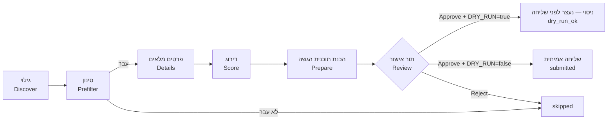

# JobHunter — מדריך שימוש

המדריך הזה מיועד לשימוש יום־יומי במערכת. פקודות, שמות קבצים וקוד מופיעים באנגלית בתוך בלוקי קוד.

**תוכן העניינים:**
[מה המערכת עושה](#מה-המערכת-עושה-ומה-לא) ·
[איך זה עובד](#איך-זה-עובד) ·
[התקנה ראשונה](#התקנה-ראשונה-מאפס-windows-11) ·
[הפעלה יומית](#הפעלה-יומית) ·
[מסכי ה-dashboard](#מסכי-ה-dashboard) ·
[מאגר התשובות](#מאגר-התשובות-והחוק-הקשיח) ·
[בחירת קורות חיים](#בחירת-קורות-חיים-לפי-שפה) ·
[DRY_RUN](#dry_run--מצב-ניסוי) ·
[הגדרות](#כל-ההגדרות) ·
[סטטוסים](#סטטוסים) ·
[נתונים וגיבוי](#איפה-נשמרים-הנתונים) ·
[פתרון תקלות](#פתרון-תקלות) ·
[מבנה הפרויקט](#מבנה-הפרויקט)

---

## מה המערכת עושה ומה לא

**עושה:**
- מחפשת משרות באתר **דרושים** לפי **סוגי התפקידים** שהגדרת (Full Stack, Backend, Junior, אוטומציה…), כל אחד עם עדיפות (tier).
- מסננת אותן בכללים קבועים: מילים בכותרת, בכירות, מיקום, חברות, ו**שנות ניסיון נדרשות** — משרה שדורשת יותר מ-`maxRequiredYears` מדולגת.
- מדרגת כל משרה מ-0 עד 100 עבור סוג התפקיד שלה, עם הסבר קצר בעברית. הדירוג נעשה במודל שפה מקומי (Ollama) ושום דבר לא יוצא מהמחשב.
- ממיינת לפי **rank**, שמעדיף משרות ג׳וניור ותפקידי ליבה: `rank = score + בונוס ניסיון + בונוס tier`.
- **מכינה** הגשה לכל משרה שתבחר:
  - פותחת את חלון ההגשה באתר;
  - בוחרת את קורות החיים המתאימים;
  - ממלאת את השאלות רק מתוך הפרופיל שלך ומאגר התשובות;
  - מצלמת מסך ועוצרת.
- **שולחת רק אחרי שאישרת** בתור האישור, ורק כש-`DRY_RUN=false`.

**לא עושה:**
- לא ממציאה עובדות. כל ערך נשלח מגיע מהפרופיל, ממאגר התשובות או ממך, והמקור נשמר לכל שדה.
- לא עוקפת CAPTCHA, הגנות בוטים או הגבלות קצב. במקרה כזה הריצה נעצרת ומסומנת `blocked`.
- לא מתחברת לאתרים בשבילך. ההתחברות ידנית, פעם אחת.
- לא שולחת לבד. בשלב הנוכחי אין שליחה אוטומטית בכלל.
- **LinkedIn לא נתמך ולא ייתמך.**

**אתרים:** דרושים — גילוי והגשה. AllJobs ו-JobMaster — בשלב הבא. משרות שההגשה אליהן היא בקישור חיצוני (אתר החברה) או במייל מגיעות לתור האישור עם הקישור, ומטופלות ידנית בינתיים.

---

## איך זה עובד



1. **גילוי:** המערכת פותחת את דף החיפוש בדרושים, קוראת את הנתונים שהאתר עצמו טוען, ולוחצת "הצג עוד משרות" עד המגבלה שהגדרת. היא עובדת לאט ובטאב אחד, כמו אדם. כל משרה נשמרת פעם אחת בלבד, וגם משרה זהה מאתר אחר (אותה חברה ואותה כותרת, תוך 14 יום) מזוהה ככפילות.
2. **סינון:** כללים קבועים, בלי מודל. ההתאמה היא למילים שלמות ובלי תלות באותיות גדולות, כך ש-"Java" לא פוסל "JavaScript": מילים שחייבות להופיע בכותרת, מילים שפוסלות (למשל "בכיר", "ראש צוות", "Senior"), מיקום וחברות חסומות. משרה שלא עוברת מקבלת `skipped` עם הסיבה.
3. **פרטים:** למשרות שעברו, המערכת פותחת את דף המשרה ושומרת את התיאור והדרישות המלאים.
4. **דרישת ניסיון:** לפני המודל, ביטוי רגולרי מחלץ את שנות הניסיון הנדרשות מהדרישות ומהתיאור, בעברית ובאנגלית.
   - שורות שמסומנות "יתרון" / advantage / nice to have / a plus לא נספרות.
   - טווח נספר לפי המינימום שלו.
   - כמה דרישות → המקסימום מבין המינימומים.
   - אם הדרישה גבוהה מ-`maxRequiredYears`, המשרה מקבלת `skipped_experience` עם הטקסט שנמצא, **בלי** לשלוח אותה למודל.
   - אם הביטוי לא מצא כלום, המודל מחזיר את הדרישה בזמן הדירוג. הביטוי גובר כשיש את שניהם.
5. **דירוג:** המודל משווה את המשרה לפרופיל שלך **עבור סוג התפקיד שלה** ומחזיר ציון, כישורים מתאימים, דרישות חסרות, בכירות ושני משפטי הסבר. הדירוג נשמר ולא יחושב שוב כל עוד המשרה לא השתנתה.
6. **rank:** `score + experienceBoost + tierBoost`.
   - בונוס ניסיון (ברירת מחדל): ג׳וניור / 0–1 שנים +15, שנתיים +5, 3 שנים −10, לא ידוע 0.
   - בונוס tier: tier 1 +5, tier 2 0, tier 3 −10.
   - רשימת המשרות, תור האישור וסדר ההכנה ממוינים לפי rank, כך שהמכסה היומית מנוצלת קודם על המשרות הטובות ביותר.
7. **הכנת תוכנית הגשה:**
   - המערכת פותחת את חלון ההגשה ורואה אילו קורות חיים קיימים בחשבון ואילו שאלות יש.
   - לכל שאלה היא מוצאת תשובה ומתעדת את המקור שלה.
   - היא מסמנת רק מה שמאושר, מצלמת מסך ו**עוצרת**. המשרה עוברת לתור האישור.
8. **תור אישור:** אתה עובר על התוכנית, משלים תשובות חסרות, מתקן, ומאשר או דוחה.
9. **שליחה:**
   - במצב ניסוי (`DRY_RUN=true`) האישור ממלא הכל, מצלם ועוצר.
   - במצב אמיתי הוא שולח ושומר הוכחה: צילום לפני ואחרי, טקסט האישור ותשובת השרת.

---

## התקנה ראשונה מאפס (Windows 11)

1. **Node.js:** התקן את גרסת ה-LTS מ-https://nodejs.org (נדרש 22.13 ומעלה). לבדיקה:
   ```powershell
   node --version
   ```
2. **Ollama:** התקן מ-https://ollama.com/download, פתח את אפליקציית Ollama, והורד את המודל (כ-8GB):
   ```powershell
   ollama pull gemma4:12b
   ```
3. **התקנת הפרויקט והדפדפן**, מתוך תיקיית הפרויקט:
   ```powershell
   npm install
   npx playwright install chromium
   ```
4. **קבצי הגדרות:**
   ```powershell
   copy .env.example .env
   copy preferences.example.yaml preferences.yaml
   ```
   ב-`preferences.yaml` מלא לפחות:
   - סוגי תפקידים לחיפוש (`roleTypes`): עדיפות (tier), שאילתות בעברית ובאנגלית ומילות כותרת;
   - `maxRequiredYears` — מקסימום שנות ניסיון נדרשות (ברירת מחדל 3);
   - ערים (`locations`);
   - שמות קורות החיים **בדיוק כפי שהם מופיעים בחשבון בדרושים** (`cv.he`, `cv.en`);
   - תשובות קבועות (`standardAnswers`).

   פירוט מלא בטבלה [למטה](#כל-ההגדרות).
5. **פרופיל:** שים את קורות החיים בתיקייה `data\profile\` בשמות `cv-he.pdf` ו-`cv-en.pdf`, והרץ:
   ```powershell
   npm run profile:init
   ```
   נוצרים שני קבצים:
   - `data\profile\profile.draft.json` — טיוטת הפרופיל;
   - `data\profile\profile.conflicts.md` — סתירות בין שני הקבצים, דברים שהופיעו רק באחד מהם, ופרטים שהמודל ניסה להוסיף ונפסלו כי לא מופיעים בקורות החיים.

   עבור על הטיוטה:
   - החלף כל ערך שמתחיל ב-`CONFLICT` בערך הנכון.
   - מחק כישורים שאינך רוצה לטעון שיש לך.
   - חבר כישורים לתפקידים שבהם השתמשת בהם, בשדה `experience[].skills`. מספר שנות הניסיון בכישור מחושב רק מהתאריכים של התפקידים האלה.
   - כפילויות של כישור מאחדים לרשומה אחת, ושאר הכתיבים נכנסים ל-`aliases`. למשל JavaScript עם `["ES6+", "ES6", "JS"]`. המערכת משתמשת ב-aliases בכל מקום: בסינון, בדירוג, בשאלות שנות ניסיון ובהתאמה למאגר התשובות. מודעה שכתוב בה "ES6" או "OOP" תזוהה ככישור הקנוני.
   - לכל כישור יש `level`: `strong` (ברירת מחדל) או `basic`. כישור `basic` נספר בדירוג ובהתאמה, אבל **אף פעם** לא משמש לענות אוטומטית על הצהרת כן/לא או על שאלת שנות ניסיון. שאלות כאלה תמיד ממתינות לך.

   - שנות ניסיון בכישור נספרות **רק מתפקידים מסוג `work`**. פרויקטים, צבא והשכלה נספרים בדירוג ובהתאמה, אבל לא בשאלות שנות ניסיון.
   - `declaredExperience` — ההצהרה שלך על סך הניסיון בפיתוח, למשל `{ "totalDevYears": 2, "basis": "…" }`. היא עונה רק על שאלות **כלליות** ("N שנות ניסיון בפיתוח תוכנה"), אף פעם לא על שאלות לגבי טכנולוגיה מסוימת.

   בסוף שנה את שם הקובץ ל-`profile.json`. הרצה חוזרת של `profile:init` שומרת את הטיוטה הקודמת כגיבוי (`profile.draft.bak-…json`).
6. **התחברות לדרושים**, פעם אחת וידנית:
   ```powershell
   npm run login -- drushim
   ```
   נפתח דפדפן. התחבר, וכשמופיע בטרמינל "login detected" סגור את החלון. הסשן נשמר ב-`data\browser-profile`. לבדיקה:
   ```powershell
   npm run session:check -- drushim
   ```
7. **בדיקה כוללת:**
   ```powershell
   npm run doctor
   ```

---

## הפעלה יומית

```powershell
npm start
```
או לחיצה כפולה על `start.cmd` בתיקיית הפרויקט.

הבדיקות שרצות לפי הסדר (בכל תקלה מוצגת הודעה בעברית ובאנגלית עם הוראות תיקון):
1. גרסת Node, והתקנת חבילות אם צריך.
2. קובץ `.env`.
3. Ollama רץ. אם לא, המערכת מנסה להפעיל את האפליקציה.
4. המודל מותקן. אם לא, המערכת מציעה להוריד אותו.
5. `preferences.yaml` ו-`profile.json` תקינים.
6. מסד הנתונים מעודכן.
7. אתה מחובר לדרושים. אם לא, המערכת שואלת אם לפתוח חלון התחברות; אפשר לענות לא, והמערכת תעלה עם הגשה מושבתת.
8. ה-dashboard נבנה מחדש אם השתנה.

בסוף מודפס סיכום: מצב DRY RUN באותיות גדולות, המודל, מצב החיבור, כמה הוגשו היום מתוך המכסה, וכמה תשובות ממתינות. אחר כך ה-dashboard נפתח בדפדפן בכתובת http://127.0.0.1:8787. לעצירה: `Ctrl+C`.

**ציד אחד מלא:**
```powershell
npm start -- --hunt
```
אחרי העלייה המערכת מריצה גילוי ודירוג, ואז מכינה תוכניות הגשה למשרות שקיבלו לפחות `autoSubmitMinScore`. מספר התוכניות מוגבל למכסה היומית שנשארה. **שום דבר לא נשלח.** ההגשות מחכות לאישור שלך בתור האישור. בסוף מודפס סיכום.

**בדיקה בלבד, בלי לשנות כלום:**
```powershell
npm run doctor
```

---

## מסכי ה-dashboard

### פס עליון (בכל המסכים)

| רכיב | מה הוא |
|---|---|
| `DRY RUN` / `LIVE` | מצב ניסוי (צהוב) או שליחה אמיתית (אדום) |
| `Today: x/y submitted` | הגשות אמיתיות היום מתוך המכסה |
| `Drushim: logged in / NOT logged in` | מצב החיבור לדרושים |
| `re-check login` | בודק שוב את החיבור, למשל אחרי `npm run login -- drushim` בטרמינל אחר |
| `pending answers` | כמה שאלות ממתינות לתשובה שלך במאגר |
| `Ollama` | האם המודל זמין |
| ספירות סטטוסים | כמה משרות יש בכל סטטוס |
| **Discover Drushim** | ריצה מלאה: חיפוש, סינון, פרטים, דירוג |
| **Score only** | דירוג בלבד, למשרות שעברו סינון ועוד לא דורגו או שהשתנו |
| **Stop** | עוצר את הריצה הנוכחית (מופיע רק כשיש ריצה) |
| Discover AllJobs / JobMaster | מושבתים, יגיעו בשלב הבא |

שורות התראה שעשויות להופיע מעל הפס:
- **לא מחובר לדרושים:** ההגשה מושבתת עד ההתחברות.
- **אין פרופיל / טיוטה ממתינה:** מה חסר בפרופיל.
- **DRY_RUN is OFF:** אישור יגרום לשליחה אמיתית.

למטה יש **Live log**, היומן החי של המערכת. אפשר לקפל אותו בלחיצה.

### Jobs — משרות
- **סינון:** אתר, סטטוס, ציון מינימלי, וחיפוש בכותרת או בחברה. `Refresh` מרענן.
- **עמודות:** `Rank` — הדירוג הסופי, ומתחתיו הפירוק: ציון, `exp` (בונוס ניסיון) ו-`tier`. `Role` — סוג התפקיד שלפיו המשרה דורגה. מסנן **All role types** מציג סוג תפקיד אחד.
- **לחיצה על שורה** פותחת את הפרטים: דרישת הניסיון עם המקור (`regex` / `llm`) והטקסט שנמצא, סימן ג׳וניור אם יש, פירוק ה-rank ואילו סוגי תפקידים מצאו את המשרה. בנוסף: הסבר הציון, כישורים מתאימים (ירוק) וחסרים (אדום), סיבת דילוג, ותיאור ודרישות המשרה.
- **`open`** פותח את המשרה באתר.
- **`apply`** מכין תוכנית הגשה: פותח את חלון ההגשה, ממלא מה שידוע, מצלם ועוצר. **לא שולח.** הכפתור מושבת כשאינך מחובר, או כשהמשרה כבר בתור, בבדיקה או נשלחה.
- **`skip` / `unskip`** מדלג על משרה, או מחזיר אותה.

### Review queue — תור אישור
כל כרטיס הוא הגשה אחת:
- **כותרת:** המשרה, החברה, הסטטוס, מצב המוכנות וקישור למודעה. מצבי המוכנות:
  - `ready` — הכל מוכן;
  - `needs your answers` — חסרות תשובות;
  - `has drafts` — יש טקסט שהמודל ניסח וצריך לעבור עליו;
  - `a required statement is false` — הצהרת חובה לא נכונה עבורך.
- **ציון והסבר** הדירוג.
- **ℹ הערות**, למשל אילו קורות חיים קיימים בחשבון.
- **CV:** הקובץ שנבחר, השפה, ואחוז האותיות העבריות במודעה. `switch to …` מחליף ידנית.
- **טבלת השדות:** שאלה, תשובה ומקור. ליד כל תשובה יש `edit`:
  - בשאלות כן/לא — כפתורי **כן** / **לא**;
  - בשאר — שדה טקסט ו-`save`;
  - `save to answers bank` מסומן כברירת מחדל, כך שהתשובה תישמר במאגר ותשמש גם למשרות הבאות. אם תבטל את הסימון, התשובה תשמש רק להגשה הזו.

  תגיות המקור:

  | תגית | מקור |
  |---|---|
  | `profile` | מהפרופיל (שם, טלפון, מייל, עיר, קישורים) |
  | `answers bank` | ממאגר התשובות (`ref` = מספר הרשומה, `conf` = רמת ההתאמה) |
  | `skill years (work roles)` | חושב מתאריכי תפקידי ה-work שמקושרים לכישור |
  | `declared experience` | מההצהרה הכללית שלך (`declaredExperience`). טקסט ה-basis מוצג מתחת |
  | `LLM draft` | טיוטה שהמודל ניסח מעובדות הפרופיל (`cites` = העובדות שעליהן נשען) |
  | `you (this job only)` | הקלדת ידנית בלי לשמור במאגר |

  ⚠ **unsupported claims** — טענות בטיוטה שבדיקת העובדות לא מצאה להן בסיס בפרופיל. תקן אותן לפני אישור.
- **צילומי מסך:** "before final click" — המצב לפני הלחיצה האחרונה; "after submit" — אחרי שליחה אמיתית. לחיצה פותחת בגודל מלא.
- **Approve:**
  - `Approve → DRY RUN (no submit)` במצב ניסוי.
  - `Approve → SUBMIT for real` במצב אמיתי, אחרי חלון אישור נוסף.
  - הכפתור מושבת כל עוד יש שאלות ממתינות, כשאינך מחובר, או כשריצה אחרת פעילה.
- **Reject / skip job** — לא להגיש. המשרה מסומנת `skipped`.
- למעלה: בחירת אילו הגשות להציג, ו-**Prepare queued**, שמכין תוכניות לכל המשרות שבסטטוס `queued`.

### Answers bank — מאגר תשובות
- למעלה מוצגים מספר השאלות הממתינות והכפתור **Seed from preferences.yaml**, שטוען את `standardAnswers`. ערכים ריקים נטענים כשאלות ממתינות.
- **הוספה:** שאלה, תשובה (ריק = ממתינה), סוג (`text`, `yes_no`, `choice`, `number`) ו-`Add`.
- **הטבלה:** השאלות הממתינות מופיעות ראשונות, וממוינות לפי **Blocks** — כמה הגשות פתוחות כל שאלה עוצרת.
  - שאלות כן/לא נענות בכפתורים, ושאר השאלות בשדה ו-`save`.
  - `Used` — כמה פעמים התשובה שימשה.
  - `Source` — מאיפה הגיעה: `seed` (מ-preferences.yaml), `user` (נוספה או נערכה כאן), או `review` (נשמרה מתור האישור).
  - `delete` מוחק.
- כל תשובה ששומרים מעדכנת אוטומטית את כל ההגשות הפתוחות שחיכו לה.

---

## מאגר התשובות והחוק הקשיח

### סדר מציאת תשובה לכל שדה
1. **פרופיל** — לשדות טקסט כמו שם, מייל, טלפון, עיר, LinkedIn ו-GitHub.
2. **מאגר תשובות** — קודם התאמה מדויקת לשאלה. המערכת מנרמלת את הניסוח, כך ש-"את/ה מוכן/ה" ו-"אתה מוכן" נחשבות לאותה שאלה, וגם כתיבים חלופיים של כישור: תשובה ל-"ניסיון ב-JavaScript?" תשמש גם ל-"ניסיון ב-ES6?". אם אין התאמה מדויקת, המודל רק **בוחר** רשומה קיימת עם אותה משמעות ומחזיר את מספרה ורמת ביטחון. הוא לא כותב תשובה. התאמה מתחת לסף (`matchConfidence`) נדחית.
3. **שנות ניסיון** — המודל רק **מסווג** את השאלה, ולא עונה עליה:
   - **כללית** ("N שנות ניסיון בפיתוח תוכנה", בלי טכנולוגיה): התשובה מגיעה מ-`declaredExperience.totalDevYears`. אם N קטן או שווה לערך — כן. אם גדול — לא, והמשרה מקבלת `skipped_screening`. בתור האישור מוצגת תגית "declared experience" עם טקסט ה-basis.
   - **טכנולוגית** ("N שנות ניסיון ב-React"): התשובה מחושבת רק מתפקידי `work` שמקושרים לכישור, אף פעם לא מההצהרה הכללית.
   - **לא ברור** → ממתינה לך.

   פרטים על המקרה הטכנולוגי, לשאלות כמו "האם יש לך לפחות 3 שנות ניסיון ב-React?":
   - התשובה מחושבת מהפרופיל, רק אם הכישור קיים בו ומחובר לתפקידים עם תאריכים.
   - החישוב שמרני: "2021–2024" נספר מדצמבר 2021 עד ינואר 2024, כדי שלא יוצגו יותר שנים מכפי שיש באמת. אם תכתוב בפרופיל תאריכים עם חודש (למשל `2021-03`), החישוב יהיה מדויק יותר.
   - כישור ברמה `basic` לעולם לא עונה כאן. השאלה תמיד ממתינה לך.
   - כתיבים חלופיים (`aliases`) נחשבים: "ES6" נספר כ-JavaScript.
   - אם הכישור לא בפרופיל, או שאין תאריכים, השאלה ממתינה.
4. **טיוטה** — רק לשאלות פתוחות, כמו "למה אתה מתעניין בתפקיד?":
   - המודל מקבל רק עובדות מהפרופיל, כל אחת עם מזהה, וחייב לציין על אילו עובדות נשען.
   - טיוטה שלא מצטטת עובדות, או מצטטת עובדה שלא קיימת, נפסלת.
   - בדיקה נוספת מסמנת טענות לא נתמכות.
   - טיוטה תמיד מוצגת לך לפני שליחה.
5. אם אף שלב לא הצליח, השאלה **ממתינה** (`pending`) ונשמרת במאגר, כדי שתענה עליה פעם אחת.

### החוק הקשיח — מה המודל לעולם לא עונה
- כל שאלת **כן/לא**, **בחירה מרשימה**, **מספר**, או **אישור תנאים / הסכמה**.
- שאלות טקסט שעוסקות ב:
  - **זמינות** ומועד תחילה;
  - **משמרות**, **סופי שבוע**, לילות;
  - **רילוקיישן**, ניידות או רכב;
  - **שכר**;
  - **הודעה מוקדמת**;
  - **צבא**, מילואים או **סיווג ביטחוני**;
  - נושאים **משפטיים**: אישור עבודה, אזרחות, הסכמה, פרטיות;
  - **רישיון**;
  - **שנות ניסיון**.

אלה מגיעים רק מהמאגר או מהפרופיל, או נשארים ממתינים לך.

### למה משרה נתקעת או מדולגת
- **ממתינה לתשובות:** יש שאלה בלי תשובה במאגר. ענה עליה במסך Answers bank או ישירות בתור האישור.
- **מדולגת בגלל שאלת סינון (screening):** בדרושים, שאלות הסינון הן הצהרות שצריך לסמן ב-✓, למשל "האם יש לך ידע בפריוריטי?". אם התשובה האמיתית שלך היא **לא**, אי אפשר לסמן ולהגיש ביושר. המשרה מקבלת `skipped_screening` עם הסיבה `screening statement answered no: …`.
- **כבר הוגש:** אם האתר מדווח שכבר הגשת למשרה, היא מסומנת `skipped` עם התאריך.

---

## בחירת קורות חיים לפי שפה

- המערכת סופרת אותיות עבריות ולועזיות בכותרת, בתיאור ובדרישות של המשרה. אין כאן מודל, רק ספירה.
- **קורות חיים באנגלית** נבחרים רק אם האותיות העבריות הן פחות מ-`ENGLISH_CV_MAX_HEBREW_RATIO` (ברירת מחדל 20%) מכלל האותיות. בכל מקרה אחר נבחרים **קורות החיים בעברית**. מודעה רגילה בעברית עם מונחים טכניים באנגלית תקבל עברית.
- השמות נלקחים מ-`cv.he` / `cv.en` ב-`preferences.yaml`, וחייבים להיות **בדיוק** כמו בחשבון בדרושים.
- אם הקובץ שנבחר לא נמצא בחשבון, ההגשה מסומנת `failed` עם הסיבה. המערכת **אף פעם** לא בוחרת קובץ אחר במקומו.
- **עקיפה ידנית:** בתור האישור, בשורת `CV`, לחץ על `switch to English` או `switch to Hebrew`.

---

## DRY_RUN — מצב ניסוי

- **`DRY_RUN=true`** (ברירת המחדל): גם אחרי Approve המערכת ממלאת הכל, מצלמת ועוצרת לפני הלחיצה האחרונה. הסטטוס הוא `dry_run_ok`. יש גם הגנה כפולה: בקשת השליחה לאתר נחסמת ברמת הרשת.
- **מעבר לשליחה אמיתית:** ב-`.env` שנה את השורה ל:
  ```
  DRY_RUN=false
  ```
  ואז עצור (`Ctrl+C`) והפעל מחדש (`npm start`). בפס העליון יופיע `LIVE` באדום, וכפתור האישור יהיה `Approve → SUBMIT for real` עם חלון אישור נוסף.
- **חזרה למצב ניסוי:** `DRY_RUN=true` והפעלה מחדש.
- גם במצב אמיתי אין שליחה בלי Approve שלך, והמכסה היומית (`dailyApplyLimit`) נאכפת.

---

## כל ההגדרות

### `.env`

| שם | ברירת מחדל | הסבר |
|---|---|---|
| `DRY_RUN` | `true` | `true` = לעולם לא שולח. `false` = שולח אחרי Approve |
| `HEADLESS` | `false` | `true` = הדפדפן עובד ברקע בלי חלון |
| `DATA_DIR` | `data` | תיקיית כל הנתונים האישיים |
| `PREFERENCES_FILE` | `preferences.yaml` | קובץ ההעדפות, יחסית לתיקיית הפרויקט |
| `PROFILE_FILE` | (ריק) | קובץ פרופיל חלופי, למשל `data/profile/profile.draft.json` לבדיקה לפני אישור. ריק = `data/profile/profile.json` |
| `PORT` | `8787` | הפורט של ה-dashboard |
| `LOG_LEVEL` | `info` | פירוט היומן: `trace` / `debug` / `info` / `warn` / `error` |
| `OLLAMA_URL` | `http://127.0.0.1:11434` | כתובת Ollama |
| `OLLAMA_MODEL_ANALYZE` | `gemma4:12b` | המודל לדירוג, להתאמת שאלות ולחילוץ נתונים |
| `OLLAMA_MODEL_WRITE` | `gemma4:12b` | המודל לניסוח טיוטות |
| `OLLAMA_TIMEOUT_MS` | `180000` | זמן מקסימלי לקריאה למודל, במילישניות |
| `BENCH_MODELS` | `gemma4:12b` | המודלים שמושווים ב-`npm run model:bench` |
| `MAX_PAGES_PER_RUN` | `3` | כמה פעמים ללחוץ "הצג עוד משרות" לכל חיפוש |
| `DAILY_APPLY_LIMIT` | `15` | מכסת הגשות אמיתיות ליום |
| `AUTO_SUBMIT_MIN_SCORE` | `80` | ציון מינימלי להכנת תוכנית ב-`--hunt` (בשלב הבא — גם לשליחה אוטומטית) |
| `MATCH_CONFIDENCE` | `0.85` | ביטחון מינימלי להתאמת שאלה לרשומה במאגר |
| `COMPANY_COOLDOWN_DAYS` | `30` | ימי המתנה בין הגשות לאותה חברה (נאכף בשלב הבא) |
| `DEDUPE_WINDOW_DAYS` | `14` | חלון הזמן לזיהוי אותה משרה באתרים שונים |
| `ENGLISH_CV_MAX_HEBREW_RATIO` | `0.2` | מתחת לאחוז הזה של אותיות עבריות נבחרים קורות חיים באנגלית |
| `PACE_MIN_MS` / `PACE_MAX_MS` | `2500` / `7000` | השהיה אקראית בין פעולות בדפדפן |

### `preferences.yaml`

| מפתח | ברירת מחדל | הסבר |
|---|---|---|
| `roleTypes[]` | — | סוגי תפקידים: `id`, `label`, `tier` (1 ליבה / 2 טוב / 3 גיבוי), `enabled`, `queries` (חיפושים), `titleKeywords` (מילים שחייבות להופיע בכותרת), `notes` (הנחיה למודל) |
| `maxRequiredYears` | `3` | משרה שדורשת יותר שנות ניסיון → `skipped_experience` |
| `ranking.experienceBoost.junior / years2 / years3 / above3 / unknown` | `15 / 5 / −10 / −20 / 0` | בונוס ה-rank לפי הניסיון הנדרש |
| `ranking.tierBoost.tier1 / tier2 / tier3` | `5 / 0 / −10` | בונוס ה-rank לפי עדיפות סוג התפקיד |
| `queries.titles` | — | (ישן) רשימת חיפוש אחת, בשימוש רק כשאין `roleTypes` |
| `locations` | — | ערים מותרות. ריק = כל מקום. משרה בלי מיקום עוברת |
| `filters.includeTitleKeywords` | — | מילות כותרת נוספות, בנוסף ל-`titleKeywords` של כל סוגי התפקידים |
| `filters.excludeTitleKeywords` | — | מילים שפוסלות משרה |
| `filters.excludeSeniorityKeywords` | Senior, Sr, Lead, Team Lead, Tech Lead, Principal, Staff, Architect, Head of, Manager, Director, בכיר, בכירה, ראש צוות, ארכיטקט, מנהל פיתוח | מילות בכירות שפוסלות. ההתאמה היא למילים שלמות, אז צריך לרשום כל צורה (בכיר וגם בכירה) |
| `filters.excludeCompanies` | — | חברות שלא רוצים |
| `filters.remoteKeywords` | — | מיקום שתמיד עובר ("מהבית", "היברידי", "כל הארץ") |
| `candidateSummary` | — | תיאור קצר שלך, משמש לדירוג **רק** כשעדיין אין `profile.json` |
| `cv.he` / `cv.en` | — | שמות קורות החיים בדיוק כמו בחשבון בדרושים |
| `thresholds.autoSubmitMinScore` | מ-`.env` | גובר על `AUTO_SUBMIT_MIN_SCORE` |
| `thresholds.matchConfidence` | מ-`.env` | גובר על `MATCH_CONFIDENCE` |
| `limits.maxPagesPerRun` | מ-`.env` | גובר על `MAX_PAGES_PER_RUN` |
| `limits.dailyApplyLimit` | מ-`.env` | גובר על `DAILY_APPLY_LIMIT` |
| `limits.companyCooldownDays` | מ-`.env` | גובר על `COMPANY_COOLDOWN_DAYS` |
| `standardAnswers` | — | תשובות קבועות שנטענות למאגר (ריק = שאלה ממתינה) |

מפתחות מוכרים ב-`standardAnswers`:
`city`, `salaryExpectation`, `noticePeriod`, `availability`, `fullTime`, `drivingLicense`, `shifts`, `weekends`, `relocation`, `militaryService`, `securityClearance`, `hybridOk`, `applyConsent`.

כל מפתח אחר נשמר במאגר עם המפתח עצמו כשאלה.

---

## סטטוסים

### משרה

| סטטוס | משמעות |
|---|---|
| `discovered` | נמצאה, עוד לא דורגה |
| `scored` | דורגה |
| `queued` | ממתינה להכנת תוכנית הגשה |
| `needs_review` | יש תוכנית, והיא מחכה בתור האישור |
| `dry_run_ok` | ניסוי הצליח: הכל מולא והמערכת עצרה לפני השליחה |
| `submitted` | נשלחה באמת |
| `failed` | נכשלה. הסיבה מוצגת (לא מחובר, קורות חיים לא נמצאו, האתר השתנה…) |
| `skipped` | דילוג, עם סיבה: סינון ראשוני (כותרת / בכירות / מיקום), כפילות, כבר הוגש, או דילוג ידני |
| `skipped_experience` | המשרה דורשת יותר מ-`maxRequiredYears` שנות ניסיון. הטקסט שנמצא מוצג כסיבה |
| `skipped_screening` | שאלת סינון שהתשובה האמיתית שלך עליה היא לא |
| `ready` | שמור לשלב הבא, ולא בשימוש כרגע |
| `blocked` | שמור. בפועל, ריצה (run) שנתקלה ב-CAPTCHA או בחסימה מסומנת `blocked` ונעצרת |

### הגשה (בתור האישור)

| סטטוס | משמעות |
|---|---|
| `needs_review` | מחכה לך |
| `approved` | אושרה ורצה עכשיו |
| `dry_run_ok` | ניסוי הסתיים בהצלחה |
| `submitted` | נשלחה, ויש הוכחה: צילומים, טקסט אישור ותשובת השרת |
| `skipped` | לא הוגשה (שאלת סינון שתשובתה לא, או כבר הוגש) |
| `rejected` | דחית אותה |
| `failed` | נכשלה. הסיבה מוצגת בכרטיס |

---

## איפה נשמרים הנתונים

כל הנתונים האישיים נמצאים בתיקייה `data\`. היא **לא** עולה ל-git.

| נתיב | מה יש בו |
|---|---|
| `data\jobhunter.sqlite` | מסד הנתונים: משרות, ציונים, מאגר תשובות, הגשות, ריצות |
| `data\profile\` | קורות החיים (PDF), הטקסט שחולץ מהם, `profile.draft.json`, `profile.conflicts.md`, `profile.json`, גיבויי טיוטות |
| `data\browser-profile\` | הסשן של הדפדפן (ההתחברות לדרושים) |
| `data\screenshots\` | **הוכחות:** `appN-prepare-…png`, `appN-dryrun-…png`, `appN-before-submit-…png`, `appN-after-…png`, `appN-response.json` (תשובת השרת), `appN-plan-…json` (תוכנית השדות) |
| `data\logs\jobhunter.log` | היומן |
| `data\reports\` | דוחות `model:bench` |
| `data\investigations\` | תיעוד בדיקות רשת של אתרים |

**גיבוי:** עצור את המערכת והעתק את כל התיקייה `data\` למקום בטוח. את `browser-profile` אפשר לא לגבות; במקרה הגרוע תתחבר מחדש. השחזור הוא העתקה בחזרה.

---

## פתרון תקלות

הצעד הראשון תמיד:
```powershell
npm run doctor
```
הפקודה בודקת הכל (Node, חבילות, `.env`, Ollama, המודל, הקבצים, מסד הנתונים, ההתחברות) ומדפיסה מה לתקן, בלי לשנות כלום.

| תקלה | מה עושים |
|---|---|
| **לא מחובר / הסשן פג** (באנר אדום, `not_logged_in`, `login expired`) | `npm run login -- drushim`, התחבר, סגור את החלון, ואז `re-check login` ב-dashboard |
| **Ollama לא רץ** | פתח את אפליקציית Ollama (`npm start` מנסה להפעיל אותה לבד) |
| **המודל חסר** | `ollama pull gemma4:12b` |
| **המכסה היומית מלאה** | המערכת מסרבת לאשר מעבר ל-`dailyApplyLimit`. לדרושים יש גם מכסה משלהם (`Drushim's daily submission limit reached`). המשך מחר |
| **CV לא נמצא** (`CV "…" not found in the panel`) | השם ב-`cv.he` / `cv.en` חייב להיות זהה לשם בחשבון. השמות הזמינים מופיעים בהערה ℹ בכרטיס ההגשה |
| **האתר שינה מבנה** (`apply panel did not open`, `apply button not found`, או `the form changed since review`) | אם הטופס השתנה מאז שבדקת, ההגשה חוזרת לתור לבדיקה מחדש. אם החלון לא נפתח כלל, צריך לעדכן את `backend/src/sites/drushim/selectors.json`. אפשר להיעזר ב-`npm run investigate:apply -- apply <jobUrl>`, שבודק בלי לשלוח: כל בקשת שליחה נחסמת |
| **ריצה `blocked`** | האתר הציג CAPTCHA או חסימה. המערכת לא עוקפת. פתח את האתר ידנית, המתן, ונסה מאוחר יותר |
| **`profile.json` לא נטען** (`unresolved conflicts`) | נשארו ערכי `CONFLICT` בקובץ. תקן אותם לפי `profile.conflicts.md` |
| **הפורט תפוס** | JobHunter כבר רץ בחלון אחר. סגור אותו, או שנה `PORT` ב-`.env` |
| **`Browser profile is in use`** | תהליך אחר משתמש בדפדפן (למשל חלון `login` פתוח). סגור אותו |

---

## מבנה הפרויקט

```
JobHunterAI/
  start.cmd, scripts/start.mjs     npm start / doctor (no dependencies)
  backend/src/
    cli/                           start, login, profile-init, discover, bench, session-check, investigate*
    config.ts, log.ts              .env + logging
    db/                            SQLite + migrations/*.sql
    browser/                       persistent browser, pacing, block detection, session state
    sites/                         SiteAdapter types, registry, drushim/ (adapter, normalize, apply, selectors.json)
    core/                          normalization, dedupe, prefilter, preferences
    llm/                           Ollama (structured output + cache), scoring
    profile/                       PDF → profile, verification, skill years
    apply/                         answers bank, field resolution, drafts, CV choice, plans, apply service
    pipeline/runner.ts             one run at a time (discover / score / prepare / approve)
    server/                        REST API + live log
  backend/test/                    tests (Playwright only against local fixtures)
  frontend/src/                    the dashboard (React)
  docs/GUIDE.md                    this guide
```

### הוספת אתר חדש (adapter)

לקראת AllJobs ו-JobMaster:

1. **לבדוק לפני שכותבים.** מקליטים את תעבורת הרשת באתר ומחפשים את ה-JSON שהאתר עצמו טוען:
   ```powershell
   npm run investigate -- alljobs "https://www.alljobs.co.il/..." --wait 30
   ```
   התוצאות נשמרות ב-`data\investigations\`.
2. **יוצרים תיקייה** `backend/src/sites/<site>/` עם:
   - `normalize.ts` — פונקציות טהורות שממירות את נתוני האתר ל-`RawJob`;
   - `adapter.ts` — מימוש `SiteAdapter`: הפונקציה `search` מחזירה משרות, ו-`getDetails` מחזירה פרטים מלאים;
   - `selectors.json` — כתובות ובוררים, כדי שאפשר יהיה לעדכן בלי לגעת בקוד.
3. **רושמים את האתר** ב-`backend/src/sites/registry.ts`: מוסיפים ל-`adapters` ומשנים את `enabled: true` ב-`SITES`. הכפתור יופיע ב-dashboard.
4. **בדיקות:** שומרים fixtures מנוקים מפרטים אישיים ב-`backend/test/fixtures/`, וכותבים בדיקות ל-normalize. מריצים:
   ```powershell
   npm test
   ```
5. **הגשה:** תהליך ההגשה של דרושים נמצא ב-`backend/src/sites/drushim/apply.ts` (`openPanel`, `fillPanel`, `submitPanel`). כרגע `backend/src/apply/service.ts` קורא ישירות לדרושים, והכללה לאתרים נוספים תיעשה בשלב הבא.
6. ההתחברות לאתר החדש: `npm run login -- <site>`, אחרי שהאתר נוסף ל-`SITES`.

### פקודות למפתחים

| פקודה | מה עושה |
|---|---|
| `npm run dev` | API עם טעינה מחדש, ו-dashboard בפורט 5173 (פיתוח) |
| `npm run build` | בונה את ה-dashboard |
| `npm test` | בדיקות |
| `npm run typecheck` | בדיקת טיפוסים |
| `npm run discover -- drushim [discover\|score\|full\|enrich]` | ריצה מהטרמינל. `enrich` = פרטים מלאים ודירוג למשרות שכבר נמצאו, בלי חיפוש חדש |
| `npm run model:bench` | השוואת מודלים ובדיקת המצאות בטיוטות, לפני ואחרי |
| `npm run bench:drafts` | רק בדיקת המצאות בטיוטות |
| `npm run db:migrate` | החלת מיגרציות |
| `npm run session:check -- drushim` | האם הדפדפן מחובר |
| `npm run investigate -- <site> <url> [--click "טקסט"] [--wait 30]` | הקלטת רשת באתר |
| `npm run investigate:apply -- find <מילות חיפוש...>` / `apply <jobUrl...>` | בדיקת תהליך הגשה, עם חסימת כל שליחה |
